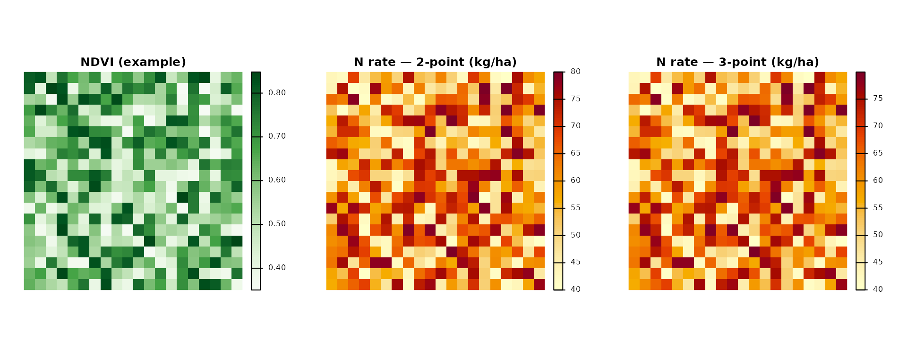
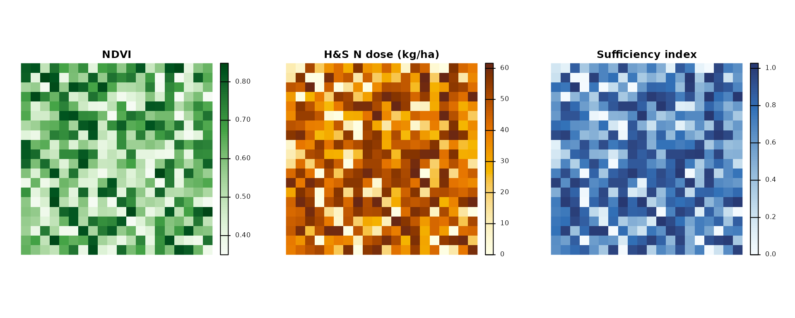

# Nitrogen Fertilization Management with agrinutri: A Comprehensive Guide

## Introduction

The **agrinutri** R package provides a comprehensive toolkit for
calculating nitrogen fertilization requirements in field crops following
the Emilia-Romagna Regional Recommendations for integrated production.
This vignette demonstrates how to use agrinutri for nitrogen balance
calculations, soil fertility assessment, and precision agriculture
applications.

### What is Nitrogen Balance?

Nitrogen balance is a quantitative method that accounts for all nitrogen
inputs and outputs in an agricultural system. The general equation used
in agrinutri is:

``` math
\text{Nitrogen Fertilization (N)} = A - B + C1 + C2 + D - E - F_{org} - G
```

Where:

- **A**: Crop nitrogen requirements (kg/ha)
- **B**: Soil nitrogen supply (sum of b1 and b2) (kg/ha)
- **C1**: Nitrogen leaching loss in winter (kg/ha)
- **C2**: Nitrogen leaching loss in spring (kg/ha)
- **D**: Immobilization and dispersion losses (kg/ha)
- **E**: Nitrogen from previous crop residues (kg/ha)
- **F\_{org}**: Nitrogen from organic fertilizers (kg/ha)
- **G**: Natural nitrogen contributions (kg/ha)

### Normative framework: DPI 2025–2026 and FertDPI

agrinutri implements the **method of the balance** (Allegato 2) of the
Disciplinari di Produzione Integrata (DPI) Emilia-Romagna, in line with
the *Guida alla Fertilizzazione Minerale e Organica* (DPI 2025) and the
regional tool **FertDPI / Fert_Office**. References: DPI Norme Generali
(Allegato 2, 3, 4, 6, 7, 9), Reg. reg. 2/2024 and 3/2017, Direttiva
Nitrati (91/676/CEE). In **Zone Vulnerabili ai Nitrati (ZVN)** the MAS
(limiti di massima applicazione standard) are binding and the 170 kg
N/ha/year ceiling from livestock effluents applies at farm level.

**Formula N (Guida DPI 2025):**  
N da apportare = **A** − **B** + **C** + **D** − **E** − **F** − **G**

- **A** = Fabbisogni colturali (assorbimenti unitari × produzione
  attesa).  
- **B** = Fertilità del suolo: **B1** (mineralizzazione S.O.:
  coefficiente × S.O. % × coefficiente tempo) + **B2** (azoto pronto:
  coefficiente × N totale ‰; solo colture con ciclo \< 1 anno). Per
  pluriennali B = B1 soltanto.  
- **C** = Perdite per lisciviazione: **Ca** (autunno-inverno: \<150 mm
  nessuna; 150–250 mm perdita progressiva; \>250 mm tutto l’N pronto) +
  **Cb** (febbraio: 1 kg N/ha ogni 10 mm oltre 250 mm cumulati).  
- **D** = Immobilizzazione e dispersione = B × fattore di correzione
  *fc* (in funzione di ossigeno e tessitura: es. buona 0,15–0,25,
  moderata 0,20–0,30, impedita 0,30–0,40).  
- **E** = N da residui della precessione (tabella: cereali paglia
  asportata −10, interrata −30; medica +80; soia 0; leguminose da
  granella +40; ecc.).  
- **F** = N da fertilizzazioni organiche anni precedenti (ammendanti
  50/30/20 %; Cattle slurry 30/15/10; suino/pollina 15/10/5).  
- **G** = Apporti naturali (precipitazioni; fissazione per leguminose).

agrinutri computes the balance and subtracts the current-year organic N
(Forg) to obtain the mineral N to apply. Fractioning rules (max 100
kg/ha N per intervention for herbaceous crops, 60 kg/ha for tree crops;
min 7 days between interventions) and presemina/autumn caps (e.g. max 30
kg/ha presemina, max 40 kg/ha arboree before 15 Oct) are set by DPI and
must be respected in the field plan.

**Soil texture (DPI groupings):** The 12 USDA texture classes are
grouped into three macro-categories used for efficiency and
coefficients: (1) *Tendenzialmente sabbioso* (S, SF, FS), (2) *Franco /
Medio impasto* (L, F, FL, FSA, FA), (3) *Tendenzialmente argilloso*
(FLA, AS, AL, A). agrinutri’s
[`tri3()`](https://mcroci.github.io/agrinutri/reference/tri3.md) and
[`calc_soil_group_and_id_rag()`](https://mcroci.github.io/agrinutri/reference/calc_soil_group_and_id_rag.md)
provide texture and soil group.

**Maximum allowed doses (MAS):** Each crop has a ceiling for N and P₂O₅
that must not be exceeded. Use `get_MAS(crop)` and
`check_MAS(crop, N_planned)` to retrieve and check against MAS (see
section below).

**Organic N efficiency (DPI):** The share of organic N available to the
crop in the year of application depends on fertilizer type,
**distribution technique** (efficient / medium / low), and **soil
texture**. Efficient = injection, fertigation, incorporation within 4 h;
medium = band spreading with quick incorporation; low = surface
spreading without incorporation. Ammendanti compostati use a fixed 40%
efficiency. agrinutri’s
[`organic_fertilization()`](https://mcroci.github.io/agrinutri/reference/organic_fertilization.md)
uses factors by source and frequency; for DPI-specific efficiency by
soil and distribution, refer to the FertDPI ‘Efficienza’ sheet or the
regional guide.

### Package Overview

agrinutri provides the following categories of functions:

1.  **Field-scale nitrogen balance** -
    [`N_balance()`](https://mcroci.github.io/agrinutri/reference/N_balance.md)
    plus the ten component helpers (crop demand, soil supply, leaching,
    immobilisation, previous-crop residue, organic contributions,
    natural deposition).
2.  **Phosphorus and potassium balance** -
    [`P_balance()`](https://mcroci.github.io/agrinutri/reference/P_balance.md),
    [`K_balance()`](https://mcroci.github.io/agrinutri/reference/K_balance.md).
3.  **Distribution plan** -
    [`plan_distribution()`](https://mcroci.github.io/agrinutri/reference/plan_distribution.md)
    with MAS and 170 kg N ZVN checks.
4.  **Precision agriculture** -
    [`variable_rate_N()`](https://mcroci.github.io/agrinutri/reference/variable_rate_N.md),
    [`estimate_N_rate_from_calibration_curve()`](https://mcroci.github.io/agrinutri/reference/estimate_N_rate_from_calibration_curve.md)
    and
    [`estimate_N_rate_from_holland_schepers()`](https://mcroci.github.io/agrinutri/reference/estimate_N_rate_from_holland_schepers.md)
    for VI-based VRT;
    [`build_strip_prescription()`](https://mcroci.github.io/agrinutri/reference/build_strip_prescription.md)
    for machine-width strips along an A-B line;
    [`export_prescription()`](https://mcroci.github.io/agrinutri/reference/export_prescription.md)
    /
    [`export_prescription_all()`](https://mcroci.github.io/agrinutri/reference/export_prescription_all.md)
    for Shapefile, GeoJSON, KML, GeoPackage, John Deere, Trimble and
    ISOXML TASKDATA formats.
5.  **Remote-sensing diagnosis** -
    [`compute_vi()`](https://mcroci.github.io/agrinutri/reference/compute_vi.md)
    (six VIs),
    [`compute_NNI()`](https://mcroci.github.io/agrinutri/reference/compute_NNI.md)
    /
    [`compute_NNI_from_S2()`](https://mcroci.github.io/agrinutri/reference/compute_NNI_from_S2.md)
    /
    [`crop_params_NNI()`](https://mcroci.github.io/agrinutri/reference/crop_params_NNI.md)
    for the GPR-based pipeline,
    [`nni_from_vi_empirical()`](https://mcroci.github.io/agrinutri/reference/nni_from_vi_empirical.md)
    for the single-VI regression path,
    [`estimate_biophysical()`](https://mcroci.github.io/agrinutri/reference/estimate_biophysical.md)
    for canopy trait retrieval.
6.  **Farm-level workflow** -
    [`farm_balance()`](https://mcroci.github.io/agrinutri/reference/farm_balance.md)
    iterates
    [`N_balance()`](https://mcroci.github.io/agrinutri/reference/N_balance.md)
    over every feature of a GeoJSON / Shapefile and returns an enriched
    `sf` layer ready for export.
7.  **Shiny application** -
    [`run_app()`](https://mcroci.github.io/agrinutri/reference/run_app.md)
    opens a six-tab web interface with interactive forms, leaflet maps
    and one-click export.

## Installation and Setup

``` r

# If not already installed
# install.packages("agrinutri")

# Load the package
library(agrinutri)

# For precision agriculture functions, also load terra
library(terra)
```

## Getting Started: A Simple Example

Let’s start with a basic example calculating the nitrogen balance for a
wheat crop:

``` r

# Calculate nitrogen balance for winter wheat
wheat_balance <- N_balance(
  expected_yield_tons_ha = 8,
  crop = "Soft wheat FF - strong (grain)",
  ccp = "Autumn-winter crop <150 days",
  sand = 30,
  clay = 25,
  Ntot = 1.2,
  SOM = 2.0,
  CN = 9,
  oxygen_availability = "Normal",
  winter_rain = 160,
  start_spring_rain = 40,
  prev_crop = "Winter cereals straw removal",
  source = "Cattle slurry",
  fertorg_frequency = "every year",
  location = "Plain adjacent to urbanized areas",
  forg_quantity = 100
)

# Display results
print(wheat_balance)
#>       A     B   b1    b2   C1 C2       D E F  Forg  G G_deposition G_fixation
#> 1 248.8 55.25 31.2 24.05 3.12  0 23.8125 0 0 198.9 10           10          0
#>   no_till_reduction C_tempo N_pct N_limit surplus_pluviometrico
#> 1                 0     0.5     1     340                 FALSE

# Calculate final nitrogen requirement
required_N <- calculate_N_fertilization(wheat_balance)
cat("\nRequired nitrogen fertilization:", round(required_N, 2), "kg/ha\n")
#> 
#> Required nitrogen fertilization: 11.58 kg/ha
```

## Understanding the Nitrogen Balance Components

### Component 1: Crop Nitrogen Demand (A)

The crop nitrogen demand is calculated based on expected yield and
crop-specific nitrogen uptake coefficients:

``` r

# Calculate crop nitrogen demand
crop_demand <- calc_crop_N_demand(
  expected_yield_tons_ha = 10,
  crop = "Soft wheat FF - strong (grain)"
)

print(crop_demand)
#> $N_requirement
#> [1] 311
#> 
#> $units
#> [1] "kg/ha"
#> 
#> $n_fixation_pct
#> [1] 0

# Available crops in the database
head(uptake_table, 10)
#>    id crop_id                                              crop    N      P2O5
#> 1   1      A2  Kiwifruit (green flesh) - fruit, wood and leaves 0.59 0.1600000
#> 2   2     Ab2 Kiwifruit (yellow flesh) - fruit, wood and leaves 0.59 0.1600000
#> 3   3      A4   Apricot (medium yield) - fruit, wood and leaves 0.55 0.1300000
#> 4   4      A5     Apricot (high yield) - fruit, wood and leaves 0.55 0.1300000
#> 5   5      A6        Other fruit trees - fruit, wood and leaves 0.33 0.2838462
#> 6   6      A8                   Orange - fruit, wood and leaves 0.28 0.1300000
#> 7   7     A10                             Chestnut (fruit only) 0.84 0.3300000
#> 8   8     A12                   Cherry - fruit, wood and leaves 0.67 0.2200000
#> 9   9     A14               Clementine - fruit, wood and leaves 0.28 0.1300000
#> 10 10     A15                   Quince (fruit, wood and leaves) 0.33 0.0800000
#>          K2O balance reference_yield std_N_demand std_P2O5_demand
#> 1  0.5900000      si              25        147.5            40.0
#> 2  0.5900000      si              30        177.0            48.0
#> 3  0.5300000      si              13         71.5            16.9
#> 4  0.5000000      si              18         99.0            23.4
#> 5  0.7411538      si              NA           NA              NA
#> 6  0.3900000      si              30         84.0            39.0
#> 7  0.8600000      si              NA           NA              NA
#> 8  0.5900000      si               9         60.3            19.8
#> 9  0.4300000      si              25         70.0            32.5
#> 10 0.3300000      si              60        198.0            48.0
#>    std_K2O_demand harvested_part
#> 1           147.5         frutti
#> 2           177.0         frutti
#> 3            68.9         frutti
#> 4            90.0         frutti
#> 5              NA         frutti
#> 6           117.0         frutti
#> 7              NA         frutti
#> 8            53.1         frutti
#> 9           107.5         frutti
#> 10          198.0         frutti
#>                                              crop_en
#> 1   Kiwifruit (green flesh) - fruit, wood and leaves
#> 2  Kiwifruit (yellow flesh) - fruit, wood and leaves
#> 3    Apricot (medium yield) - fruit, wood and leaves
#> 4      Apricot (high yield) - fruit, wood and leaves
#> 5         Other fruit trees - fruit, wood and leaves
#> 6                    Orange - fruit, wood and leaves
#> 7                              Chestnut (fruit only)
#> 8                    Cherry - fruit, wood and leaves
#> 9                Clementine - fruit, wood and leaves
#> 10                   Quince (fruit, wood and leaves)
#>                                              crop_it
#> 1       Actinidia polpa verde frutti, legno e foglie
#> 2      Actinidia polpa gialla frutti, legno e foglie
#> 3  Albicocco media produzione frutti, legno e foglie
#> 4  Albicocco  alta produzione frutti, legno e foglie
#> 5            Altri fruttiferi frutti, legno e foglie
#> 6                     Arancio frutti, legno e foglie
#> 7                               Castagno solo frutti
#> 8                    Ciliegio frutti, legno e foglie
#> 9                  Clementine frutti, legno e foglie
#> 10                  Cotogno (frutti, legno e foglie)
```

### Component 2: Soil Fertility (B = b1 + b2)

Soil fertility accounts for both readily available nitrogen (b1) and
mineralizable nitrogen from organic matter (b2):

``` r

# Calculate soil fertility
soil_N <- soil_fertility(
  Ntot = 1.2,
  SOM = 2.5,
  soil.group = "Sandy textures",
  CN = 9,
  ccp = "Autumn-winter crop <150 days"
)

print(soil_N)
#> $b1
#> [1] 33.6
#> 
#> $b2
#> [1] 43.75
#> 
#> $b1_potential
#> [1] 33.6
#> 
#> $no_till_reduction
#> [1] 0
#> 
#> $B
#> [1] 77.35
#> 
#> $C_tempo
#> [1] 0.5
#> 
#> $units
#> [1] "kg/ha"
cat("Total soil N supply (B):", soil_N$b1 + soil_N$b2, "kg/ha\n")
#> Total soil N supply (B): 77.35 kg/ha
```

#### Determining Soil Group

First, you need to determine the soil group based on texture:

``` r

# Classify soil texture using simplified method
texture_class <- tri3(clay = 20, sand = 35)
cat("Simplified texture class:", texture_class, "\n")
#> Simplified texture class: F

# Get detailed classification and soil properties
soil_props <- calc_soil_group_and_id_rag(clay = 20, sand = 35)
print(soil_props)
#> $soil.group
#> [1] "Loamy textures"
#> 
#> $id_rag
#> [1] 2
#> 
#> $TRI3
#> [1] "F"
```

### Component 3: Leaching Losses (C1, C2)

Leaching losses depend on rainfall and soil drainage properties:

``` r

# Calculate leaching losses
leaching <- leaching_loss(
  winter_rain = 180,
  start_spring_rain = 45,
  oxygen_availability = "Normal",
  id_rag = 3,
  b1 = 25
)

print(leaching)
#> $C1
#> [1] 7.5
#> 
#> $C2
#> [1] 0
#> 
#> $surplus_pluviometrico
#> [1] FALSE
cat("Total leaching loss:", leaching$C1 + leaching$C2, "kg/ha\n")
#> Total leaching loss: 7.5 kg/ha
```

### Component 4: Immobilization Loss (D)

Immobilization occurs when soil microorganisms use nitrogen for their
own growth:

``` r

# Calculate immobilization loss
immobilization <- calc_N_immobilization_loss(
  B = 50,
  oxygen_availability = "Normal",
  id_rag = 3
)

cat("Immobilization loss (D):", immobilization, "kg/ha\n")
#> Immobilization loss (D): 15 kg/ha
```

### Component 5: Previous Crop Residues (E)

Nitrogen contribution from previous crop residues:

``` r

# Nitrogen from previous crop
residue_N <- nitrogen_from_previous_crop_residues(
  previous_crop = "Winter cereals straw removal"
)

cat("Nitrogen from residues (E):", residue_N, "kg/ha\n")
#> Nitrogen from residues (E): -10 kg/ha

# Available previous crops
head(e.table, 10)
#>    ID_Pre                previous_crop   N legume
#> 1       1                   Sugar beet  30  FALSE
#> 2       2 Winter cereals straw removal -10  FALSE
#> 3       3  Winter cereals straw burial -30  FALSE
#> 4       4                     Rapeseed  20  FALSE
#> 5       5                    Sunflower   0  FALSE
#> 6       6         Maize stalks removed -10  FALSE
#> 7       7          Maize stalks buried -40  FALSE
#> 8       8              Alfalfa thinned  60   TRUE
#> 9       9   Alfalfa in good conditions  80   TRUE
#> 10     10              Leaf vegetables  25  FALSE
#>                          previous_crop_it
#> 1                            Barbabietola
#> 2  Cereale autunno-vern. Paglia asportata
#> 3  Cereale autunno-vern. Paglia interrata
#> 4                                   Colza
#> 5                                Girasole
#> 6                  Mais stocchi asportati
#> 7                  Mais stocchi interrati
#> 8                       Medicaio diradato
#> 9           Medicaio in buone conndizioni
#> 10                      Orticole a foglia
```

### Component 6: Organic Fertilizer (Forg)

Contribution from organic fertilizers:

``` r

# Calculate organic fertilizer contribution
organic_N <- organic_fertilization(
  source = "Cattle slurry",
  frequency = "every year",
  quantity = 100
)

cat("Organic fertilizer N (Forg):", organic_N, "kg/ha\n")
#> Organic fertilizer N (Forg): 0.3 kg/ha

# Compare different organic sources (names must match `f.table$source`)
sources <- c("Cattle slurry", "Manures", "Pig slurry or poultry manure")
organic_comparison <- data.frame(
  source = sources,
  N_contribution = sapply(sources, function(s) {
    organic_fertilization(source = s, frequency = "every year", quantity = 100)
  })
)
print(organic_comparison)
#>                                                    source N_contribution
#> Cattle slurry                               Cattle slurry           0.30
#> Manures                                           Manures           0.50
#> Pig slurry or poultry manure Pig slurry or poultry manure           0.15
```

### Component 7: Natural Contribution (G)

Natural nitrogen inputs from atmospheric deposition:

``` r

# Calculate natural nitrogen contribution
natural_N <- natural_contribution(
  location = "Plain adjacent to urbanized areas",
  ccp = "Autumn-winter crop <150 days"
)

cat("Natural contribution (G):", natural_N, "kg/ha\n")
#> Natural contribution (G): 10 kg/ha

# Available locations
head(g.table, 10)
#>   ID_UBI                          location annual_deposition
#> 1      1 Plain adjacent to urbanized areas                20
#> 2      2                    Isolated plain                15
#> 3      3                  Hill or mountain                10
#>                            location_it
#> 1 Pianura limitrofa a zone urbanizzate
#> 2                      Pianura isolata
#> 3                   Collina o montagna
```

## Complete Workflow: Maize Production Example

Let’s work through a complete example for maize production:

``` r

# Step 1: Define field parameters
maize_params <- list(
  expected_yield_tons_ha = 12,  # tons/ha
  crop = "Silage maize (class 700)",  # or "Silage maize (class 700)" (alias)
  ccp = "Spring-summer crop 100–130 days",
  clay = 28,
  sand = 32,
  Ntot = 1.5,
  SOM = 2.8,
  CN = 10,
  oxygen_availability = "Normal",
  winter_rain = 165,
  start_spring_rain = 35,
  prev_crop = "Winter cereals straw removal",
  source = "Cattle slurry",
  fertorg_frequency = "every year",
  location = "Plain adjacent to urbanized areas",
  forg_quantity = 90
)

# Step 2: Calculate complete nitrogen balance
maize_balance <- do.call(N_balance, maize_params)

# Step 3: Display detailed results
cat("=== MAIZE NITROGEN BALANCE ===\n")
#> === MAIZE NITROGEN BALANCE ===
print(maize_balance)
#>      A       B b1      b2   C1 C2        D E F   Forg    G G_deposition
#> 1 46.8 84.1178 39 45.1178 5.85  0 31.02945 0 0 179.01 13.4         13.4
#>   G_fixation no_till_reduction C_tempo N_pct N_limit surplus_pluviometrico
#> 1          0                 0    0.67     1     340                 FALSE

# Step 4: Calculate final requirement
maize_N_requirement <- calculate_N_fertilization(maize_balance)
cat("\nFinal N requirement:", round(maize_N_requirement, 2), "kg/ha\n")
#> 
#> Final N requirement: 0 kg/ha

# Step 5: Interpretation
cat("\n=== INTERPRETATION ===\n")
#> 
#> === INTERPRETATION ===
cat("Crop demand (A):", round(maize_balance$A, 1), "kg/ha\n")
#> Crop demand (A): 46.8 kg/ha
cat("Soil supply (B):", round(maize_balance$B, 1), "kg/ha\n")
#> Soil supply (B): 84.1 kg/ha
cat("Leaching losses (C1+C2):", round(maize_balance$C1 + maize_balance$C2, 1), "kg/ha\n")
#> Leaching losses (C1+C2): 5.8 kg/ha
cat("Immobilization (D):", round(maize_balance$D, 1), "kg/ha\n")
#> Immobilization (D): 31 kg/ha
cat("Residue contribution (E):", round(maize_balance$E, 1), "kg/ha\n")
#> Residue contribution (E): 0 kg/ha
cat("Organic fertilizer (Forg):", round(maize_balance$Forg, 1), "kg/ha\n")
#> Organic fertilizer (Forg): 179 kg/ha
cat("Natural contribution (G):", round(maize_balance$G, 1), "kg/ha\n")
#> Natural contribution (G): 13.4 kg/ha
```

## Checking against Maximum Allowed Doses (MAS)

DPI (Allegato 9, Reg. reg. 2/2024) sets **maximum allowed doses (MAS)**
of N per crop; in ZVN they are binding. The planned dose must not exceed
MAS. Use `get_MAS(crop, edition = "2025")` for the ZVN table from the
*Guida alla Fertilizzazione* 2025, or `get_MAS(crop, edition = "2026")`
(default) for the FertDPI-style table. Use
[`check_MAS()`](https://mcroci.github.io/agrinutri/reference/check_MAS.md)
to verify a planned N dose.

``` r

# List MAS for main crops (default: edition 2026)
get_MAS()
#>                                                                    crop
#> 1                      Kiwifruit (green flesh) - fruit, wood and leaves
#> 2                     Kiwifruit (yellow flesh) - fruit, wood and leaves
#> 3                       Apricot (medium yield) - fruit, wood and leaves
#> 4                         Apricot (high yield) - fruit, wood and leaves
#> 5                            Other fruit trees - fruit, wood and leaves
#> 6                                       Orange - fruit, wood and leaves
#> 7                                                 Chestnut (fruit only)
#> 8                                       Cherry - fruit, wood and leaves
#> 9                                   Clementine - fruit, wood and leaves
#> 10                                      Quince (fruit, wood and leaves)
#> 11                                         Fig - fruit, wood and leaves
#> 12                                   Persimmon - fruit, wood and leaves
#> 13                                       Lemon - fruit, wood and leaves
#> 14                                                          Hop (green)
#> 15                                    Mandarin - fruit, wood and leaves
#> 16                                      Almond - fruit, wood and leaves
#> 17                                       Apple - fruit, wood and leaves
#> 18                                                            Blueberry
#> 19                          Asian pear (Nashi) - fruit, wood and leaves
#> 20                                      Loquat - fruit, wood and leaves
#> 21                                   Nectarine - fruit, wood and leaves
#> 22                                    Hazelnut - fruit, wood and leaves
#> 23                                      Walnut - fruit, wood and leaves
#> 24                                      Olive - olives, wood and leaves
#> 25                         Pear (medium yield) - fruit, wood and leaves
#> 26                           Pear (high yield) - fruit, wood and leaves
#> 27                                       Peach - fruit, wood and leaves
#> 28                                                               Poplar
#> 29                                                        Energy poplar
#> 30                                        Plum - fruit, wood and leaves
#> 31                             Table grape - bunches, shoots and leaves
#> 32  Grapevine for wine (hill and mountain) - bunches, shoots and leaves
#> 33                           Vineyard (plain) - grapes, wood and leaves
#> 34                                    Other straw cereals (whole plant)
#> 35                                                                  Oat
#> 36                                                    Oat (whole plant)
#> 37                                             Sugar beet (whole plant)
#> 38                                                   Sugar beet (roots)
#> 39                                                           Fibre hemp
#> 40                                                   Abyssinian cabbage
#> 41                                                             Chickpea
#> 42                                                             Rapeseed
#> 43                                               Rapeseed (whole plant)
#> 44                                                                Spelt
#> 45                                                  Spelt (whole plant)
#> 46                                                    Faba bean (grain)
#> 47                                                  Sunflower (achenes)
#> 48                                              Sunflower (whole plant)
#> 49                                                  Durum wheat (grain)
#> 50                                            Durum wheat (whole plant)
#> 51                                            Soft wheat FP/FPS (grain)
#> 52                                      Soft wheat FP/FPS (whole plant)
#> 53                                                Biscuit wheat (grain)
#> 54                                          Biscuit wheat (whole plant)
#> 55                                       Soft wheat FF - strong (grain)
#> 56                                 Soft wheat FF - strong (whole plant)
#> 57                                                               Lentil
#> 58                                                           Fibre flax
#> 59                                                      Linseed (grain)
#> 60                                                                Lupin
#> 61                                          Grain maize 300-400 (grain)
#> 62                                    Grain maize 300-400 (whole plant)
#> 63                                          Grain maize 500-700 (grain)
#> 64                                    Grain maize 500-700 (whole plant)
#> 65                                                   Sweet maize (ears)
#> 66                                            Sweet maize (whole plant)
#> 67                                             Silage maize (class 500)
#> 68                                             Silage maize (class 700)
#> 69                                                       Barley (grain)
#> 70                                                 Barley (whole plant)
#> 71                                                       Foxtail millet
#> 72                                                          Protein pea
#> 73                                               Protein pea + residues
#> 74                                           Horseradish (green manure)
#> 75                                                         Rice (grain)
#> 76                                                 Rice (grain + straw)
#> 77                                                          Rye (grain)
#> 78                                                    Rye (whole plant)
#> 79                                                       Indian mustard
#> 80                                                      Soybean (grain)
#> 81                                                Soybean (whole plant)
#> 82                                                       Forage sorghum
#> 83                                           Grain sorghum (grain only)
#> 84                                          Grain sorghum (whole plant)
#> 85                                                       Bright tobacco
#> 86                                         Bright tobacco (whole plant)
#> 87                                                       Burley tobacco
#> 88                                         Burley tobacco (whole plant)
#> 89                                                            Triticale
#> 90                                              Triticale (whole plant)
#> 91                                                           Oat silage
#> 92                                                      Rapeseed silage
#> 93                                                         Orchardgrass
#> 94                                                              Alfalfa
#> 95                                  Autumn-spring cereal/crucifer grass
#> 96                                           Autumn-spring legume grass
#> 97                                             Biennial or grass-meadow
#> 98                                  Biennial mixed or polyphytic meadow
#> 99                                                         Spelt silage
#> 100                                                         Tall fescue
#> 101                                                       Timothy grass
#> 102                                                  Durum wheat silage
#> 103                                                   Soft wheat silage
#> 104                                                 Ryegrass for silage
#> 105                                                    Italian ryegrass
#> 106                                                  Perennial ryegrass
#> 107                                                       Barley silage
#> 108                                                       Grass meadows
#> 109                                                       Clover meadow
#> 110                                         Pure legume meadow - Clover
#> 111                              Pure legume meadow - Birdsfoot trefoil
#> 112                                          Pure legume meadow - Sulla
#> 113                                       Pure legume meadow - Sainfoin
#> 114                                                       Hill pastures
#> 115                                   Polyphytic meadows (>50% legumes)
#> 116                                                  Polyphytic meadows
#> 117                                           Permanent lowland meadows
#> 118                                                        Mixed meadow
#> 119                                                          Rye silage
#> 120                                                    Triticale silage
#> 121                                                              Garlic
#> 122                                       Green asparagus (whole plant)
#> 123                                        Green asparagus (high yield)
#> 124                                                Basil (medium yield)
#> 125                                       Basil (high yield, multi-cut)
#> 126                    Chard and leaf beet (fresh market, medium yield)
#> 127           Chard and leaf beet (fresh market, high yield, multi-cut)
#> 128                     Leaf beet (processing, medium yield, multi-cut)
#> 129                           Chard (processing, high yield, multi-cut)
#> 130                                         Broccoli rabe / turnip tops
#> 131                                             Broccoli (medium yield)
#> 132                                               Broccoli (high yield)
#> 133                                         Head cabbage (medium yield)
#> 134                                           Head cabbage (high yield)
#> 135                                                           Artichoke
#> 136                                              Cardoon (medium yield)
#> 137                                                Cardoon (high yield)
#> 138                                                              Carrot
#> 139                                          Cauliflower (medium yield)
#> 140                                            Cauliflower (high yield)
#> 141                          Savoy cabbage (fresh market, medium yield)
#> 142                            Savoy cabbage (fresh market, high yield)
#> 143                                    Kale, black cabbage and kohlrabi
#> 144                                       Fresh cucumber (medium yield)
#> 145                                         Fresh cucumber (high yield)
#> 146                                Chicory (fresh market, medium yield)
#> 147                                  Chicory (fresh market, high yield)
#> 148                         Chicory (processing, high yield, multi-cut)
#> 149                                                Onion (medium yield)
#> 150                                                  Onion (high yield)
#> 151                                                          Watermelon
#> 152                                  Endive and escarole (medium yield)
#> 153                                    Endive and escarole (high yield)
#> 154                                                          Green bean
#> 155                                               Shelling bean in pods
#> 156                                                            Dry bean
#> 157                                                    Fresh broad bean
#> 158                                                              Fennel
#> 159                                                          Strawberry
#> 160                                                             Lettuce
#> 161                                                Lettuce (greenhouse)
#> 162                                      Eggplant (field, medium yield)
#> 163                                   Eggplant (greenhouse, high yield)
#> 164                                                               Melon
#> 165                                                              Potato
#> 166                                     Pepper (greenhouse, high yield)
#> 167                                   Pepper (greenhouse, medium yield)
#> 168                                                             Berries
#> 169                                              Processing pea (grain)
#> 170                                             Fresh-market pea (pods)
#> 171                                    Processing tomato (medium yield)
#> 172                                      Processing tomato (high yield)
#> 173                                         Fresh-market tomato (field)
#> 174                                    Fresh-market tomato (greenhouse)
#> 175                                                                Leek
#> 176                                              Parsley (medium yield)
#> 177                                     Parsley (high yield, multi-cut)
#> 178                               Radicchio (red chicory, medium yield)
#> 179                                 Radicchio (red chicory, high yield)
#> 180                                                              Turnip
#> 181                                                              Radish
#> 182                                               Rocket (medium yield)
#> 183                                      Rocket (high yield, multi-cut)
#> 184                                                             Shallot
#> 185                                               Celery (medium yield)
#> 186                                                 Celery (high yield)
#> 187                                     Spinach (high yield, multi-cut)
#> 188                                              Spinach (medium yield)
#> 191                                          Savoy cabbage (processing)
#> 192                                                             Pumpkin
#> 193                                Courgette (processing, medium yield)
#> 194                                  Courgette (processing, high yield)
#> 195                              Courgette (fresh market, medium yield)
#> 196                                Courgette (fresh market, high yield)
#> 197                                        Sugar beet seed (seed phase)
#> 198                                            Carrot seed (seed phase)
#> 199                                         Carrot seed (nursery phase)
#> 200                                                      Cabbage (seed)
#> 201                                                     Cucumber (seed)
#> 202                                                      Chicory (seed)
#> 203                                             Onion seed (seed phase)
#> 204                                          Onion seed (nursery phase)
#> 205                                                    Coriander (seed)
#> 206                                                      Alfalfa (seed)
#> 207                                                       Fennel (seed)
#> 208                                           Durum wheat (seed, grain)
#> 209                                            Soft wheat (seed, grain)
#> 210                                             Sunflower (seed, grain)
#> 211                                                      Lettuce (seed)
#> 212                                                Barley (seed, grain)
#> 213                                           Protein pea (seed, grain)
#> 214                                                      Parsley (seed)
#> 215                                                       Radish (seed)
#> 216                                                   Rye (seed, grain)
#> 217                                               Soybean (seed, grain)
#> 218                                             Triticale (seed, grain)
#> 219                                                       Clover (seed)
#> 220                                                           Leaf beet
#> 222                                                        Baby chicory
#> 224                                           Brassica leaves and stems
#> 226                                                        Head lettuce
#> 227                                            Baby lettuce (first cut)
#> 228                                           Baby lettuce (second cut)
#> 229                                                  Rocket (first cut)
#> 230                                                 Rocket (second cut)
#> 231                                            Baby spinach (first cut)
#> 232                                           Baby spinach (second cut)
#> 233                                                          Corn salad
#> 234                                                   generic baby leaf
#> 235                                                                   5
#> 236                                             Currently selected crop
#> 238                                                       Previous crop
#> 239                                                Maize stalks removed
#>                                                                  crop_it
#> 1                           Actinidia polpa verde frutti, legno e foglie
#> 2                          Actinidia polpa gialla frutti, legno e foglie
#> 3                      Albicocco media produzione frutti, legno e foglie
#> 4                      Albicocco  alta produzione frutti, legno e foglie
#> 5                                Altri fruttiferi frutti, legno e foglie
#> 6                                         Arancio frutti, legno e foglie
#> 7                                                   Castagno solo frutti
#> 8                                        Ciliegio frutti, legno e foglie
#> 9                                      Clementine frutti, legno e foglie
#> 10                                      Cotogno (frutti, legno e foglie)
#> 11                                           Fico frutti, legno e foglie
#> 12                                           Kaki frutti, legno e foglie
#> 13                                         Limone frutti, legno e foglie
#> 14                                                       Luppolo (verde)
#> 15                                      Mandarino frutti, legno e foglie
#> 16                                       Mandorlo frutti, legno e foglie
#> 17                                           Melo frutti, legno e foglie
#> 18                                                              Mirtillo
#> 19                                          Nashi frutti, legno e foglie
#> 20                                        Nespolo frutti, legno e foglie
#> 21                                      Nettarine frutti, legno e foglie
#> 22                                       Nocciolo frutti, legno e foglie
#> 23                                 Noce da frutto frutti, legno e foglie
#> 24                                           Olivo olive, legno e foglie
#> 25                          Pero media produzione frutti, legno e foglie
#> 26                           Pero alta produzione frutti, legno e foglie
#> 27                                          Pesco frutti, legno e foglie
#> 28                                                                Pioppo
#> 29                                                     Pioppo da energia
#> 30                                         Susino frutti, legno e foglie
#> 31                               Uva da tavola grappoli, tralci e foglie
#> 32  Vite per uva da vino (collina e montagna) grappoli, tralci e foglie 
#> 33               Vite per uva da vino (pianura) grappoli, legno e foglie
#> 34                                Altri cereali a paglia (pianta intera)
#> 35                                                                 Avena
#> 36                                                   Avena pianta intera
#> 37                            Barbababietola da zucchero (pianta intera)
#> 38                                    Barbabietola da zucchero  (radici)
#> 39                                                       Canapa da fibra
#> 40                                                       Cavolo abissino
#> 41                                                                  Cece
#> 42                                                                 Colza
#> 43                                                   Colza pianta intera
#> 44                                                                 Farro
#> 45                                                 Farro (pianta intera)
#> 46                                                    Favino da granella
#> 47                                                     Girasole (acheni)
#> 48                                              Girasole (pianta intera)
#> 49                                                 Grano duro (granella)
#> 50                                            Grano duro (pianta intera)
#> 51                                        Grano tenero FP/FPS (granella)
#> 52                                   Grano tenero FP/FPS (pianta intera)
#> 53                                  Grano tenero biscottiero  (granella)
#> 54                                Grano tenero biscottiero pianta intera
#> 55                                            Grano tenero FF (granella)
#> 56                                       Grano tenero FF (pianta intera)
#> 57                                                            Lenticchia
#> 58                                                           Lino  fibra
#> 59                                                         Lino granella
#> 60                                                                Lupino
#> 61                                   Mais da granella 300-400 (granella)
#> 62                              Mais da granella 300-400 (pianta intera)
#> 63                                   Mais da granella 500-700 (granella)
#> 64                              Mais da granella 500-700 (pianta intera)
#> 65                                                  Mais dolce  (spighe)
#> 66                                            Mais dolce (pianta intera)
#> 67                                             Mais trinciato classe 500
#> 68                                             Mais trinciato classe 700
#> 69                                                       Orzo (granella)
#> 70                                                  Orzo (pianta intera)
#> 71                                                                Panico
#> 72                                                      Pisello proteico
#> 73                                            Pisello proteico + residui
#> 74                                                  Rafano (da sovescio)
#> 75                                                       Riso (granella)
#> 76                                                Riso (granella+paglia)
#> 77                                                     Segale (granella)
#> 78                                                  Segale pianta intera
#> 79                                                        Senape indiana
#> 80                                                       Soia (granella)
#> 81                                                  Soia (pianta intera)
#> 82                                                     Sorgo da foraggio
#> 83                                    Sorgo da granella  (solo granella)
#> 84                                     Sorgo da granella (pianta intera)
#> 85                                                        Tabacco Bright
#> 86                                          Tabacco Bright pianta intera
#> 87                                                        Tabacco Burley
#> 88                                          Tabacco Burley pianta intera
#> 89                                                             Triticale
#> 90                                               Triticale pianta intera
#> 91                                                        Avena insilata
#> 92                                                        Colza insilato
#> 93                                                        Erba mazzolina
#> 94                                                           Erba medica
#> 95                                       Erbai aut prim. Di cer. O cruc.
#> 96                                         Erbai aut prim. Di leguminose
#> 97                             Erbai biennali o Prati avv. di Graminacee
#> 98                            Erbai biennali misti o Prati avv. Polifita
#> 99                                                        Farro insilato
#> 100                                                  Festuca arundinacea
#> 101                                                Fleolo (coda di topo)
#> 102                                                 Grano duro  insilato
#> 103                                               Grano tenero  insilato
#> 104                                                   Loglio da insilare
#> 105                                                              Loiessa
#> 106                                                      Loietto perenne
#> 107                                                        Orzo insilato
#> 108                                                  Prati di graminacee
#> 109                                                   Prati di trifoglio
#> 110                           Prati di leguminose in purezza - Trifoglio
#> 111                          Prati di leguminose in purezza - Ginestrino
#> 112                               Prati di leguminose in purezza - Sulla
#> 113                           Prati di leguminose in purezza - Lupinella
#> 114                                             Prati pascoli in collina
#> 115                                       Prati polifiti >50% leguminose
#> 116                                                       Prati polifiti
#> 117                                             Prati stabili in pianura
#> 118                                                          Prato misto
#> 119                                                      Segale insilato
#> 120                                                   Triticale insilato
#> 121                                                                Aglio
#> 122                                       Asparago verde (pianta intera)
#> 123                                       Asparago verde alta produzione
#> 124                                            Basilico media produzione
#> 125                                   Basilico alta produzione piu tagli
#> 126             Bietola da costa e da foglia m. fresco  media produzione
#> 127    Bietola da costa e da foglia m. fresco  alta produzione piu tagli
#> 128         Bietola da foglie per l'industria media produzione piu tagli
#> 129           Bietola da costa per l'industria alta produzione piu tagli
#> 130                                          Broccoletto  - Cime di rapa
#> 131                                            Broccolo media produzione
#> 132                                             Broccolo alta produzione
#> 133                                           Cappuccio media produzione
#> 134                                            Cappuccio alta produzione
#> 135                                                             Carciofo
#> 136                                               Cardo media produzione
#> 137                                                Cardo alta produzione
#> 138                                                               Carota
#> 139                                          Cavolfiore media produzione
#> 140                                           Cavolfiore alta produzione
#> 141                                Cavolo verza mercato media produzione
#> 142                                 Cavolo verza mercato alta produzione
#> 143                             Cavolo Riccio, Cavolo nero e Cavolo Rapa
#> 144                                   Cetriolo da mensa media produzione
#> 145                                    Cetriolo da mensa alta produzione
#> 146                                  Cicoria da mercato media produzione
#> 147                                   Cicoria da mercato alta produzione
#> 148                       Cicoria da industria alta produzione piu tagli
#> 149                                             Cipolla media produzione
#> 150                                              Cipolla alta produzione
#> 151                                                             Cocomero
#> 152                  Endivie (indivie riccia e scarola) media produzione
#> 153                   Endivie (indivie riccia e scarola) alta produzione
#> 154                                                            Fagiolino
#> 155                                      Fagiolo in baccelli da sgranare
#> 156                                                        Fagiolo secco
#> 157                                               Fava da consumo fresco
#> 158                                                            Finocchio
#> 159                                                             Fragola 
#> 160                                                              Lattuga
#> 161                                             Lattuga coltura protetta
#> 162                            Melanzana in pieno campo media produzione
#> 163                           Melanzana coltura protetta alta produzione
#> 164                                                               Melone
#> 165                                                               Patata
#> 166                                    Peperone in serra alta produzione
#> 167                                   Peperone in serra media produzione
#> 168                                                       Piccoli frutti
#> 169                                         Pisello da industria (grani)
#> 170                                 Pisello da mercato fresco (baccelli)
#> 171                               Pomodoro da industria media produzione
#> 172                                Pomodoro da industria alta produzione
#> 173                                      Pomodoro da mensa a pieno campo
#> 174                                           Pomodoro da mensa in serra
#> 175                                                                Porro
#> 176                                          Prezzemolo media produzione
#> 177                                 Prezzemolo alta produzione piu tagli
#> 178               Radicchio (cicoria a foglie colorate) media produzione
#> 179                Radicchio (cicoria a foglie colorate) alta produzione
#> 180                                                                 Rapa
#> 181                                                            Ravanello
#> 182                                              Rucola media produzione
#> 183                                 Rucola alta produzione con piu tagli
#> 184                                                             Scalogno
#> 185                                              Sedano media produzione
#> 186                                               Sedano alta produzione
#> 187                               Spinacio alta produzione con piu tagli
#> 188                                            Spinacio media produzione
#> 191                                                   Verza da industria
#> 192                                                                Zucca
#> 193                               Zucchino da industria media produzione
#> 194                                Zucchino da industria alta produzione
#> 195                          Zucchino da mercato fresco media produzione
#> 196                          Zucchino da mercato  fresco alta produzione
#> 197                              Barbabiertola da seme (fase porta seme)
#> 198                                      Carota da seme (fase portaseme)
#> 199                                         Carota da seme (fase vivaio)
#> 200                                                       Cavoli da seme
#> 201                                                     Cetriolo da seme
#> 202                                                      Cicoria da seme
#> 203                                     Cipolla da seme (fase portaseme)
#> 204                                        Cipolla da seme (fase vivaio)
#> 205                                                   Coriandolo da seme
#> 206                                                 Erba medica  da seme
#> 207                                                    Finocchio da seme
#> 208                                     Frumento duro da seme (granella)
#> 209                                   Frumento tenero da seme (granella)
#> 210                                          Girasole da seme (granella)
#> 211                                                      Lattuga da seme
#> 212                                              Orzo da seme (granella)
#> 213                                  Pisello proteico da seme (granella)
#> 214                                                   Prezzemolo da seme
#> 215                                                    Ravanello da seme
#> 216                                            Segale da seme (granella)
#> 217                                              Soia da seme (granella)
#> 218                                         Triticale da seme (granella)
#> 219                                        Trifoglio da seme (trifoglio)
#> 220                                                    Bietola da foglia
#> 222                                                             Cicorino
#> 224                                           Foglie e steli di Brassica
#> 226                                                     Lattuga da cespo
#> 227                                                 Lattughino 1o taglio
#> 228                                                 Lattughino 2o taglio
#> 229                                                     Rucola 1o taglio
#> 230                                                     Rucola 2o taglio
#> 231                                                  Spinacino 1o taglio
#> 232                                                  Spinacino 2o taglio
#> 233                                                         Valerianella
#> 234                                                   baby leaf generica
#> 235                                                                    5
#> 236                                      Coltura attualmente selezionata
#> 238                                                          Precessione
#> 239                                               Mais stocchi asportati
#>                                                                 crop_en
#> 1                      Kiwifruit (green flesh) - fruit, wood and leaves
#> 2                     Kiwifruit (yellow flesh) - fruit, wood and leaves
#> 3                       Apricot (medium yield) - fruit, wood and leaves
#> 4                         Apricot (high yield) - fruit, wood and leaves
#> 5                            Other fruit trees - fruit, wood and leaves
#> 6                                       Orange - fruit, wood and leaves
#> 7                                                 Chestnut (fruit only)
#> 8                                       Cherry - fruit, wood and leaves
#> 9                                   Clementine - fruit, wood and leaves
#> 10                                      Quince (fruit, wood and leaves)
#> 11                                         Fig - fruit, wood and leaves
#> 12                                   Persimmon - fruit, wood and leaves
#> 13                                       Lemon - fruit, wood and leaves
#> 14                                                          Hop (green)
#> 15                                    Mandarin - fruit, wood and leaves
#> 16                                      Almond - fruit, wood and leaves
#> 17                                       Apple - fruit, wood and leaves
#> 18                                                            Blueberry
#> 19                          Asian pear (Nashi) - fruit, wood and leaves
#> 20                                      Loquat - fruit, wood and leaves
#> 21                                   Nectarine - fruit, wood and leaves
#> 22                                    Hazelnut - fruit, wood and leaves
#> 23                                      Walnut - fruit, wood and leaves
#> 24                                      Olive - olives, wood and leaves
#> 25                         Pear (medium yield) - fruit, wood and leaves
#> 26                           Pear (high yield) - fruit, wood and leaves
#> 27                                       Peach - fruit, wood and leaves
#> 28                                                               Poplar
#> 29                                                        Energy poplar
#> 30                                        Plum - fruit, wood and leaves
#> 31                             Table grape - bunches, shoots and leaves
#> 32  Grapevine for wine (hill and mountain) - bunches, shoots and leaves
#> 33                           Vineyard (plain) - grapes, wood and leaves
#> 34                                    Other straw cereals (whole plant)
#> 35                                                                  Oat
#> 36                                                    Oat (whole plant)
#> 37                                             Sugar beet (whole plant)
#> 38                                                   Sugar beet (roots)
#> 39                                                           Fibre hemp
#> 40                                                   Abyssinian cabbage
#> 41                                                             Chickpea
#> 42                                                             Rapeseed
#> 43                                               Rapeseed (whole plant)
#> 44                                                                Spelt
#> 45                                                  Spelt (whole plant)
#> 46                                                    Faba bean (grain)
#> 47                                                  Sunflower (achenes)
#> 48                                              Sunflower (whole plant)
#> 49                                                  Durum wheat (grain)
#> 50                                            Durum wheat (whole plant)
#> 51                                            Soft wheat FP/FPS (grain)
#> 52                                      Soft wheat FP/FPS (whole plant)
#> 53                                                Biscuit wheat (grain)
#> 54                                          Biscuit wheat (whole plant)
#> 55                                       Soft wheat FF - strong (grain)
#> 56                                 Soft wheat FF - strong (whole plant)
#> 57                                                               Lentil
#> 58                                                           Fibre flax
#> 59                                                      Linseed (grain)
#> 60                                                                Lupin
#> 61                                          Grain maize 300-400 (grain)
#> 62                                    Grain maize 300-400 (whole plant)
#> 63                                          Grain maize 500-700 (grain)
#> 64                                    Grain maize 500-700 (whole plant)
#> 65                                                   Sweet maize (ears)
#> 66                                            Sweet maize (whole plant)
#> 67                                             Silage maize (class 500)
#> 68                                             Silage maize (class 700)
#> 69                                                       Barley (grain)
#> 70                                                 Barley (whole plant)
#> 71                                                       Foxtail millet
#> 72                                                          Protein pea
#> 73                                               Protein pea + residues
#> 74                                           Horseradish (green manure)
#> 75                                                         Rice (grain)
#> 76                                                 Rice (grain + straw)
#> 77                                                          Rye (grain)
#> 78                                                    Rye (whole plant)
#> 79                                                       Indian mustard
#> 80                                                      Soybean (grain)
#> 81                                                Soybean (whole plant)
#> 82                                                       Forage sorghum
#> 83                                           Grain sorghum (grain only)
#> 84                                          Grain sorghum (whole plant)
#> 85                                                       Bright tobacco
#> 86                                         Bright tobacco (whole plant)
#> 87                                                       Burley tobacco
#> 88                                         Burley tobacco (whole plant)
#> 89                                                            Triticale
#> 90                                              Triticale (whole plant)
#> 91                                                           Oat silage
#> 92                                                      Rapeseed silage
#> 93                                                         Orchardgrass
#> 94                                                              Alfalfa
#> 95                                  Autumn-spring cereal/crucifer grass
#> 96                                           Autumn-spring legume grass
#> 97                                             Biennial or grass-meadow
#> 98                                  Biennial mixed or polyphytic meadow
#> 99                                                         Spelt silage
#> 100                                                         Tall fescue
#> 101                                                       Timothy grass
#> 102                                                  Durum wheat silage
#> 103                                                   Soft wheat silage
#> 104                                                 Ryegrass for silage
#> 105                                                    Italian ryegrass
#> 106                                                  Perennial ryegrass
#> 107                                                       Barley silage
#> 108                                                       Grass meadows
#> 109                                                       Clover meadow
#> 110                                         Pure legume meadow - Clover
#> 111                              Pure legume meadow - Birdsfoot trefoil
#> 112                                          Pure legume meadow - Sulla
#> 113                                       Pure legume meadow - Sainfoin
#> 114                                                       Hill pastures
#> 115                                   Polyphytic meadows (>50% legumes)
#> 116                                                  Polyphytic meadows
#> 117                                           Permanent lowland meadows
#> 118                                                        Mixed meadow
#> 119                                                          Rye silage
#> 120                                                    Triticale silage
#> 121                                                              Garlic
#> 122                                       Green asparagus (whole plant)
#> 123                                        Green asparagus (high yield)
#> 124                                                Basil (medium yield)
#> 125                                       Basil (high yield, multi-cut)
#> 126                    Chard and leaf beet (fresh market, medium yield)
#> 127           Chard and leaf beet (fresh market, high yield, multi-cut)
#> 128                     Leaf beet (processing, medium yield, multi-cut)
#> 129                           Chard (processing, high yield, multi-cut)
#> 130                                         Broccoli rabe / turnip tops
#> 131                                             Broccoli (medium yield)
#> 132                                               Broccoli (high yield)
#> 133                                         Head cabbage (medium yield)
#> 134                                           Head cabbage (high yield)
#> 135                                                           Artichoke
#> 136                                              Cardoon (medium yield)
#> 137                                                Cardoon (high yield)
#> 138                                                              Carrot
#> 139                                          Cauliflower (medium yield)
#> 140                                            Cauliflower (high yield)
#> 141                          Savoy cabbage (fresh market, medium yield)
#> 142                            Savoy cabbage (fresh market, high yield)
#> 143                                    Kale, black cabbage and kohlrabi
#> 144                                       Fresh cucumber (medium yield)
#> 145                                         Fresh cucumber (high yield)
#> 146                                Chicory (fresh market, medium yield)
#> 147                                  Chicory (fresh market, high yield)
#> 148                         Chicory (processing, high yield, multi-cut)
#> 149                                                Onion (medium yield)
#> 150                                                  Onion (high yield)
#> 151                                                          Watermelon
#> 152                                  Endive and escarole (medium yield)
#> 153                                    Endive and escarole (high yield)
#> 154                                                          Green bean
#> 155                                               Shelling bean in pods
#> 156                                                            Dry bean
#> 157                                                    Fresh broad bean
#> 158                                                              Fennel
#> 159                                                          Strawberry
#> 160                                                             Lettuce
#> 161                                                Lettuce (greenhouse)
#> 162                                      Eggplant (field, medium yield)
#> 163                                   Eggplant (greenhouse, high yield)
#> 164                                                               Melon
#> 165                                                              Potato
#> 166                                     Pepper (greenhouse, high yield)
#> 167                                   Pepper (greenhouse, medium yield)
#> 168                                                             Berries
#> 169                                              Processing pea (grain)
#> 170                                             Fresh-market pea (pods)
#> 171                                    Processing tomato (medium yield)
#> 172                                      Processing tomato (high yield)
#> 173                                         Fresh-market tomato (field)
#> 174                                    Fresh-market tomato (greenhouse)
#> 175                                                                Leek
#> 176                                              Parsley (medium yield)
#> 177                                     Parsley (high yield, multi-cut)
#> 178                               Radicchio (red chicory, medium yield)
#> 179                                 Radicchio (red chicory, high yield)
#> 180                                                              Turnip
#> 181                                                              Radish
#> 182                                               Rocket (medium yield)
#> 183                                      Rocket (high yield, multi-cut)
#> 184                                                             Shallot
#> 185                                               Celery (medium yield)
#> 186                                                 Celery (high yield)
#> 187                                     Spinach (high yield, multi-cut)
#> 188                                              Spinach (medium yield)
#> 191                                          Savoy cabbage (processing)
#> 192                                                             Pumpkin
#> 193                                Courgette (processing, medium yield)
#> 194                                  Courgette (processing, high yield)
#> 195                              Courgette (fresh market, medium yield)
#> 196                                Courgette (fresh market, high yield)
#> 197                                        Sugar beet seed (seed phase)
#> 198                                            Carrot seed (seed phase)
#> 199                                         Carrot seed (nursery phase)
#> 200                                                      Cabbage (seed)
#> 201                                                     Cucumber (seed)
#> 202                                                      Chicory (seed)
#> 203                                             Onion seed (seed phase)
#> 204                                          Onion seed (nursery phase)
#> 205                                                    Coriander (seed)
#> 206                                                      Alfalfa (seed)
#> 207                                                       Fennel (seed)
#> 208                                           Durum wheat (seed, grain)
#> 209                                            Soft wheat (seed, grain)
#> 210                                             Sunflower (seed, grain)
#> 211                                                      Lettuce (seed)
#> 212                                                Barley (seed, grain)
#> 213                                           Protein pea (seed, grain)
#> 214                                                      Parsley (seed)
#> 215                                                       Radish (seed)
#> 216                                                   Rye (seed, grain)
#> 217                                               Soybean (seed, grain)
#> 218                                             Triticale (seed, grain)
#> 219                                                       Clover (seed)
#> 220                                                           Leaf beet
#> 222                                                        Baby chicory
#> 224                                           Brassica leaves and stems
#> 226                                                        Head lettuce
#> 227                                            Baby lettuce (first cut)
#> 228                                           Baby lettuce (second cut)
#> 229                                                  Rocket (first cut)
#> 230                                                 Rocket (second cut)
#> 231                                            Baby spinach (first cut)
#> 232                                           Baby spinach (second cut)
#> 233                                                          Corn salad
#> 234                                                   generic baby leaf
#> 235                                                                   5
#> 236                                             Currently selected crop
#> 238                                                       Previous crop
#> 239                                                Maize stalks removed
#>                 phase mas_N reference_yield max_theoretical_N standard_N
#> 1                  nd   150       25.000000               340        120
#> 2                  nd   150       25.000000               340        150
#> 3                  nd   135       13.000000               340         75
#> 4                  nd   135       13.000000               340        100
#> 5                  nd    NA              NA               340         NA
#> 6                  nd    NA              NA               340        120
#> 7                  nd    NA              NA               340         NA
#> 8                  nd   120        9.000000               340         70
#> 9                  nd    NA              NA               340        140
#> 10                 nd    NA       60.000000               340        140
#> 11                 nd    NA              NA               340         NA
#> 12                 nd    NA              NA               340         60
#> 13                 nd    NA              NA               340        120
#> 14                 nd    NA       14.000000               340        120
#> 15                 nd    NA              NA               340        140
#> 16                 nd    NA              NA               340         NA
#> 17                 nd   120       35.000000               340         80
#> 18                 nd    NA              NA               340        125
#> 19                 nd    NA              NA               340         NA
#> 20                 nd    NA              NA               340         NA
#> 21                 nd   175       25.000000               340        100
#> 22                 nd   100        2.000000               340         NA
#> 23                 nd   120        4.000000               340         90
#> 24                 nd    NA              NA               340         70
#> 25                 nd   120       30.000000               340         90
#> 26                 nd   120       30.000000               340        120
#> 27                 nd   175       25.000000               340        100
#> 28                 nd    NA              NA               340         NA
#> 29                 nd    NA              NA               340         NA
#> 30                 nd   120       20.000000               340         90
#> 31                 nd   100       18.000000               340         90
#> 32                 nd    70        9.000000               340         50
#> 33                 nd   100       18.000000               340         80
#> 34                 nd    NA              NA               340         NA
#> 35                 nd   110        4.500000               340         60
#> 36                 nd   110        4.500000               340         60
#> 37                 nd   160       60.000000               340        120
#> 38                 nd   160       60.000000               340        120
#> 39                 nd    NA              NA               340         NA
#> 40                 nd    NA              NA               340         NA
#> 41                 nd    80        3.000000               340         40
#> 42                 nd   150        4.000000               340        135
#> 43                 nd   150        4.000000               340        135
#> 44                 nd    NA              NA               340         40
#> 45                 nd    NA              NA               340         40
#> 46                 nd    NA              NA               340          0
#> 47                 nd   120        3.500000               340         90
#> 48                 nd   120        3.500000               340         90
#> 49                 nd   190        6.000000               340        160
#> 50                 nd   190        6.000000               340        160
#> 51                 nd   180        6.500000               340        155
#> 52                 nd   180        6.500000               340        155
#> 53                 nd   180        6.500000               340        140
#> 54                 nd   180        6.500000               340        140
#> 55                 nd   190        6.000000               340        160
#> 56                 nd   190        6.000000               340        160
#> 57                 nd    NA              NA               340         NA
#> 58                 nd    NA              NA               340         NA
#> 59                 nd    NA              NA               340         NA
#> 60                 nd    NA              NA               340         NA
#> 61                 nd   280       13.000000               340        150
#> 62                 nd   280       13.000000               340        150
#> 63                 nd   280       13.000000               340        240
#> 64                 nd   280       13.000000               340        240
#> 65                 nd   170       16.000000               340        170
#> 66                 nd   170       16.000000               340        170
#> 67                 nd   280       76.666667               340        150
#> 68                 nd   280       76.666667               340        240
#> 69                 nd   150        6.000000               340        125
#> 70                 nd   150        6.000000               340        125
#> 71                 nd    NA              NA               340         NA
#> 72                 nd    NA              NA                50         40
#> 73                 nd    NA              NA                50         40
#> 74                 nd    NA              NA               340         NA
#> 75                 nd   160        7.000000               340        110
#> 76                 nd   160        7.000000               340        110
#> 77                 nd   120        4.500000               340        100
#> 78                 nd   120        4.500000               340        100
#> 79                 nd    NA              NA               340         NA
#> 80                 nd    30        3.500000               120          0
#> 81                 nd    30        3.500000               120          0
#> 82                 nd    NA              NA               340         NA
#> 83                 nd   220        7.500000               340        160
#> 84                 nd   220        7.500000               340        160
#> 85                 nd   200        4.400000               340         NA
#> 86                 nd   200        4.400000               340         NA
#> 87                 nd   200        4.400000               340         NA
#> 88                 nd   200        4.400000               340         NA
#> 89                 nd   150        6.000000               340        140
#> 90                 nd   150        6.000000               340        140
#> 91                 nd    NA              NA               340         NA
#> 92                 nd    NA              NA               340         NA
#> 93                 nd   300       15.294118               340        200
#> 94                 nd   170              NA               100          0
#> 95                 nd   120        8.235294               340         NA
#> 96                 nd    NA              NA               340         NA
#> 97                 nd   300       15.294118               340         NA
#> 98                 nd   300       15.294118               340         NA
#> 99                 nd    NA              NA               340         NA
#> 100                nd   300       15.294118               340        200
#> 101                nd    NA              NA               340         NA
#> 102                nd    NA              NA               340         NA
#> 103                nd    NA              NA               340         NA
#> 104                nd    NA              NA               340         NA
#> 105                nd   120        8.235294               340         NA
#> 106                nd    NA              NA               340         NA
#> 107                nd    NA              NA               340         NA
#> 108                nd   300       15.294118               340         NA
#> 109                nd   170       10.000000               340         NA
#> 110                nd   170        8.235294               340          0
#> 111                nd   170        9.411765               340          0
#> 112                nd   170        7.647059               340          0
#> 113                nd   170       15.294118               340          0
#> 114                nd   300       15.294118               340         NA
#> 115                nd    NA              NA               340         NA
#> 116                nd   300       15.294118               340        155
#> 117                nd   300       15.294118               340        140
#> 118                nd   300       15.294118               340         NA
#> 119                nd    NA              NA               340         NA
#> 120                nd    NA              NA               340         NA
#> 121                nd   170        9.000000               340        110
#> 122                nd   210        8.000000               340        180
#> 123                nd   210       10.500000               340        200
#> 124                nd   110       20.000000               340        100
#> 125                nd   100       55.000000               340         60
#> 126                nd   190       35.000000               340        150
#> 127                nd   190       35.000000               340        160
#> 128                nd   190       35.000000               340        110
#> 129                nd   280       25.000000               340        160
#> 130                nd    NA              NA               340         NA
#> 131                nd   180       20.000000               340        130
#> 132                nd   180       20.000000               340        160
#> 133                nd   250       27.000000               340        150
#> 134                nd   250       27.000000               340        180
#> 135                nd    NA              NA               340        180
#> 136                nd    NA              NA               340        120
#> 137                nd    NA              NA               340        150
#> 138                nd   195       55.000000               340        120
#> 139                nd   225       35.000000               340        150
#> 140                nd   225       35.000000               340        180
#> 141                nd   165       30.000000               340        130
#> 142                nd   165       30.000000               340        160
#> 143                nd   180       20.000000               340        130
#> 144                nd   225       25.000000               340        175
#> 145                nd   225       25.000000               340        210
#> 146                nd   210       32.000000               340        140
#> 147                nd   210       32.000000               340        165
#> 148                nd   210       32.000000               340        140
#> 149                nd   160       35.000000               340        130
#> 150                nd   160       65.000000               340        180
#> 151                nd   130       60.000000               340        100
#> 152                nd   130       35.000000               340        130
#> 153                nd   130       35.000000               340        160
#> 154                nd    70        9.000000               340         70
#> 155                nd    70        4.000000               340         70
#> 156                nd    NA              NA               340         NA
#> 157                nd    NA              NA               340         NA
#> 158                nd   240       38.000000               340        160
#> 159                nd   160       35.000000               340        120
#> 160                nd   130       30.000000               340        110
#> 161                nd    NA              NA               340         NA
#> 162                nd   175       70.000000               340        250
#> 163                nd   175       70.000000               340        300
#> 164                nd   140       35.000000               340        120
#> 165                nd   190       48.000000               340        190
#> 166                nd   200       50.000000               340        190
#> 167                nd   200       50.000000               340        160
#> 168                nd   200       50.000000               340         NA
#> 169                nd    NA              NA               340         50
#> 170                nd    NA              NA               340         50
#> 171                nd   180       80.000000               340        130
#> 172                nd   180       80.000000               340        150
#> 173                nd   180       80.000000               340        130
#> 174                nd   180       80.000000               340        230
#> 175                nd   126       35.000000               340        180
#> 176                nd   100       20.000000               340         80
#> 177                nd   100       20.000000               340         50
#> 178                nd   190       20.000000               340        130
#> 179                nd   190       20.000000               340        150
#> 180                nd    NA              NA               340         NA
#> 181                nd    80       30.000000               340         80
#> 182                nd   130       30.000000               340        110
#> 183                nd   150       30.000000               340         80
#> 184                nd   120        8.000000               340         90
#> 185                nd   250       80.000000               340        240
#> 186                nd   250       80.000000               340        270
#> 187                nd   190       20.000000               340        110
#> 188                nd   125       13.000000               340        150
#> 191                nd   150       35.000000               340        150
#> 192                nd   210       40.000000               340        110
#> 193                nd   190       50.000000               340        175
#> 194                nd   190       50.000000               340        200
#> 195                nd   190       50.000000               340        150
#> 196                nd   190       50.000000               340        180
#> 197                nd    NA              NA               340        140
#> 198                nd    NA              NA               340        120
#> 199                nd    NA              NA               340        120
#> 200                nd    NA              NA               340        160
#> 201                nd    NA              NA               340        180
#> 202                nd    NA              NA               340        140
#> 203                nd    NA              NA               340        130
#> 204                nd    NA              NA               340        130
#> 205                nd    NA              NA               340         70
#> 206                nd    NA              NA               340          0
#> 207                nd    NA              NA               340        100
#> 208                nd   190        6.000000               340        160
#> 209                nd   180        6.500000               340        140
#> 210                nd   120        3.500000               340         90
#> 211                nd   130              NA               340        100
#> 212                nd   150        6.000000               340        125
#> 213                nd    NA              NA                50         50
#> 214                nd    NA              NA               340        100
#> 215                nd    NA              NA               340        150
#> 216                nd   120        4.500000               340        100
#> 217                nd    30              NA               120          0
#> 218                nd   150        6.000000               340        140
#> 219                nd   170              NA               340          0
#> 220         1o taglio    NA              NA               340         60
#> 222         1o taglio    NA              NA               340         60
#> 224         1o taglio    NA              NA               340         40
#> 226   un ciclo intero    NA              NA               340        110
#> 227         1o taglio    NA              NA               340         25
#> 228 2o taglio o succ.    NA              NA               340         15
#> 229         1o taglio    NA              NA               340         40
#> 230 2o taglio o succ.    NA              NA               340         15
#> 231         1o taglio    NA              NA               340         25
#> 232 2o taglio o succ.    NA              NA               340         15
#> 233   un ciclo intero    NA              NA               340         40
#> 234   un ciclo intero    NA              NA               340         40
#> 235                 4     7       12.000000                 6         15
#> 236              fase    NA              NA                NA         NA
#> 238              <NA>    NA              NA                NA         NA
#> 239              <NA>     0              NA                NA         NA
#>     max_N_dose                note
#> 1      160.000        RR n. 2/2024
#> 2      190.000        RR n. 2/2024
#> 3      125.000        RR n. 2/2024
#> 4      150.000        RR n. 2/2024
#> 5           NA                <NA>
#> 6      170.000        RR n. 2/2024
#> 7           NA                <NA>
#> 8      120.000        RR n. 2/2024
#> 9      190.000        RR n. 2/2024
#> 10     190.000                <NA>
#> 11          NA                <NA>
#> 12     100.000        RR n. 2/2024
#> 13     170.000        RR n. 2/2024
#> 14     160.000                <NA>
#> 15     190.000        RR n. 2/2024
#> 16          NA                <NA>
#> 17     140.000        RR n. 2/2024
#> 18     155.000                <NA>
#> 19          NA                <NA>
#> 20          NA                <NA>
#> 21     150.000        RR n. 2/2024
#> 22          NA                <NA>
#> 23     140.000        RR n. 2/2024
#> 24     100.000        RR n. 2/2024
#> 25     140.000        RR n. 2/2024
#> 26     170.000        RR n. 2/2024
#> 27     150.000        RR n. 2/2024
#> 28          NA                <NA>
#> 29          NA                <NA>
#> 30     140.000        RR n. 2/2024
#> 31     140.000        RR n. 2/2024
#> 32      90.000        RR n. 2/2024
#> 33     110.000        RR n. 2/2024
#> 34          NA                <NA>
#> 35     100.000        RR n. 2/2024
#> 36     100.000        RR n. 2/2024
#> 37     160.000        RR n. 2/2024
#> 38     160.000        RR n. 2/2024
#> 39          NA                <NA>
#> 40          NA                <NA>
#> 41      70.000        RR n. 2/2024
#> 42     175.000        RR n. 2/2024
#> 43     175.000        RR n. 2/2024
#> 44      70.000        RR n. 2/2024
#> 45      70.000        RR n. 2/2024
#> 46      40.000        RR n. 2/2024
#> 47     130.000        RR n. 2/2024
#> 48     130.000        RR n. 2/2024
#> 49     200.000        RR n. 2/2024
#> 50     200.000        RR n. 2/2024
#> 51     195.000        RR n. 2/2024
#> 52     195.000        RR n. 2/2024
#> 53     180.000        RR n. 2/2024
#> 54     180.000        RR n. 2/2024
#> 55     200.000        RR n. 2/2024
#> 56     200.000        RR n. 2/2024
#> 57          NA                <NA>
#> 58          NA                <NA>
#> 59          NA                <NA>
#> 60          NA                <NA>
#> 61     220.000        RR n. 2/2024
#> 62     220.000        RR n. 2/2024
#> 63     310.000        RR n. 2/2024
#> 64     310.000        RR n. 2/2024
#> 65     210.000        RR n. 2/2024
#> 66     210.000        RR n. 2/2024
#> 67     200.000        RR n. 2/2024
#> 68     310.000        RR n. 2/2024
#> 69     165.000        RR n. 2/2024
#> 70     165.000        RR n. 2/2024
#> 71          NA                <NA>
#> 72      60.000        RR n. 2/2024
#> 73      60.000        RR n. 2/2024
#> 74          NA                <NA>
#> 75     150.000        RR n. 2/2024
#> 76     150.000        RR n. 2/2024
#> 77     150.000        RR n. 2/2024
#> 78     150.000        RR n. 2/2024
#> 79          NA                <NA>
#> 80     120.000        RR n. 2/2024
#> 81     120.000        RR n. 2/2024
#> 82          NA                <NA>
#> 83     190.000        RR n. 2/2024
#> 84     190.000        RR n. 2/2024
#> 85          NA                <NA>
#> 86          NA                <NA>
#> 87          NA                <NA>
#> 88          NA                <NA>
#> 89     190.000        RR n. 2/2024
#> 90     190.000        RR n. 2/2024
#> 91          NA                <NA>
#> 92          NA                <NA>
#> 93     250.000        RR n. 2/2024
#> 94     100.000        RR n. 2/2024
#> 95          NA                <NA>
#> 96          NA                <NA>
#> 97          NA                <NA>
#> 98          NA                <NA>
#> 99          NA                <NA>
#> 100    250.000        RR n. 2/2024
#> 101         NA                <NA>
#> 102         NA                <NA>
#> 103         NA                <NA>
#> 104         NA                <NA>
#> 105         NA                <NA>
#> 106         NA                <NA>
#> 107         NA                <NA>
#> 108         NA                <NA>
#> 109         NA                <NA>
#> 110      0.000                <NA>
#> 111      0.000                <NA>
#> 112      0.000                <NA>
#> 113      0.000                <NA>
#> 114         NA                <NA>
#> 115         NA                <NA>
#> 116    200.000        RR n. 2/2024
#> 117    160.000        RR n. 2/2024
#> 118         NA                <NA>
#> 119         NA                <NA>
#> 120         NA                <NA>
#> 121    170.000        RR n. 2/2024
#> 122    210.000        RR n. 2/2024
#> 123    230.000 Ricalcolato col DPI
#> 124    140.000        RR n. 2/2024
#> 125    100.000 Ricalcolato col DPI
#> 126    190.000        RR n. 2/2024
#> 127    200.000        RR n. 2/2024
#> 128    150.000        RR n. 2/2024
#> 129    200.000        RR n. 2/2024
#> 130         NA                <NA>
#> 131    180.000        RR n. 2/2024
#> 132    210.000        RR n. 2/2024
#> 133    190.000        RR n. 2/2024
#> 134    220.000        RR n. 2/2024
#> 135    230.000        RR n. 2/2024
#> 136    170.000   calcolato col DPI
#> 137    200.000   calcolato col DPI
#> 138    170.000        RR n. 2/2024
#> 139    190.000        RR n. 2/2024
#> 140    220.000        RR n. 2/2024
#> 141    180.000        RR n. 2/2024
#> 142    210.000        RR n. 2/2024
#> 143    180.000   calcolato col DPI
#> 144    215.000        RR n. 2/2024
#> 145    250.000        RR n. 2/2024
#> 146    180.000        RR n. 2/2024
#> 147    205.000        RR n. 2/2024
#> 148    180.000        RR n. 2/2024
#> 149    180.000        RR n. 2/2024
#> 150    230.000 Ricalcolato col DPI
#> 151    130.000        RR n. 2/2024
#> 152    170.000        RR n. 2/2024
#> 153    200.000        RR n. 2/2024
#> 154     95.000        RR n. 2/2024
#> 155     95.000        RR n. 2/2024
#> 156         NA                <NA>
#> 157         NA                <NA>
#> 158    210.000        RR n. 2/2024
#> 159    160.000        RR n. 2/2024
#> 160    150.000        RR n. 2/2024
#> 161         NA                <NA>
#> 162    300.000        RR n. 2/2024
#> 163    350.000        RR n. 2/2024
#> 164    160.000        RR n. 2/2024
#> 165    230.000        RR n. 2/2024
#> 166    230.000        RR n. 2/2024
#> 167    200.000                <NA>
#> 168         NA                <NA>
#> 169     70.000                <NA>
#> 170     70.000        RR n. 2/2024
#> 171    170.000        RR n. 2/2024
#> 172    190.000                <NA>
#> 173    170.000        RR n. 2/2024
#> 174    270.000        RR n. 2/2024
#> 175    230.000        RR n. 2/2024
#> 176    110.000        RR n. 2/2024
#> 177     80.000        RR n. 2/2024
#> 178    160.000        RR n. 2/2024
#> 179    180.000        RR n. 2/2024
#> 180         NA                <NA>
#> 181    105.000        RR n. 2/2024
#> 182    140.000   calcolato col DPI
#> 183    110.000   calcolato col DPI
#> 184    130.000        RR n. 2/2024
#> 185    290.000        RR n. 2/2024
#> 186    320.000        RR n. 2/2024
#> 187    150.000        RR n. 2/2024
#> 188    190.000        RR n. 2/2024
#> 191    190.000        RR n. 2/2024
#> 192    140.000        RR n. 2/2024
#> 193    215.000        RR n. 2/2024
#> 194    240.000        RR n. 2/2024
#> 195    190.000        RR n. 2/2024
#> 196    220.000        RR n. 2/2024
#> 197    180.000        RR n. 2/2024
#> 198    150.000        RR n. 2/2024
#> 199    155.000        RR n. 2/2024
#> 200    200.000        RR n. 2/2024
#> 201    220.000        RR n. 2/2024
#> 202    180.000        RR n. 2/2024
#> 203    160.000        RR n. 2/2024
#> 204    170.000        RR n. 2/2024
#> 205     90.000        RR n. 2/2024
#> 206    100.000        RR n. 2/2024
#> 207    120.000        RR n. 2/2024
#> 208    190.000        RR n. 2/2024
#> 209    180.000        RR n. 2/2024
#> 210    130.000        RR n. 2/2024
#> 211    130.000        RR n. 2/2024
#> 212    165.000        RR n. 2/2024
#> 213     80.000        RR n. 2/2024
#> 214    120.000        RR n. 2/2024
#> 215    190.000        RR n. 2/2024
#> 216    150.000        RR n. 2/2024
#> 217    120.000        RR n. 2/2024
#> 218    190.000        RR n. 2/2024
#> 219      0.000                <NA>
#> 220     90.000        RR n. 2/2024
#> 222    100.000        RR n. 2/2024
#> 224     60.000        RR n. 2/2024
#> 226    140.000        RR n. 2/2024
#> 227     45.000        RR n. 2/2024
#> 228     35.000        RR n. 2/2024
#> 229     60.000        RR n. 2/2024
#> 230     35.000        RR n. 2/2024
#> 231     45.000        RR n. 2/2024
#> 232     35.000        RR n. 2/2024
#> 233     60.000        RR n. 2/2024
#> 234     60.000        RR n. 2/2024
#> 235     17.000                  18
#> 236         NA                nota
#> 238         NA               kg/ha
#> 239    142.246                 200

# DPI 2025 Guida (ZVN table) – different values and crops
get_MAS(edition = "2025")
#>                          crop mas_N reference_yield     type
#> 1  Frumento tenero (granella)   180             6.5  Erbacee
#> 2  Grano tenero FF (granella)   180             6.5  Erbacee
#> 3    Frumento duro (granella)   190             6.0  Erbacee
#> 4       Grano duro (granella)   190             6.0  Erbacee
#> 5                        Orzo   150             6.0  Erbacee
#> 6            Mais da granella   280            13.0  Erbacee
#> 7            Mais da insilato   280            23.0  Erbacee
#> 8     Shredded corn class 700   280            23.0  Erbacee
#> 9                        Soia    30              NA  Erbacee
#> 10   Barbabietola da zucchero   160            60.0  Erbacee
#> 11      Pomodoro da industria   180            80.0 Orticole
#> 12                     Patata   190            48.0 Orticole
#> 13                       Melo   120            35.0  Arboree
#> 14                       Pero   120            30.0  Arboree
#> 15          Pesco e Nettarine   175            25.0  Arboree
#> 16         Vite (uva da vino)   100            18.0  Arboree
#> 17             Asparago verde   210             7.0 Orticole

# Get MAS for a specific crop
get_MAS("Soft wheat FF - strong (grain)")
#>                              crop                    crop_it
#> 55 Soft wheat FF - strong (grain) Grano tenero FF (granella)
#>                           crop_en phase mas_N reference_yield max_theoretical_N
#> 55 Soft wheat FF - strong (grain)    nd   190               6               340
#>    standard_N max_N_dose         note
#> 55        160        200 RR n. 2/2024
get_MAS("Soft wheat FF - strong (grain)", edition = "2025")  # 180 kg/ha
#> NULL
get_MAS("Grain maize 500-700 (grain)", edition = "2025")            # 280 kg/ha (irriguo)
#> NULL

# Check if a planned N dose is within MAS
check_MAS("Soft wheat FF - strong (grain)", 180)   # OK
#> $ok
#> [1] TRUE
#> 
#> $mas_N
#> [1] 190
#> 
#> $N_planned
#> [1] 180
#> 
#> $message
#> [1] "Planned N is within MAS."
check_MAS("Soft wheat FF - strong (grain)", 220)   # Over MAS
#> $ok
#> [1] FALSE
#> 
#> $mas_N
#> [1] 190
#> 
#> $N_planned
#> [1] 220
#> 
#> $message
#> [1] "Planned N (220 kg/ha) exceeds MAS (190 kg/ha)."
check_MAS("Grain maize 500-700 (grain)", 250)             # OK (MAS 260 or 280 depending on edition)
#> $ok
#> [1] TRUE
#> 
#> $mas_N
#> [1] 280
#> 
#> $N_planned
#> [1] 250
#> 
#> $message
#> [1] "Planned N is within MAS."

# After calculating requirement, verify against MAS
required_N <- calculate_N_fertilization(wheat_balance)
check_MAS("Soft wheat FF - strong (grain)", round(required_N, 0))
#> $ok
#> [1] TRUE
#> 
#> $mas_N
#> [1] 190
#> 
#> $N_planned
#> [1] 12
#> 
#> $message
#> [1] "Planned N is within MAS."
```

Soia: MAS N = 30 kg/ha (ZVN 2025); in case of failed rhizobium, up to
120 kg/ha is allowed. Reductions: −40 kg/ha after prato ≥3 years; −60
kg/ha after medicaio ≥3 years. In ZVN, respect the 170 kg N/ha/year
limit from livestock effluents (farm average). All fertilizations must
be recorded in field sheets within 7 days (DPI cap. 11).

## Scenario Comparison

Compare different management scenarios for the same field:

``` r

# Base scenario parameters
base_params <- list(
  expected_yield_tons_ha = 10,
  crop = "Soft wheat FF - strong (grain)",
  ccp = "Autumn-winter crop <150 days",
  clay = 22,
  sand = 30,
  Ntot = 1.2,
  SOM = 2.0,
  CN = 9,
  oxygen_availability = "Normal",
  winter_rain = 160,
  start_spring_rain = 40,
  location = "Plain adjacent to urbanized areas"
)

# Scenario 1: No organic fertilization
scenario1 <- do.call(N_balance, c(base_params, list(
  prev_crop = "Winter cereals straw removal",
  source = "Cattle slurry",
  fertorg_frequency = "never",
  forg_quantity = 0
)))
N1 <- calculate_N_fertilization(scenario1)

# Scenario 2: With organic fertilization (80 m³/ha)
scenario2 <- do.call(N_balance, c(base_params, list(
  prev_crop = "Winter cereals straw removal",
  source = "Cattle slurry",
  fertorg_frequency = "every year",
  forg_quantity = 80
)))
N2 <- calculate_N_fertilization(scenario2)

# Scenario 3: Higher organic rate (150 m³/ha)
scenario3 <- do.call(N_balance, c(base_params, list(
  prev_crop = "Winter cereals straw removal",
  source = "Cattle slurry",
  fertorg_frequency = "every year",
  forg_quantity = 150
)))
N3 <- calculate_N_fertilization(scenario3)

# Compare scenarios
comparison <- data.frame(
  Scenario = c("No organic", "80 m³/ha organic", "150 m³/ha organic"),
  Organic_N = c(scenario1$Forg, scenario2$Forg, scenario3$Forg),
  N_requirement = c(N1, N2, N3),
  N_saved = c(0, N1 - N2, N1 - N3)
)

print(comparison)
#>            Scenario Organic_N N_requirement  N_saved
#> 1        No organic      0.00      272.6825   0.0000
#> 2  80 m³/ha organic    159.12      113.5625 159.1200
#> 3 150 m³/ha organic    298.35        0.0000 272.6825
cat("\nNitrogen saved with organic fertilization:\n")
#> 
#> Nitrogen saved with organic fertilization:
cat("Scenario 2:", round(N1 - N2, 2), "kg/ha (", round((N1-N2)/N1*100, 1), "%)\n")
#> Scenario 2: 159.12 kg/ha ( 58.4 %)
cat("Scenario 3:", round(N1 - N3, 2), "kg/ha (", round((N1-N3)/N1*100, 1), "%)\n")
#> Scenario 3: 272.68 kg/ha ( 100 %)
```

## Precision Agriculture: NDVI-Based Variable Rate Application

agrinutri supports precision agriculture through NDVI-based nitrogen
rate estimation. Below, **maps** show example rasters (synthetic field);
in practice you replace `ndvi_raster` with your Sentinel‑2 or UAV NDVI
layer.

### Method 1: Calibration Curve

``` r

# Create example NDVI raster
set.seed(42)
ndvi_raster <- terra::rast(nrows=20, ncols=20, xmin=0, xmax=100, ymin=0, ymax=100)
terra::values(ndvi_raster) <- runif(terra::ncell(ndvi_raster), 0.35, 0.85)

# Two-point calibration
n_rate_2pt <- estimate_N_rate_from_calibration_curve(
  raster = ndvi_raster,
  minN = 40,  # N rate for max NDVI (healthy areas)
  maxN = 80,  # N rate for min NDVI (areas needing more N)
  calibration_type = "two-point",
  plot = FALSE
)

# Three-point calibration (more accurate)
n_rate_3pt <- estimate_N_rate_from_calibration_curve(
  raster = ndvi_raster,
  minN = 40,
  meanN = 60,  # N rate for mean NDVI
  maxN = 80,
  calibration_type = "three-point",
  plot = FALSE
)

# Compare results
cat("Two-point calibration - Mean N rate:",
    round(terra::global(n_rate_2pt, "mean", na.rm=TRUE)[1,1], 2), "kg/ha\n")
#> Two-point calibration - Mean N rate: 60.05 kg/ha
cat("Three-point calibration - Mean N rate:",
    round(terra::global(n_rate_3pt, "mean", na.rm=TRUE)[1,1], 2), "kg/ha\n")
#> Three-point calibration - Mean N rate: 60.03 kg/ha

# Spatial maps: NDVI and recommended N rate (variable-rate prescription)
op <- par(no.readonly = TRUE)
par(mfrow = c(1, 3), mar = c(2, 2, 2.5, 1))
terra::plot(ndvi_raster, main = "NDVI (example)", axes = FALSE,
             col = grDevices::hcl.colors(100, "Greens", rev = TRUE))
terra::plot(n_rate_2pt, main = "N rate — 2-point (kg/ha)", axes = FALSE,
             col = grDevices::hcl.colors(100, "YlOrRd", rev = TRUE))
terra::plot(n_rate_3pt, main = "N rate — 3-point (kg/ha)", axes = FALSE,
             col = grDevices::hcl.colors(100, "YlOrRd", rev = TRUE))
```



``` r

par(op)
```

### Method 2: Holland & Schepers Algorithm

``` r

# Holland & Schepers method
hs_result <- estimate_N_rate_from_holland_schepers(
  ndvi_raster = ndvi_raster,
  base_N_rate = 60,  # Base application rate
  plot = FALSE
)

cat("Holland & Schepers - Mean N rate:",
    round(terra::global(hs_result$dose_raster, "mean", na.rm=TRUE)[1,1], 2), "kg/ha\n")
#> Holland & Schepers - Mean N rate: 38.87 kg/ha
cat("Sufficiency Index range:",
    round(terra::global(hs_result$sufficiency_index_raster, "min", na.rm=TRUE)[1,1], 2), "to",
    round(terra::global(hs_result$sufficiency_index_raster, "max", na.rm=TRUE)[1,1], 2), "\n")
#> Sufficiency Index range: 0 to 1.03

# Maps: NDVI, recommended N dose, sufficiency index (SI)
op2 <- par(no.readonly = TRUE)
par(mfrow = c(1, 3), mar = c(2, 2, 2.5, 1))
terra::plot(ndvi_raster, main = "NDVI", axes = FALSE,
             col = grDevices::hcl.colors(100, "Greens", rev = TRUE))
terra::plot(hs_result$dose_raster, main = "H&S N dose (kg/ha)", axes = FALSE,
             col = grDevices::hcl.colors(100, "YlOrBr", rev = TRUE))
terra::plot(hs_result$sufficiency_index_raster, main = "Sufficiency index", axes = FALSE,
             col = grDevices::hcl.colors(100, "Blues", rev = TRUE))
```



``` r

par(op2)

# Export maps for farm management systems
# terra::writeRaster(hs_result$dose_raster, "N_application_map.tif",
#                    overwrite=TRUE)
```

## Batch Processing Multiple Fields

For agricultural consultants managing multiple fields:

``` r

# Create field data
fields_data <- data.frame(
  field_id = c("Field_A", "Field_B", "Field_C"),
  expected_yield = c(9, 11, 8),
  crop = c("Soft wheat FF - strong (grain)", "Silage maize (class 700)",
           "Soft wheat FF - strong (grain)"),
  ccp = c("Autumn-winter crop <150 days", "Spring-summer crop 100–130 days",
          "Autumn-winter crop <150 days"),
  clay = c(20, 30, 18),
  sand = c(32, 28, 35),
  Ntot = c(1.1, 1.6, 1.0),
  SOM = c(1.9, 3.0, 1.7),
  CN = c(8, 11, 9),
  winter_rain = c(150, 180, 140),
  prev_crop = c("Winter cereals straw removal", "Winter cereals straw removal",
                "Legumes"),
  organic_quantity = c(0, 100, 80)
)

# Function to process one field
process_field <- function(row) {
  N_balance(
    expected_yield_tons_ha = row$expected_yield,
    crop = as.character(row$crop),
    ccp = as.character(row$ccp),
    clay = row$clay,
    sand = row$sand,
    Ntot = row$Ntot,
    SOM = row$SOM,
    CN = row$CN,
    winter_rain = row$winter_rain,
    start_spring_rain = 40,
    prev_crop = as.character(row$prev_crop),
    source = "Cattle slurry",
    fertorg_frequency = ifelse(row$organic_quantity > 0, "every year", "never"),
    forg_quantity = row$organic_quantity,
    oxygen_availability = "Normal",
    location = "Plain adjacent to urbanized areas"
  )
}

# Process all fields
field_results <- lapply(seq_len(nrow(fields_data)), function(i) {
  process_field(fields_data[i, ])
})

# Calculate N requirements
fields_data$N_requirement <- sapply(field_results, function(x) {
  calculate_N_fertilization(x)
})

# Add field areas and calculate totals
fields_data$area_ha <- c(15, 20, 12)
fields_data$total_N_kg <- fields_data$N_requirement * fields_data$area_ha

# Summary table
summary_table <- fields_data[, c("field_id", "crop", "area_ha", 
                                  "N_requirement", "total_N_kg")]
names(summary_table)[4] <- "N_rate_kg_ha"
print(summary_table)
#>   field_id                           crop area_ha N_rate_kg_ha total_N_kg
#> 1  Field_A Soft wheat FF - strong (grain)      15    239.92500  3598.8750
#> 2  Field_B       Silage maize (class 700)      20      0.00000     0.0000
#> 3  Field_C Soft wheat FF - strong (grain)      12     44.84812   538.1775

cat("\nTotal nitrogen required for all fields:", 
    sum(summary_table$total_N_kg), "kg\n")
#> 
#> Total nitrogen required for all fields: 4137.052 kg
```

## Advanced: Sensitivity Analysis

Understand how different factors affect nitrogen requirements:

``` r

# Base scenario
base_scenario <- N_balance(
  expected_yield_tons_ha = 10,
  crop = "Soft wheat FF - strong (grain)",
  ccp = "Autumn-winter crop <150 days",
  clay = 22, sand = 30,
  Ntot = 1.2, SOM = 2.0, CN = 9,
  winter_rain = 160, start_spring_rain = 40,
  prev_crop = "Winter cereals straw removal",
  source = "Cattle slurry",
  fertorg_frequency = "every year",
  forg_quantity = 100,
  oxygen_availability = "Normal",
  location = "Plain adjacent to urbanized areas"
)

base_N <- calculate_N_fertilization(base_scenario)

# Sensitivity to SOM
SOM_values <- c(1.5, 2.0, 2.5, 3.0, 3.5)
SOM_impact <- sapply(SOM_values, function(som) {
  sc <- N_balance(
    expected_yield_tons_ha = 10,
    crop = "Soft wheat FF - strong (grain)",
    ccp = "Autumn-winter crop <150 days",
    clay = 22, sand = 30,
    Ntot = 1.2, SOM = som, CN = 9,
    winter_rain = 160, start_spring_rain = 40,
    prev_crop = "Winter cereals straw removal",
    source = "Cattle slurry",
    fertorg_frequency = "every year",
    forg_quantity = 100,
    oxygen_availability = "Normal",
    location = "Plain adjacent to urbanized areas"
  )
  calculate_N_fertilization(sc)
})

# Sensitivity to winter rainfall
rainfall_values <- c(100, 130, 160, 190, 220)
rainfall_impact <- sapply(rainfall_values, function(wr) {
  sc <- N_balance(
    expected_yield_tons_ha = 10,
    crop = "Soft wheat FF - strong (grain)",
    ccp = "Autumn-winter crop <150 days",
    clay = 22, sand = 30,
    Ntot = 1.2, SOM = 2.0, CN = 9,
    winter_rain = wr, start_spring_rain = 40,
    prev_crop = "Winter cereals straw removal",
    source = "Cattle slurry",
    fertorg_frequency = "every year",
    forg_quantity = 100,
    oxygen_availability = "Normal",
    location = "Plain adjacent to urbanized areas"
  )
  calculate_N_fertilization(sc)
})

# Display results
sensitivity_results <- data.frame(
  Parameter = c(rep("SOM (%)", length(SOM_values)),
                rep("Winter rainfall (mm)", length(rainfall_values))),
  Value = c(SOM_values, rainfall_values),
  N_requirement = c(SOM_impact, rainfall_impact),
  Change_from_base = c(SOM_impact - base_N, rainfall_impact - base_N)
)

print(sensitivity_results)
#>               Parameter Value N_requirement Change_from_base
#> 1               SOM (%)   1.5      78.29187         4.509375
#> 2               SOM (%)   2.0      73.78250         0.000000
#> 3               SOM (%)   2.5      69.27313        -4.509375
#> 4               SOM (%)   3.0      64.76375        -9.018750
#> 5               SOM (%)   3.5      64.76375        -9.018750
#> 6  Winter rainfall (mm) 100.0      70.66250        -3.120000
#> 7  Winter rainfall (mm) 130.0      70.66250        -3.120000
#> 8  Winter rainfall (mm) 160.0      73.78250         0.000000
#> 9  Winter rainfall (mm) 190.0      83.14250         9.360000
#> 10 Winter rainfall (mm) 220.0     102.86250        29.080000

cat("\nKey insights:\n")
#> 
#> Key insights:
cat("- SOM increase from 1.5% to 3.5% changes N requirement by",
    round(max(SOM_impact) - min(SOM_impact), 1), "kg/ha\n")
#> - SOM increase from 1.5% to 3.5% changes N requirement by 13.5 kg/ha
cat("- Rainfall increase from 100mm to 220mm changes N requirement by",
    round(max(rainfall_impact) - min(rainfall_impact), 1), "kg/ha\n")
#> - Rainfall increase from 100mm to 220mm changes N requirement by 32.2 kg/ha
```

## Best Practices and Tips

### 1. Respect DPI and MAS

- **MAS**: Always check that the planned N (and P₂O₅ if you use
  mineral P) does not exceed the maximum allowed dose for the crop:
  `check_MAS(crop, N_planned)`.
- **ZVN**: In Nitrate Vulnerable Zones, respect the 170 kg N/ha/year
  ceiling from livestock effluents (farm level).
- **Fertilization plan**: DPI requires a written plan (scadenze: erbacee
  entro 28 feb, orticole entro 15 apr, arboree/sementiere entro 15 apr;
  versione definitiva before harvest). Register each intervention in the
  field sheets within 7 days.

### 2. Input Data Quality

- **Soil sampling**: Sample at optimal times (autumn, 2 months after
  fertilization)
- **Sample depth**: 0-30 cm is standard for nitrogen balance
  calculations
- **Number of samples**: 15-20 points per field for representative
  results
- **Laboratory analysis**: Use certified laboratories for accurate
  results

### 3. Crop Selection

Make sure to use the exact crop name as it appears in the database:

``` r

# Check available crops
available_crops <- uptake_table$crop
cat("Available crops (first 10):\n")
#> Available crops (first 10):
print(head(available_crops, 10))
#>  [1] "Kiwifruit (green flesh) - fruit, wood and leaves" 
#>  [2] "Kiwifruit (yellow flesh) - fruit, wood and leaves"
#>  [3] "Apricot (medium yield) - fruit, wood and leaves"  
#>  [4] "Apricot (high yield) - fruit, wood and leaves"    
#>  [5] "Other fruit trees - fruit, wood and leaves"       
#>  [6] "Orange - fruit, wood and leaves"                  
#>  [7] "Chestnut (fruit only)"                            
#>  [8] "Cherry - fruit, wood and leaves"                  
#>  [9] "Clementine - fruit, wood and leaves"              
#> [10] "Quince (fruit, wood and leaves)"
```

### 4. Parameter Validation

The
[`N_balance()`](https://mcroci.github.io/agrinutri/reference/N_balance.md)
function includes input validation, but you should verify:

- Sand + Clay ≤ 100%
- All percentages are between 0-100
- Expected yield is positive
- Crop name matches database exactly

### 5. Interpreting Results

- **Negative N requirement**: Soil supply exceeds crop demand - no
  fertilization needed
- **Low N requirement (\<50 kg/ha)**: Soil is fertile, minimal
  supplementation needed
- **High N requirement (\>150 kg/ha)**: Consider organic amendments or
  soil improvement

### 6. Seasonal Adjustments

- Recalculate after significant rainfall events (affects leaching)
- Monitor soil moisture (affects mineralization rates)
- Adjust for seasonal variations in organic matter decomposition

## Troubleshooting Common Issues

### Issue 1: Crop not found

``` r

# Error: Crop not found
# Solution: Check exact spelling and match with database
tryCatch({
  calc_crop_N_demand(crop = "Wheat")  # Wrong name
}, error = function(e) {
  cat("Error:", e$message, "\n")
  cat("Solution: Use 'Soft wheat FF - strong (grain)' instead\n")
})
#> Error: Crop ' Wheat ' not found in the uptake table. 
#> Solution: Use 'Soft wheat FF - strong (grain)' instead
```

### Issue 2: Invalid soil texture

``` r

# Error: Invalid clay and sand combination
# Solution: Ensure clay + sand ≤ 100
tryCatch({
  tri3(clay = 60, sand = 50)  # Sum exceeds 100
}, error = function(e) {
  cat("Error:", e$message, "\n")
  cat("Solution: Check that clay + sand ≤ 100%\n")
})
#> Error: Invalid clay and sand combination. Their sum must not exceed 100%. 
#> Solution: Check that clay + sand ≤ 100%
```

### Issue 3: NA values in results

``` r

# If you get NA values, check:
# 1. Location name matches g.table
# 2. CCP matches coef_time
# 3. Previous crop matches e.table
# 4. Oxygen availability matches ca.table

# The function will warn you about NA components
result <- N_balance(
  expected_yield_tons_ha = 10,
  crop = "Soft wheat FF - strong (grain)",
  ccp = "Autumn-winter crop <150 days",
  sand = 30, clay = 25,
  # ... other parameters
)
# Check for warnings about missing data
```

## Additional Resources

### Internal Data Tables

All internal datasets are documented and accessible:

``` r

# View available datasets
cat("Available internal datasets:\n")
#> Available internal datasets:
cat("- uptake_table: Crop nitrogen uptake coefficients\n")
#> - uptake_table: Crop nitrogen uptake coefficients
cat("- e.table: Previous crop residue values\n")
#> - e.table: Previous crop residue values
cat("- f.table: Organic fertilizer factors\n")
#> - f.table: Organic fertilizer factors
cat("- g.table: Natural deposition rates\n")
#> - g.table: Natural deposition rates
cat("- soil.table: Soil classification table\n")
#> - soil.table: Soil classification table
cat("- tri2.table, tri3.table: Soil texture matrices\n")
#> - tri2.table, tri3.table: Soil texture matrices
cat("- ca.table, cb.table: Leaching and immobilization factors\n")
#> - ca.table, cb.table: Leaching and immobilization factors
cat("- coefN_readily, coefN_mineralised: Soil fertility coefficients\n")
#> - coefN_readily, coefN_mineralised: Soil fertility coefficients
cat("- coef_time: Time adjustment factors\n")
#> - coef_time: Time adjustment factors

# Access any dataset
head(uptake_table, 5)
#>   id crop_id                                              crop    N      P2O5
#> 1  1      A2  Kiwifruit (green flesh) - fruit, wood and leaves 0.59 0.1600000
#> 2  2     Ab2 Kiwifruit (yellow flesh) - fruit, wood and leaves 0.59 0.1600000
#> 3  3      A4   Apricot (medium yield) - fruit, wood and leaves 0.55 0.1300000
#> 4  4      A5     Apricot (high yield) - fruit, wood and leaves 0.55 0.1300000
#> 5  5      A6        Other fruit trees - fruit, wood and leaves 0.33 0.2838462
#>         K2O balance reference_yield std_N_demand std_P2O5_demand std_K2O_demand
#> 1 0.5900000      si              25        147.5            40.0          147.5
#> 2 0.5900000      si              30        177.0            48.0          177.0
#> 3 0.5300000      si              13         71.5            16.9           68.9
#> 4 0.5000000      si              18         99.0            23.4           90.0
#> 5 0.7411538      si              NA           NA              NA             NA
#>   harvested_part                                           crop_en
#> 1         frutti  Kiwifruit (green flesh) - fruit, wood and leaves
#> 2         frutti Kiwifruit (yellow flesh) - fruit, wood and leaves
#> 3         frutti   Apricot (medium yield) - fruit, wood and leaves
#> 4         frutti     Apricot (high yield) - fruit, wood and leaves
#> 5         frutti        Other fruit trees - fruit, wood and leaves
#>                                             crop_it
#> 1      Actinidia polpa verde frutti, legno e foglie
#> 2     Actinidia polpa gialla frutti, legno e foglie
#> 3 Albicocco media produzione frutti, legno e foglie
#> 4 Albicocco  alta produzione frutti, legno e foglie
#> 5           Altri fruttiferi frutti, legno e foglie
```

### Getting Help

- **Package documentation**:
  [`help(package = "agrinutri")`](https://mcroci.github.io/agrinutri/reference)
- **Function help**:
  [`?N_balance`](https://mcroci.github.io/agrinutri/reference/N_balance.md)
  or
  [`?calc_crop_N_demand`](https://mcroci.github.io/agrinutri/reference/calc_crop_N_demand.md)
- **GitHub issues**: Report bugs at
  <https://github.com/mcroci/agrinutri/issues>
- **Email**: Contact <michele.croci@unicatt.it>

## References

1.  Disciplinari di Produzione Integrata (DPI) 2025 – Regione
    Emilia-Romagna, Direzione Generale Agricoltura, Caccia e Pesca.
    Norme Generali, Allegati 2, 3, 4, 6, 7, 9.
2.  Guida alla Fertilizzazione Minerale e Organica – N, P, K per colture
    erbacee e arboree. DPI 2025, Emilia-Romagna.
3.  Regolamento regionale 2/2024 – Limiti MAS (Allegato 9). Regolamento
    regionale 3/2017 – Utilizzazione agronomica degli effluenti e del
    digestato.
4.  Direttiva Nitrati 91/676/CEE – Zone Vulnerabili ai Nitrati (170 kg
    N/ha/anno da effluenti zootecnici; soglie minime efficienza Reg. UE
    2021/2115).
5.  FertDPI / Fert_Office – strumento regionale per il piano di
    fertilizzazione (DPI 2026).
6.  Precision Agriculture Best Practices (International Society of
    Precision Agriculture).

------------------------------------------------------------------------

**Note**: The calculations in agrinutri follow regional guidelines for
Emilia-Romagna, Italy. For other regions, coefficients and parameters
may need adjustment based on local conditions and regulations.
