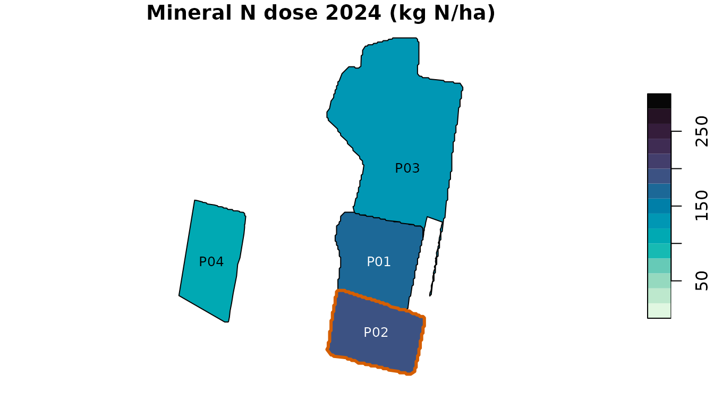
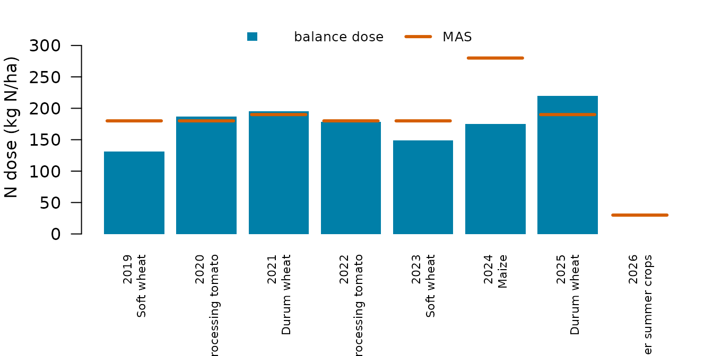

# Farm-level balance and strip-prescription map

This vignette follows the workflow of the agrinutri article on a real
farm of the Po plain near Piacenza (Italy):

1.  Load a farm layer whose columns carry the balance inputs.
2.  Run the N, P₂O₅ and K₂O balances on every plot with
    [`farm_balance()`](https://mcroci.github.io/agrinutri/reference/farm_balance.md).
3.  Follow one plot through eight years of rotation.
4.  Turn a Sentinel-2 scene into a strip prescription for that plot.
5.  Export it for the on-board monitor.

## 1. The farm

`piacenza_farm.geojson` holds four neighbouring fields delineated from
Sentinel-2 (46.7 ha), one for each crop of 2024. The crop of every year
from 2019 to 2026 was estimated from satellite data; soil values are
field means of the regional soil maps; rainfall comes from ERA5 and
yields from the provincial statistics.

``` r

library(agrinutri)
library(sf)
farm <- sf::st_read(system.file("extdata/piacenza_farm.geojson", package = "agrinutri"),
                    quiet = TRUE)
sf::st_drop_geometry(farm)[, c("plot", "area_ha", "c2023", "c2024", "clay", "olsen_value", "k_value")]
#>   plot area_ha             c2023             c2024   clay olsen_value k_value
#> 1  P01   8.612        Soft wheat             Maize 19.399      17.025  88.375
#> 2  P02   7.565       Durum wheat Processing tomato 20.776      18.844  99.669
#> 3  P03  23.148 Processing tomato        Soft wheat 17.342      18.960  84.855
#> 4  P04   7.403 Processing tomato       Durum wheat 16.949      18.280  78.653
```

## 2. Balances for every plot

[`farm_balance()`](https://mcroci.github.io/agrinutri/reference/farm_balance.md)
applies
[`N_balance()`](https://mcroci.github.io/agrinutri/reference/N_balance.md)
to every feature and appends `N_target`, `MAS_cap`, `MAS_ok` and
`N_total_kg`. With `p_balance` and `k_balance` it also runs the P₂O₅ and
K₂O balances from the columns `olsen_value`/`olsen_unit` and
`k_value`/`k_unit` (here Olsen P and exchangeable K as elements, mg/kg).

``` r

out <- farm_balance(farm, p_balance = TRUE, k_balance = TRUE)
sf::st_drop_geometry(out)[, c("plot", "crop", "N_target", "MAS_cap", "MAS_ok",
                              "N_total_kg", "P2O5_target", "K2O_target")]
#>   plot                             crop N_target MAS_cap MAS_ok N_total_kg
#> 1  P01      Grain maize 500-700 (grain)    175.0     280   TRUE     1507.1
#> 2  P02 Processing tomato (medium yield)    193.1     180  FALSE     1460.8
#> 3  P03        Soft wheat FP/FPS (grain)    133.6     180   TRUE     3092.6
#> 4  P04              Durum wheat (grain)    105.4     190   TRUE      780.3
#>   P2O5_target K2O_target
#> 1        50.9      121.5
#> 2        91.0      281.1
#> 3        41.3      139.5
#> 4        35.0      174.7
```

The processing tomato exceeds its maximum allowed dose (MAS) and is
flagged. The standard-dose scheme of the guidelines gives one value per
crop instead:

``` r

vapply(out$crop, function(cr) dose_standard_N(cr)$dose_final, numeric(1))
#>      Grain maize 500-700 (grain) Processing tomato (medium yield) 
#>                              240                              130 
#>        Soft wheat FP/FPS (grain)              Durum wheat (grain) 
#>                              155                              160
```

``` r

plot(out["N_target"], main = "Mineral N dose 2024 (kg N/ha)", breaks = seq(0, 300, 20),
     pal = function(n) hcl.colors(n, "Mako", rev = TRUE), key.pos = 4, reset = FALSE)
plot(sf::st_geometry(out[!out$MAS_ok, ]), border = "#D55E00", lwd = 3, add = TRUE)
text(sf::st_coordinates(sf::st_point_on_surface(sf::st_geometry(out))), labels = out$plot,
     cex = 0.8, col = ifelse(out$N_target > 150, "white", "black"))
```



## 3. One plot through the rotation

Because the inputs are columns, the balance runs over years as easily as
over plots. `piacenza_p01_rotation.csv` holds the yearly inputs of plot
P01; the soil is the same every year.

``` r

rot <- read.csv(system.file("extdata/piacenza_p01_rotation.csv", package = "agrinutri"))
p1  <- farm[farm$plot == "P01", ]
yr <- do.call(rbind, lapply(seq_len(nrow(rot)), function(i) {
  r <- rot[i, ]
  b <- N_balance(expected_yield_tons_ha = r$expected_yield_tons_ha, crop = r$crop, ccp = r$ccp,
                 sand = p1$sand, clay = p1$clay, Ntot = p1$Ntot, SOM = p1$SOM, CN = p1$CN,
                 oxygen_availability = "Normal", winter_rain = r$winter_rain,
                 start_spring_rain = r$start_spring_rain, prev_crop = r$prev_crop,
                 source = "None", fertorg_frequency = "every year",
                 location = p1$location, forg_quantity = 0)
  data.frame(year = r$year, crop = r$crop_class,
             N    = round(calculate_N_fertilization(b), 1),
             MAS  = get_MAS(r$crop)$mas_N,
             P2O5 = round(P_balance(r$expected_yield_tons_ha, r$crop, olsen_value = p1$olsen_value,
                                    olsen_unit = "P", clay = p1$clay, sand = p1$sand)$P2O5_required, 1),
             K2O  = round(K_balance(r$expected_yield_tons_ha, r$crop, k_value = p1$k_value,
                                    k_unit = "K", clay = p1$clay, sand = p1$sand)$K2O_required, 1))
}))
yr
#>   year               crop     N MAS P2O5   K2O
#> 1 2019         Soft wheat 131.2 180 38.8 118.3
#> 2 2020  Processing tomato 187.0 180 91.0 300.0
#> 3 2021        Durum wheat 195.2 190 59.7 134.8
#> 4 2022  Processing tomato 178.8 180 91.0 300.0
#> 5 2023         Soft wheat 149.0 180 50.5 125.8
#> 6 2024              Maize 174.9 280 50.9 121.4
#> 7 2025        Durum wheat 219.5 190 47.6 126.4
#> 8 2026 Other summer crops   0.0  30 47.6 163.8
```

``` r

par(mar = c(6, 4, 1, 1))
bp <- barplot(yr$N, names.arg = paste(yr$year, yr$crop, sep = "\n"), las = 2, cex.names = 0.7,
              col = hcl.colors(3, "Mako")[2], border = NA, ylim = c(0, 340),
              ylab = "N dose (kg N/ha)")
segments(bp - 0.45, yr$MAS, bp + 0.45, yr$MAS, col = "#D55E00", lwd = 3)
legend("top", c("balance dose", "MAS"), fill = c(hcl.colors(3, "Mako")[2], NA), horiz = TRUE,
       border = NA, lty = c(NA, 1), lwd = c(NA, 3), col = c(NA, "#D55E00"), bty = "n", cex = 0.8)
```



The dose changes with the crop, its expected yield, the autumn-winter
rainfall of the leaching terms and the previous crop; where the bar
passes the orange line the MAS, not the balance, sets the plan. The
legume of 2026 needs no mineral N. With low exchangeable K the K₂O
balance follows the enrichment strategy every year.

## 4. From Sentinel-2 to a strip prescription

[`estimate_biophysical()`](https://mcroci.github.io/agrinutri/reference/estimate_biophysical.md)
retrieves leaf area index, leaf dry matter and canopy N content from the
Level-2A scene of 13 August 2024 with Gaussian-process regression;
[`compute_NNI_from_S2()`](https://mcroci.github.io/agrinutri/reference/compute_NNI_from_S2.md)
turns them into the Nitrogen Nutrition Index.

``` r

s2f <- system.file("extdata/sentinel-2/S2_piacenza_P01_20240813.tif", package = "agrinutri")
bio <- estimate_biophysical(s2f, output_dir = tempdir(),
                            variables = c("LAI", "Cm", "CNC_Cprot", "FVC"))
nni <- compute_NNI_from_S2(bio$LAI, bio$Cm, bio$CNC_Cprot, cnc_layer = "CNC_Cprot",
                           crop = "maize", fvc = bio$FVC)
N_star <- out$N_target[out$plot == "P01"]
```

[`build_strip_prescription()`](https://mcroci.github.io/agrinutri/reference/build_strip_prescription.md)
tiles the plot along the A-B line of a 24 m spreader, with 30 m cells.
NNI zones set the cells to the upper bound (deficient), the target
(optimal) or the lower bound (excessive); the free cells are then
shifted so that the area-weighted mean equals the field balance.

``` r

rx <- build_strip_prescription(p1, machine_width = 24, cell_length = 30,
                               variability = "nni", nni_raster = nni$NNI,
                               n_target = N_star, min_dose = 0.8 * N_star,
                               max_dose = 1.2 * N_star)
table(rx$dose)
#> 
#> 141.1 176.4   210 
#>    16   118    18
c(target = N_star, mean = round(weighted.mean(rx$dose, rx$area_ha), 1))
#> target   mean 
#>    175    175
```

``` r

par(mfrow = c(1, 2), mar = c(1, 1, 2, 4))
p1_v <- terra::project(terra::vect(p1), terra::crs(nni$NNI))
terra::plot(terra::mask(nni$NNI, p1_v), main = "NNI", col = hcl.colors(30, "RdBu"),
            range = c(0.6, 1.4), axes = FALSE)
terra::lines(p1_v)
plot(rx["dose"], main = "Dose (kg N/ha)", breaks = seq(0.8, 1.2, 0.05) * N_star,
     pal = function(n) hcl.colors(n, "Mako", rev = TRUE), key.pos = 4, reset = FALSE)
```


Other variabilities use the same call: `"uniform"`, `"calibration"` (a
VI ramp with `vi_low`/`vi_high`), `"classes"` (VI quantile classes).
Pass `angle_deg` or an `ab_line` to force the driving direction.

## 5. Export to tractor-ready formats

[`export_prescription()`](https://mcroci.github.io/agrinutri/reference/export_prescription.md)
writes a single file;
[`export_prescription_all()`](https://mcroci.github.io/agrinutri/reference/export_prescription_all.md)
bundles several formats in one folder.

``` r

export_prescription(rx, "rx.shp",    format = "shp")
export_prescription(rx, "JD/rx.shp", format = "johndeere")
export_prescription(rx, "TASKDATA",  format = "isoxml",
  isoxml_opts = list(task_name = "P01 top-dress", product = "Urea 46 pct", unit = "kg/ha"))
export_prescription_all(rx, "rx_bundle", "P01_2024", formats = c("shp", "isoxml", "johndeere"))
```

The Shiny interface
([`agrinutri::run_app()`](https://mcroci.github.io/agrinutri/reference/run_app.md))
exposes the same flow with interactive forms and a map preview. Data
sources are listed in
[`?piacenza`](https://mcroci.github.io/agrinutri/reference/piacenza.md).
