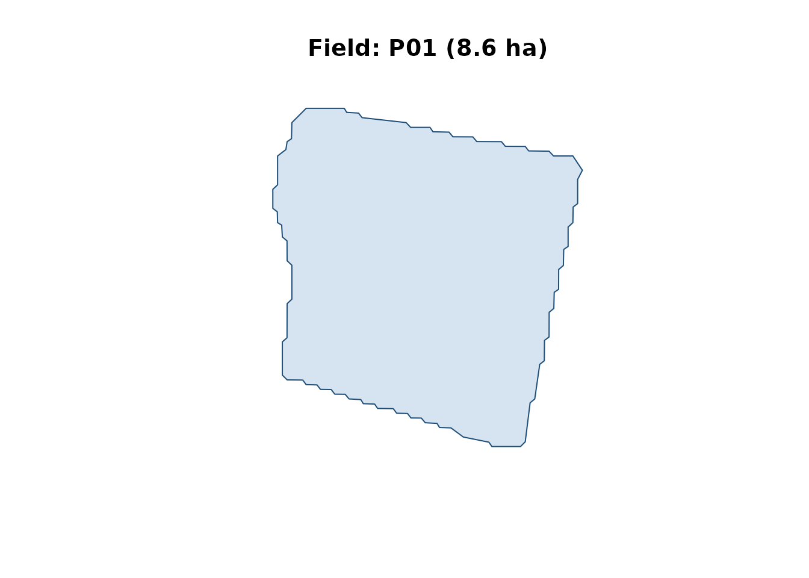
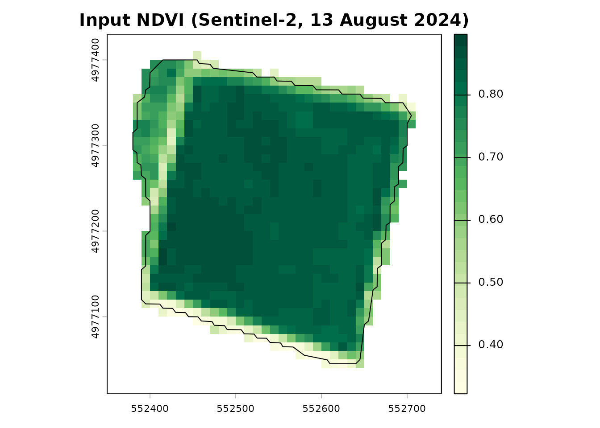
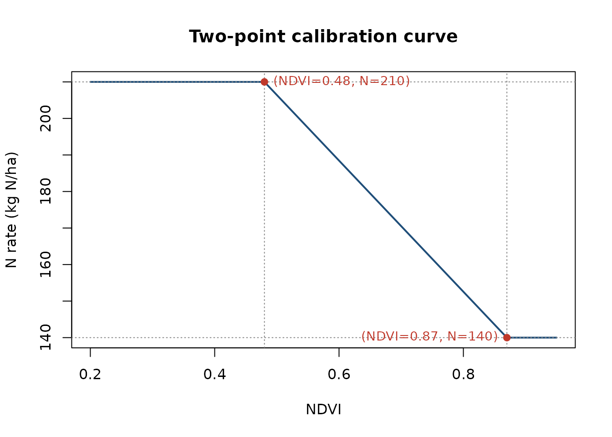
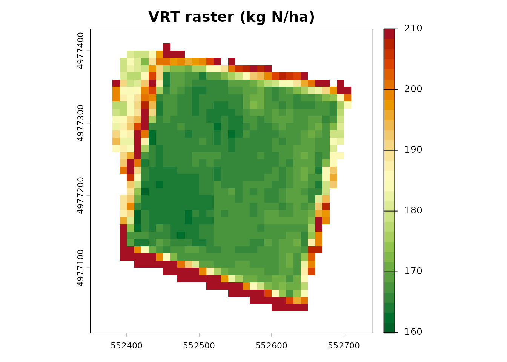
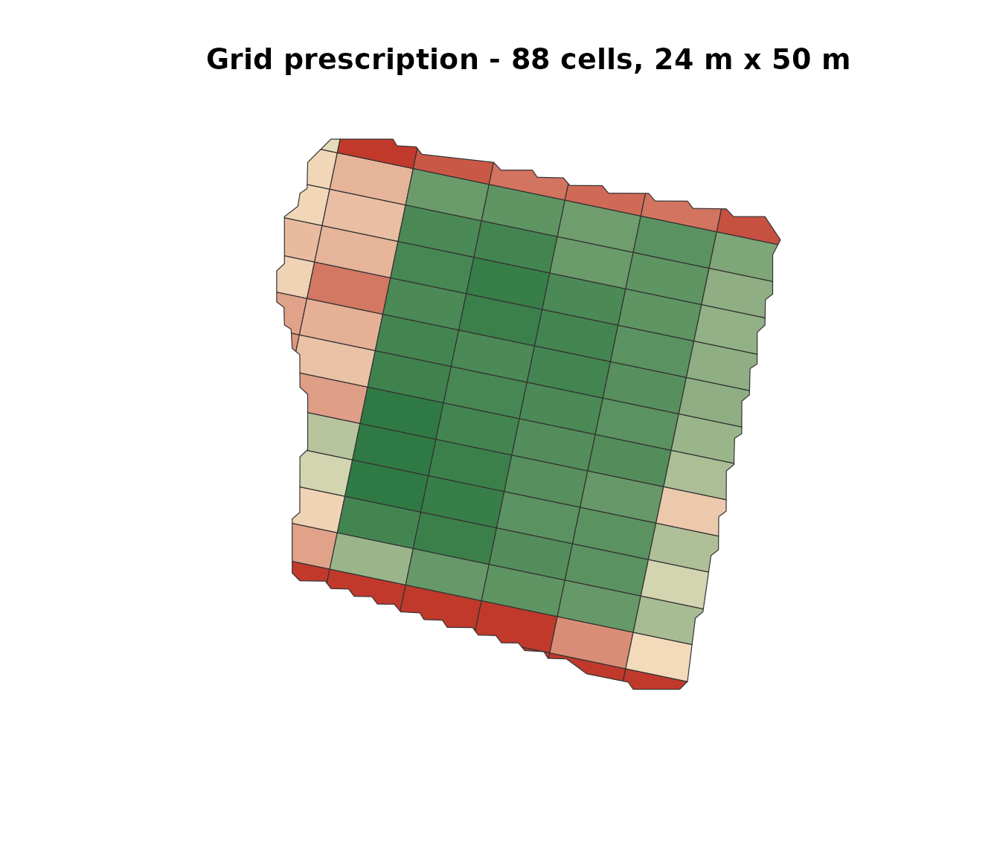
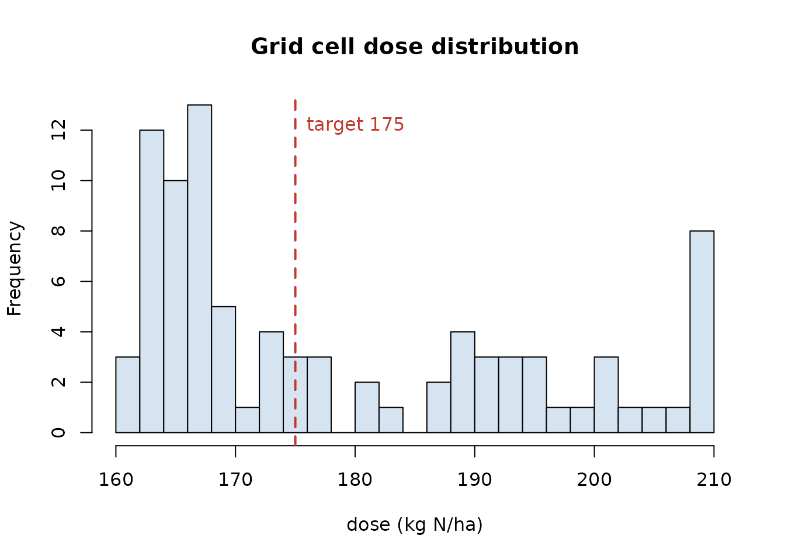

# Prescription map worked example: NDVI, calibration curve, grid

This vignette shows the **full workflow** from an NDVI raster to a
machine-width grid prescription map, in six steps:

1.  Load a field polygon (plot P01 of the bundled Piacenza farm).
2.  Compute its NDVI from the bundled Sentinel-2 scene.
3.  Define the **calibration curve** (VI -\> N rate) from two anchor
    points.
4.  Generate **Option A** - a pixel-by-pixel VRT raster with
    [`variable_rate_N()`](https://mcroci.github.io/agrinutri/reference/variable_rate_N.md).
5.  Generate **Option B** - a **grid prescription** with
    [`build_strip_prescription()`](https://mcroci.github.io/agrinutri/reference/build_strip_prescription.md)
    (machine width x cell length, along an A-B line), colour-coded by
    the same calibration.
6.  Export both as GeoTIFF / Shapefile / ISOXML.

All of this runs on the Piacenza example data that ships with agrinutri
(see
[`?piacenza`](https://mcroci.github.io/agrinutri/reference/piacenza.md)).

## 1. Load a field polygon

``` r

library(agrinutri)
library(sf)

farm  <- sf::st_read(system.file("extdata/piacenza_farm.geojson", package = "agrinutri"),
                     quiet = TRUE)
field <- farm[farm$plot == "P01", ]      # grain maize in 2024, 8.6 ha
sf::st_drop_geometry(field)[, c("plot", "crop", "area_ha")]
#>   plot                        crop area_ha
#> 1  P01 Grain maize 500-700 (grain)   8.612
plot(sf::st_geometry(field), col = "#D5E4F0", border = "#1F4E79",
     main = sprintf("Field: %s (%.1f ha)", field$plot, field$area_ha))
```



## 2. NDVI from Sentinel-2

The bundled scene is the Sentinel-2 Level-2A acquisition of 13 August
2024 over P01, with reflectance scaled by 10000:

``` r

library(terra)

s2 <- terra::rast(system.file("extdata/sentinel-2/S2_piacenza_P01_20240813.tif",
                              package = "agrinutri"))
fv <- terra::project(terra::vect(field), terra::crs(s2))
r  <- terra::mask(compute_vi(s2, "NDVI", scale_factor = 10000), fv)
names(r) <- "NDVI"
r
#> class       : SpatRaster
#> size        : 42, 39, 1  (nrow, ncol, nlyr)
#> resolution  : 10, 10  (x, y)
#> extent      : 552350, 552740, 4977010, 4977430  (xmin, xmax, ymin, ymax)
#> coord. ref. : WGS 84 / UTM zone 32N (EPSG:32632)
#> source(s)   : memory
#> varname     : S2_piacenza_P01_20240813
#> name        :     NDVI
#> min value   :  0.32309
#> max value   : 0.897106

terra::plot(r, main = "Input NDVI (Sentinel-2, 13 August 2024)",
            col = hcl.colors(30, "YlGn", rev = TRUE))
terra::lines(fv)
```



## 3. Define the calibration curve

The **two-point linear** calibration maps an NDVI reference (lowest
vigour) to `max_dose` (to push canopy development) and a high-vigour
NDVI to `min_dose` (canopy already lush, less N needed):

``` r

# N target from the field-scale balance of P01 (2024), bounds 80-120 percent
N_target <- farm_balance(farm)$N_target[farm$plot == "P01"]
min_dose <- 0.8 * N_target
max_dose <- 1.2 * N_target

# Anchors from the field NDVI: 5th percentile -> max_dose, 95th -> min_dose
q <- terra::global(r, function(v) quantile(v, c(0.05, 0.95), na.rm = TRUE))
vi_low  <- round(q[1, 1], 2)
vi_high <- round(q[1, 2], 2)

# Plot the calibration
vi  <- seq(0.20, 0.95, length.out = 200)
slope <- (min_dose - max_dose) / (vi_high - vi_low)
intercept <- max_dose - slope * vi_low
dose_curve <- pmin(pmax(slope * vi + intercept, min_dose), max_dose)

plot(vi, dose_curve, type = "l", lwd = 2, col = "#1F4E79",
     xlab = "NDVI", ylab = "N rate (kg N/ha)",
     main = "Two-point calibration curve")
abline(v = c(vi_low, vi_high), lty = 3, col = "#888")
abline(h = c(min_dose, max_dose), lty = 3, col = "#888")
points(c(vi_low, vi_high), c(max_dose, min_dose),
       pch = 19, col = "#C0392B")
text(vi_low,  max_dose, sprintf("(NDVI=%.2f, N=%g)", vi_low, max_dose),
     pos = 4, cex = 0.9, col = "#C0392B")
text(vi_high, min_dose, sprintf("(NDVI=%.2f, N=%g)", vi_high, min_dose),
     pos = 2, cex = 0.9, col = "#C0392B")
```



## 4. Option A - pixel-by-pixel VRT raster

[`variable_rate_N()`](https://mcroci.github.io/agrinutri/reference/variable_rate_N.md)
applies the calibration to every pixel and rescales the output so the
area-weighted mean equals the balance target (mass-balance constraint).
With `method = "calibration"` the two anchor points are taken
automatically from the **empirical `min` / `max` of the NDVI raster**
mapped to (`maxN`, `minN`) — i.e. the lowest-vigour pixels get the
highest dose and vice-versa. If you need to fix the anchors yourself
(e.g. the field percentiles above, or values from your local
calibration), use Option B with
[`build_strip_prescription()`](https://mcroci.github.io/agrinutri/reference/build_strip_prescription.md)
below, which exposes them as arguments.

``` r

vr <- variable_rate_N(
  ndvi_raster = r,
  n_dose      = N_target,
  method      = "calibration",      # or "holland" for Holland & Schepers
  minN        = min_dose,
  maxN        = max_dose
)

rx_raster <- vr$rate_raster %||% vr    # robust to return shape
terra::plot(rx_raster,
            main = "VRT raster (kg N/ha)",
            col = rev(hcl.colors(30, "RdYlGn")))
```



``` r

cat("Mean applied N:  ", round(terra::global(rx_raster, "mean", na.rm = TRUE)[1, 1], 1),
    "kg N/ha\n")
#> Mean applied N:   175 kg N/ha
cat("Range:           ", round(terra::global(rx_raster, "min", na.rm = TRUE)[1, 1], 1),
    "-", round(terra::global(rx_raster, "max", na.rm = TRUE)[1, 1], 1), "kg N/ha\n")
#> Range:            159.9 - 210 kg N/ha
```

`%||%` is just defensive code (some versions of
[`variable_rate_N()`](https://mcroci.github.io/agrinutri/reference/variable_rate_N.md)
return a list, others a raster directly); it is defined once at the top
of the vignette in the hidden setup chunk.

## 5. Option B - machine-width grid along an A-B line

The pixel-by-pixel raster in Option A is fine for a self-driving tractor
with a continuous-rate spreader, but many farm monitors prefer a **block
prescription**: rectangular cells of `machine_width x cell_length` with
a single dose per cell. agrinutri’s
[`build_strip_prescription()`](https://mcroci.github.io/agrinutri/reference/build_strip_prescription.md)
produces exactly that, applying the same calibration internally:

``` r

rx_grid <- build_strip_prescription(
  field         = field,
  machine_width = 24,     # metres, working width of the spreader
  cell_length   = 50,     # metres, along the A-B line (0 = continuous strips)
  angle_deg     = NULL,   # NULL = auto-detect long side; set 30 / 90 / ... to force
  variability   = "calibration",
  vi_raster     = r,
  n_target      = N_target,
  min_dose      = min_dose,
  max_dose      = max_dose,
  vi_low        = vi_low,
  vi_high       = vi_high,
  preserve_mean = TRUE)

# Plot with the dose-based palette used by the Shiny app
pal <- colorRampPalette(c("#2F7A44", "#F6E7C7", "#C0392B"))(100)
col_idx <- as.integer(round(
  (rx_grid$dose - min(rx_grid$dose, na.rm = TRUE)) /
    diff(range(rx_grid$dose, na.rm = TRUE)) * 99)) + 1
plot(sf::st_geometry(rx_grid),
     col = pal[col_idx], border = "#333", lwd = 0.6,
     main = sprintf("Grid prescription - %d cells, 24 m x 50 m",
                    nrow(rx_grid)))
```



The **A-B direction** is inferred from the longest edge of the field
polygon. Pass `angle_deg = 45` (or any number) to force a specific
driving direction, or `ab_line = <sf LINESTRING>` to use an existing
tramline.

### Distribution of doses per grid cell

``` r

hist(rx_grid$dose, breaks = 20, col = "#D5E4F0",
     main = "Grid cell dose distribution",
     xlab = "dose (kg N/ha)")
abline(v = N_target, col = "#C0392B", lwd = 2, lty = 2)
text(N_target, par("usr")[4]*0.9,
     sprintf("target %g", N_target), pos = 4, col = "#C0392B")
```



## 6. Export to tractor-ready formats

``` r

# A) raster GeoTIFF (farm-management software, continuous)
terra::writeRaster(rx_raster, "rx_raster.tif", overwrite = TRUE)

# B) grid polygons - any format accepted by the on-board monitor
export_prescription(rx_grid, "rx_grid.shp",          format = "shp")
export_prescription(rx_grid, "JD/rx_grid.shp",       format = "johndeere")
export_prescription(rx_grid, "TRIMBLE/rx_grid.shp",  format = "trimble")
export_prescription(rx_grid, "TASKDATA",             format = "isoxml",
  isoxml_opts = list(task_name = "N top-dress",
                      product   = "Urea 46 pct",
                      unit      = "kg/ha"))

# Or every format in one zip-ready folder:
export_prescription_all(rx_grid, "rx_bundle", "P01_2024",
  formats = c("shp", "geojson", "gpkg", "isoxml",
              "johndeere", "trimble"))
```

## 7. Notes

- **Mass-balance constraint** - `preserve_mean = TRUE` (default) makes
  the area-weighted mean dose match `n_target`. The balance provides the
  legally defensible field ceiling (MAS / ZVN 170 kg N/ha), and the VRT
  / grid layer redistributes it in space.
- **Calibration sources** - the default anchors (`vi_low = 0.35`,
  `vi_high = 0.80`) work for most mid-season Sentinel-2 NDVI in Northern
  Italy. Recalibrate locally against a set of plot-level yield /
  N-status samples for operational use.
- **Cell granularity** - finer `cell_length` gives a denser grid but
  risks delivery oscillations on the spreader; 50-100 m along the A-B
  line is a reasonable default for a 24-36 m machine.
- **Same pipeline for NNI** - replace `variability = "calibration"` with
  `variability = "nni"` and pass an NNI raster (from
  [`compute_NNI_from_S2()`](https://mcroci.github.io/agrinutri/reference/compute_NNI_from_S2.md)
  or
  [`nni_from_vi_empirical()`](https://mcroci.github.io/agrinutri/reference/nni_from_vi_empirical.md))
  instead of the VI to drive the strips by nitrogen status zones
  directly.
