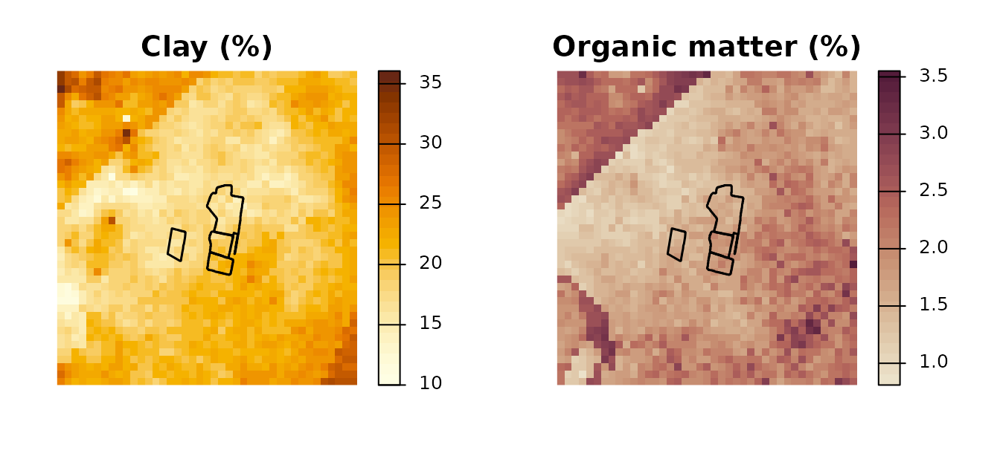
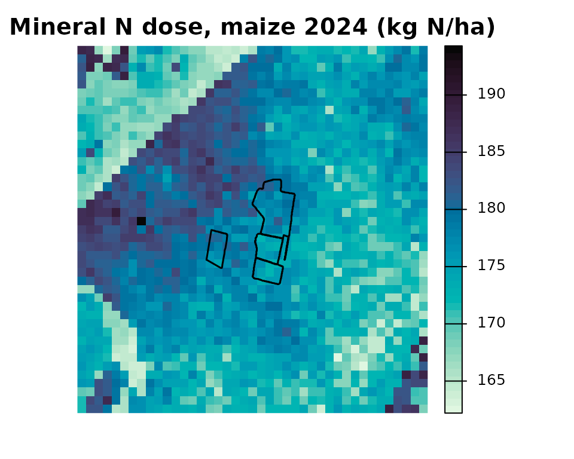
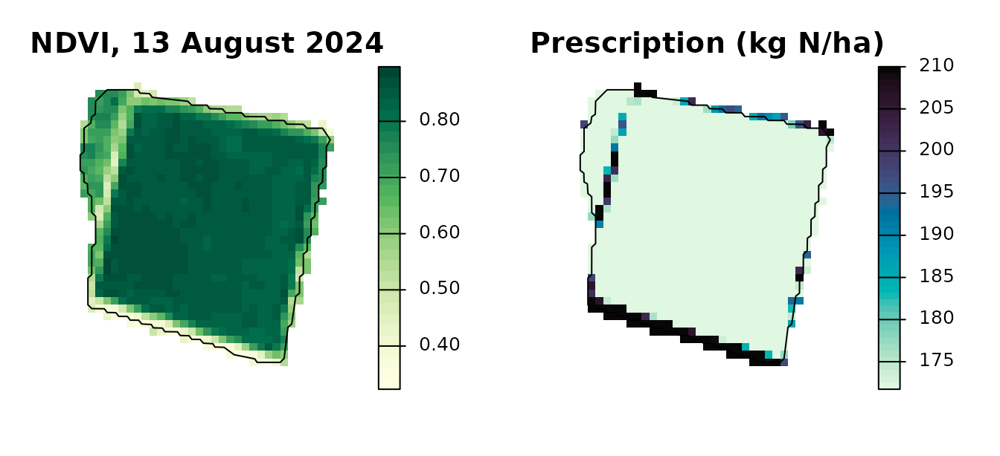

# Spatial Nitrogen Balance and Variable-Rate Prescription

## Overview

This vignette runs the spatial workflow of agrinutri on real data from
the Po plain near Piacenza (Italy):

1.  **Load** the regional soil maps 0-30 cm (100 m grid) around a small
    farm, bundled with the package.
2.  **Compute** a nitrogen balance for every pixel with
    [`spatial_N_balance()`](https://mcroci.github.io/agrinutri/reference/spatial_N_balance.md).
3.  **Check** it against the field balance of
    [`farm_balance()`](https://mcroci.github.io/agrinutri/reference/farm_balance.md).
4.  **Redistribute** the field dose of one plot with a Sentinel-2 NDVI
    and
    [`variable_rate_N()`](https://mcroci.github.io/agrinutri/reference/variable_rate_N.md),
    keeping its mean.

The field-scale balance provides the regulatory N target; the
variable-rate functions move it in space under a mass-balance
constraint.

## 1. Regional soil maps and the farm

`rer_soil_piacenza.tif` is a clip of the soil maps of Regione
Emilia-Romagna (CC BY 4.0) over the farm and 1.5 km around it: clay and
sand (percent), organic carbon (percent), total N (g/kg), Olsen P and
exchangeable K (mg/kg).
[`spatial_N_balance()`](https://mcroci.github.io/agrinutri/reference/spatial_N_balance.md)
wants total N, organic matter, clay, sand and the C/N ratio, so organic
matter and C/N are derived from organic carbon.

``` r

library(agrinutri)
library(terra)
#> terra 1.9.50

rer  <- terra::rast(system.file("extdata/rer_soil_piacenza.tif", package = "agrinutri"))
soil <- c(rer[["ntot"]],                        # g/kg, as Ntot in N_balance()
          rer[["corg"]] * 1.724,                # organic matter, percent
          rer[["clay"]], rer[["sand"]],
          rer[["corg"]] * 10 / rer[["ntot"]])   # C/N
names(soil) <- c("TN", "SOM", "Clay", "Sand", "CNratio")

farm <- sf::st_read(system.file("extdata/piacenza_farm.geojson", package = "agrinutri"),
                    quiet = TRUE)
farm_v <- terra::vect(sf::st_transform(farm, terra::crs(soil)))
soil
#> class       : SpatRaster
#> size        : 43, 41, 5  (nrow, ncol, nlyr)
#> resolution  : 100, 100  (x, y)
#> extent      : 550300, 554400, 4975300, 4979600  (xmin, xmax, ymin, ymax)
#> coord. ref. : RDN2008 / UTM zone 32N (EPSG:7791)
#> sources     : rer_soil_piacenza.tif (3 layers)
#>               memory (2 layers)
#> varnames    : rer_soil_piacenza
#>               rer_soil_piacenza
#>               rer_soil_piacenza
#>               rer_soil_piacenza
#>               rer_soil_piacenza
#> names       :   TN,     SOM,      Clay, Sand,   CNratio
#> min values  : 0.96, 0.81028,        10, 2.99,       3.5
#> max values  :  2.4, 3.55144, 36.060001,   34, 14.299999
```

``` r

par(mfrow = c(1, 2), mar = c(1, 1, 2, 4))
terra::plot(soil[["Clay"]], main = "Clay (%)", col = hcl.colors(30, "YlOrBr", rev = TRUE),
            axes = FALSE)
terra::lines(farm_v, lwd = 1.5)
terra::plot(soil[["SOM"]], main = "Organic matter (%)", col = hcl.colors(30, "BrwnYl", rev = TRUE),
            axes = FALSE)
terra::lines(farm_v, lwd = 1.5)
```



## 2. A balance for every pixel

[`spatial_N_balance()`](https://mcroci.github.io/agrinutri/reference/spatial_N_balance.md)
calls
[`N_balance()`](https://mcroci.github.io/agrinutri/reference/N_balance.md)
on every non-NA pixel. Crop, yield, rainfall, previous crop and organic
history are scalars; the soil maps alone make the balance vary in space.
Here every pixel is computed as the 2024 grain maize of plot P01, with
the inputs stored in the farm layer.

``` r

p1 <- farm[farm$plot == "P01", ]
n_map <- spatial_N_balance(
  soil_stack             = soil,
  expected_yield_tons_ha = p1$expected_yield_tons_ha,
  crop                   = p1$crop,
  ccp                    = p1$ccp,
  oxygen_availability    = p1$oxygen_availability,
  winter_rain            = p1$winter_rain,
  start_spring_rain      = p1$start_spring_rain,
  prev_crop              = p1$prev_crop,
  source                 = p1$source,
  fertorg_frequency      = p1$fertorg_frequency,
  location               = p1$location,
  forg_quantity          = 0
)
```

``` r

terra::plot(n_map[["N_to_apply"]], main = "Mineral N dose, maize 2024 (kg N/ha)",
            col = hcl.colors(50, "Mako", rev = TRUE), axes = FALSE)
terra::lines(farm_v, lwd = 1.5)
```



## 3. Pixels and field agree

The mean of the pixels that touch plot P01 is close to the field balance
computed by
[`farm_balance()`](https://mcroci.github.io/agrinutri/reference/farm_balance.md)
from the field means of the same maps:

``` r

pix <- terra::extract(n_map[["N_to_apply"]], farm_v[farm$plot == "P01"],
                      fun = mean, na.rm = TRUE, touches = TRUE)[1, 2]
fld <- farm_balance(farm)$N_target[farm$plot == "P01"]
c(pixels = round(pix, 1), field = fld)
#> pixels  field 
#>  175.2  175.0
```

## 4. Variable rate inside plot P01

`S2_piacenza_P01_20240813.tif` is the Sentinel-2 Level-2A scene of 13
August 2024 over P01 (reflectance scaled by 10000). The NDVI drives the
Holland-Schepers sufficiency index; the doses may range between 80 and
120 percent of the field balance and their mean is rescaled to it.

``` r

s2   <- terra::rast(system.file("extdata/sentinel-2/S2_piacenza_P01_20240813.tif",
                                package = "agrinutri"))
p1_v <- terra::project(farm_v[farm$plot == "P01"], terra::crs(s2))
ndvi <- terra::mask(compute_vi(s2, "NDVI", scale_factor = 10000), p1_v)

vr <- variable_rate_N(ndvi_raster = ndvi, n_dose = fld, method = "holland",
                      minN = 0.8 * fld, maxN = 1.2 * fld)
```

``` r

par(mfrow = c(1, 2), mar = c(1, 1, 2, 4))
terra::plot(ndvi, main = "NDVI, 13 August 2024", col = hcl.colors(30, "YlGn", rev = TRUE),
            axes = FALSE)
terra::lines(p1_v)
terra::plot(vr$rate_raster, main = "Prescription (kg N/ha)",
            col = hcl.colors(50, "Mako", rev = TRUE), axes = FALSE)
terra::lines(p1_v)
```



``` r

cat("Field balance:   ", fld, "kg N/ha\n")
#> Field balance:    175 kg N/ha
cat("Prescription mean:", round(vr$mean_kg_ha, 1), "kg N/ha\n")
#> Prescription mean: 175 kg N/ha
cat("Range:           ", round(vr$min_kg_ha, 1), "-", round(vr$max_kg_ha, 1), "kg N/ha\n")
#> Range:            171.7 - 210 kg N/ha
```

Where the bounds clip many pixels, the mean can stay below the target:
the bounds take precedence over the mass balance.

## 5. Export

The raster can be written as a GeoTIFF, or polygonised by
[`export_prescription()`](https://mcroci.github.io/agrinutri/reference/export_prescription.md)
into any of the formats accepted by on-board monitors (Shapefile,
GeoJSON, KML, GeoPackage, John Deere-ready, Trimble-ready, ISOXML
TASKDATA):

``` r

terra::writeRaster(vr$rate_raster, "P01_prescription.tif", overwrite = TRUE)
export_prescription(vr$rate_raster, "TASKDATA", format = "isoxml",
  isoxml_opts = list(task_name = "P01 top-dress", product = "Urea 46 pct", unit = "kg/ha"))
export_prescription_all(vr$rate_raster, "rx_bundle", "P01_2024",
  formats = c("shp", "isoxml", "johndeere"))
```

For machine-width strips along an A-B line instead of pixels, see
[`vignette("farm-and-prescription-map")`](https://mcroci.github.io/agrinutri/articles/farm-and-prescription-map.md).

## Data sources

Soil: Regione Emilia-Romagna, carte dei suoli 0-30 cm (tessitura;
sostanza organica; azoto totale, fosforo assimilabile, potassio
scambiabile), CC BY 4.0. Sentinel-2: Copernicus Sentinel data 2024.
Field boundaries delineated from Sentinel-2; rainfall from ERA5. See
[`?piacenza`](https://mcroci.github.io/agrinutri/reference/piacenza.md).
