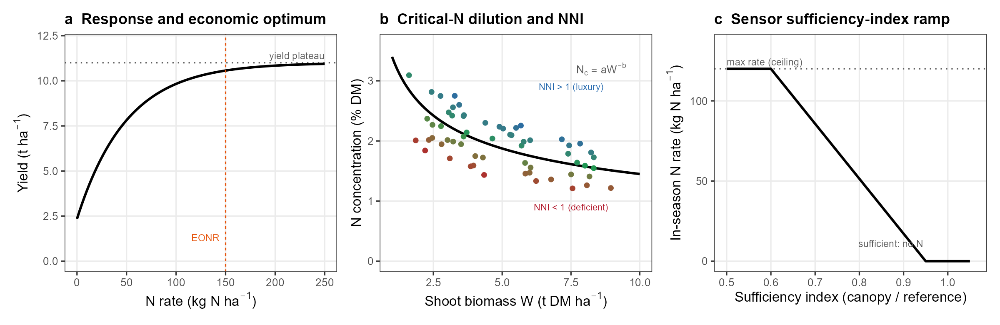
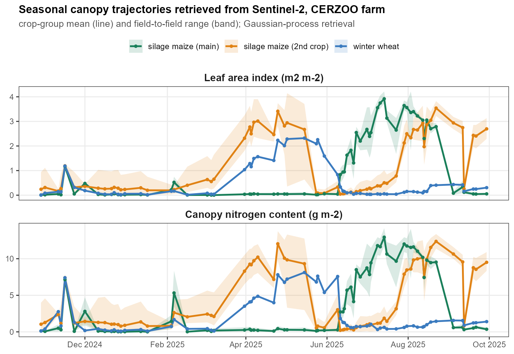
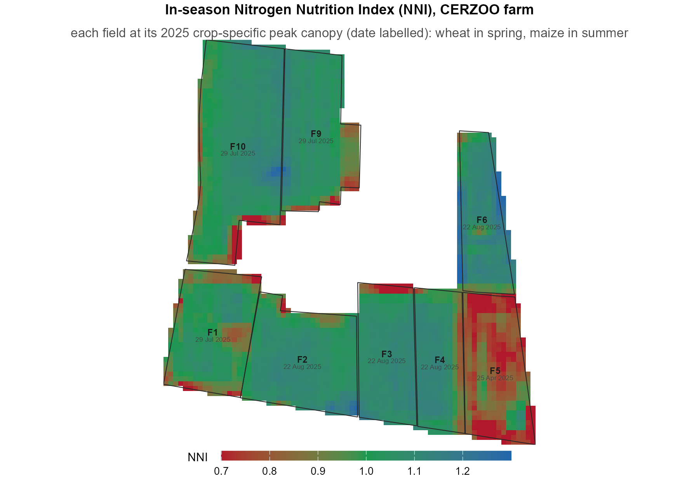
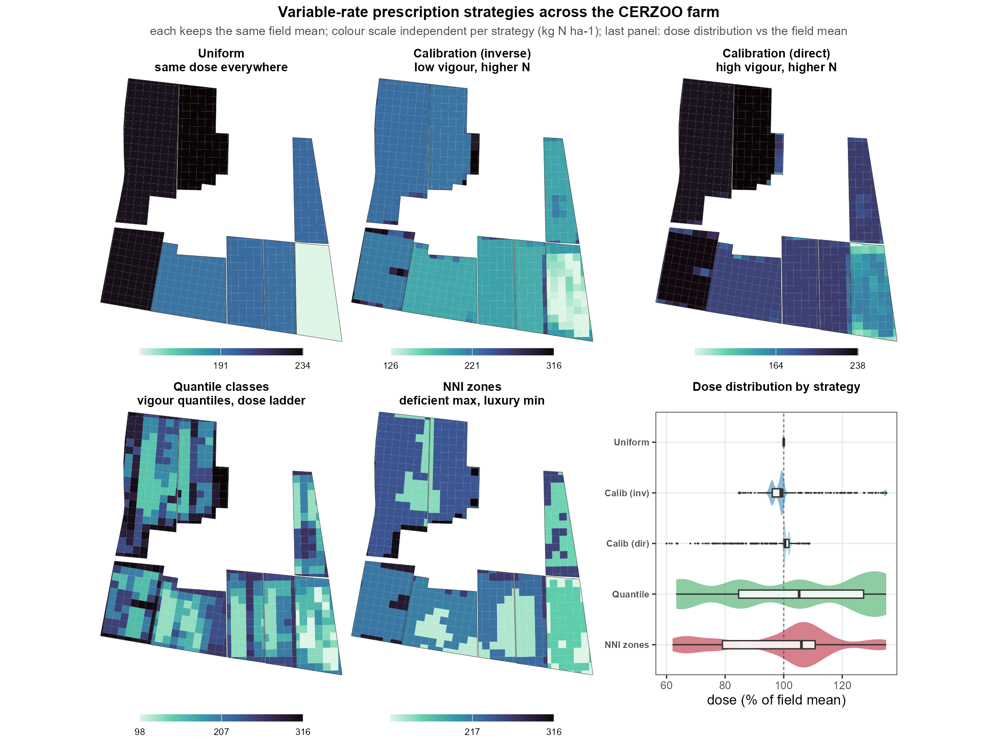
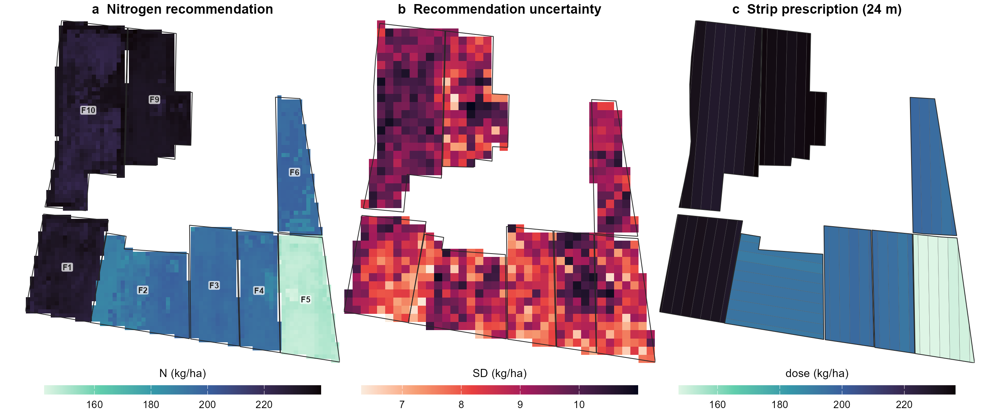
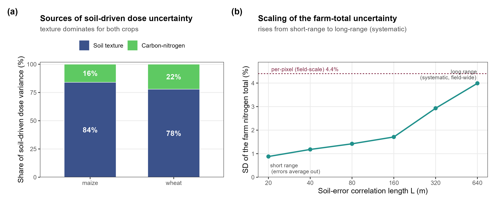
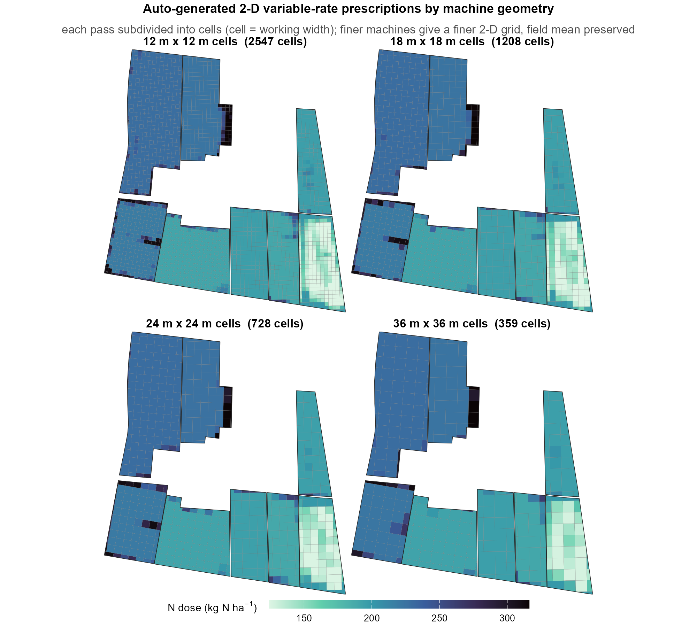
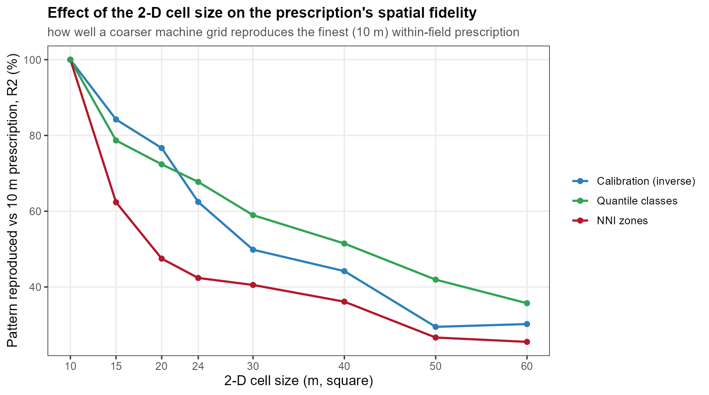

<!--
Draft assembled from outline v3 and methods draft v2, then revised after a four-lens
review (consistency, structure, integrity, reviewer objections). Conventions: no em or
en dashes (ranges as "X to Y"); colon separators; literal accents; SI units. All
load-bearing numbers now trace to the corrected correlated Monte Carlo run
(scratchpad/mc_v2.log, mc_farm_out/farm_accounting.csv, mc_v2_out/corr_length_curve.csv,
strips_out/strip_summary.csv) and every figure (1 to 10) is rendered. Items that only the
authors can supply remain marked `[confirm ...]` (declarations, DOIs, grant number) or
`[CITATION NEEDED: ...]` (the external soil-spatialization companion work); these must be
resolved before submission. No invented DOIs.
-->

## Highlights

- Open R tool runs the regulatory nitrogen balance from pixel to farm
- Cross-validated soil maps and their uncertainty give the prescription an uncertainty band
- The confidence in the nitrogen total depends on the soil-error correlation length
- Field and farm nitrogen accounting from one auditable computation
- A variance decomposition shows which soil property to sample more densely

## Abstract

Precision nitrogen management must match supply to crop demand in space and time
while respecting economic and regulatory limits, yet the operational tools that set
the rate give a single deterministic number, at a single scale, in closed
spreadsheets, and ignore the uncertainty of their soil inputs. We present NFert, an
open-source R package (version 0.14.2, MIT license, versioned on GitHub with
continuous integration and an archived release) that implements the Emilia-Romagna
Integrated Production nitrogen balance (DPI 2026, Allegato 2), couples it under a
single mass-balance constraint to a Sentinel-2 diagnosis of nitrogen status and to a
variable-rate prescription, and runs the same balance from the pixel to the
farm. Two features distinguish it from existing tools: it propagates the
uncertainty of the soil inputs (texture, organic carbon, total nitrogen) through the
balance by correlated Monte Carlo, and it reports the rate and its confidence at
field and farm scale. On the CERZOO experimental farm (Po Valley, Italy:
eight fields of silage maize (main and second crop) and soft wheat, about 32 ha),
soil maps and their cross-validated estimation uncertainty give a variable-rate
prescription with an uncertainty band and a per-crop decomposition of the soil sources of
uncertainty, and the same computation produces the farm nitrogen total (6.6 t N) with
its uncertainty. The confidence in that total depends on the spatial correlation
length of the soil error, from about 0.9 percent under short-range error to about 4.0
percent under long-range error. NFert offers a transparent, uncertainty-aware,
multi-scale alternative to closed tools, and, downstream of the cited soil input
layer, the analysis is reproducible from the open code and the released rasters.

**Keywords:** variable-rate nitrogen; nutrient balance; uncertainty propagation;
multi-scale nutrient accounting; Sentinel-2; reproducible research

---

## 1. Introduction

Fertilization is among the most consequential decisions in arable cropping, and the
rate of nitrogen applied is the decision that most directly determines its outcome:
the yield and quality achievable, the profitability of the operation, and the size of
the nitrogen surplus lost to water and air [@oenema2003; @sutton2011]. The rate is a
constrained optimization in which agronomic, economic and regulatory objectives must
be satisfied at once, and for nitrogen the regulatory ceiling is explicit: the
European Nitrates Directive constrains application in vulnerable zones [@nitrates1991],
and regional integrated-production schemes translate it into an auditable field
budget [@dpi2026].

The methods proposed to set the nitrogen rate form a small number of recurring
families: regulatory or mass-balance budgets; soil-test and standard-dose schemes;
crop-growth models; sensor-based empirical algorithms; biophysical diagnosis through
the Nitrogen Nutrition Index; and, more recently, machine learning. A scoping review
of side-dress recommendation systems found the empirical, vegetation-index-based
family dominant, with mechanistic and machine-learning systems a minority
[@corti2022]. Here we take the families as given and address three gaps that a
practical tool must close.

The first gap is integration. A reflectance index resolves within-field variability
but sets no field-level ceiling, while a mass balance sets a defensible ceiling but
no spatial pattern; the two are rarely coupled in one reproducible workflow, so a
sensor-driven map and a compliant budget are seldom reconciled [@raun2002;
@holland2010]. The second gap is openness and reproducibility. The regulatory methods
are typically locked in closed regional spreadsheets, and research code is fragmented
and often not versioned or inspectable, which undermines replication and cross-region
transfer [@seibold2021; @wilkinson2016]. The third gap, less often made explicit, is
that operational tools give a deterministic rate at a single scale: they ignore the
uncertainty of their soil inputs, and they disconnect the field decision from the
farm accounting that advisers and regulators need.

The closest precedent couples a mass balance to variable-rate nitrogen in a
nitrate-vulnerable zone [@basso2016], but as a case study rather than an open, reusable
tool, and without propagating the soil-input uncertainty or reporting across nested
scales. Table 1 positions NFert against the families of nitrogen-rate tools along the
dimensions a practical, auditable tool must satisfy: open and inspectable code,
uncertainty-aware output, field-and-farm reporting, a regulatory-compliant budget, and a
sensor-driven prescription in a machine-ready format.

**Table 1.** How NFert compares with the main families of nitrogen rate-setting tools.
"Yes", "partial" and "no" indicate whether a family typically provides each property.

| Tool family | Open, inspectable | Uncertainty-aware | Field + farm | Compliant budget | Sensor VRT + export |
|-------------|-------------------|-------------------|--------------|------------------|---------------------|
| Regional regulatory spreadsheet, e.g. Fert_Office [@fertoffice2026] | No | No | Partial | Yes | No |
| Sensor-based VRT algorithms [@raun2002; @holland2010] | Partial | No | Field | No | Yes |
| Crop-growth models, e.g. QUEFTS [@janssen1990] | Partial | No | Field | No | No |
| Coupled balance and VRT nitrogen in vulnerable zones [@basso2016] | No | No | Field | Yes | Partial |
| NFert (this work) | Yes | Yes | Yes | Yes | Yes |

This paper presents NFert, an open, versioned R implementation that closes these
gaps for nitrogen. NFert makes two contributions beyond existing tools: it propagates
soil-input uncertainty through the regulatory balance, and it reports the rate and its
confidence in one computation across field and farm scale. Around these, it
implements the regional regulatory balance end to end, couples it under a single
mass-balance constraint to a Sentinel-2 nitrogen-status diagnosis and a variable-rate
prescription, and demonstrates the tool on a real maize and wheat farm. A key
methodological point, which the open implementation makes computable in a few lines, is
that the confidence in an aggregate nitrogen total is not a fixed number but depends on
the spatial correlation length of the soil error. The remainder of the paper describes
the tool and its methods (Section 2), the field and farm application (Section 3), the
discussion of the cross-scale uncertainty (Section 4), and the impact and outlook
(Section 5).

## 2. Materials and methods

### 2.1 Design and implementation

NFert is an R package (version 0.14.2, MIT license) with a single hard runtime
dependency (terra, for raster handling [@terra2024]) and optional packages that enable
the Sentinel-2 retrieval, the machine-format exports and the interactive app. It is
hosted on GitHub, tested by a unit-test suite that regression-checks the balance against
the regional Fert_Office reference tool, run under continuous integration across Linux,
macOS and Windows, and archived with a persistent identifier. Its design
principle is that every coefficient table is an editable, inspectable object rather
than a hidden spreadsheet cell, so a recommendation can be verified, corrected and
transferred. The package exposes the balance, the diagnosis and the prescription as
scriptable functions, and an optional interactive interface. Figure 1 shows the
architecture: the agronomic core (the balance and its regulatory caps) feeds, under
the mass-balance constraint, the precision module (the vegetation-index engine, the
biophysical retrieval, the Nitrogen Nutrition Index, the variable-rate step and the
export formats).


**Figure 1.** Architecture of NFert. The regulatory nitrogen balance sets the
compliant field budget; the precision module resolves the within-field pattern from
Sentinel-2; the mass-balance constraint reconciles the two into a variable-rate
prescription, exported to farm-monitor formats. The same computation is applied at
field and farm scale, and soil-input uncertainty is propagated throughout.

The nitrogen rate rests on a small number of functional forms that recur across
recommendation methods and that NFert draws on (Figure 2): the yield response to
nitrogen and its economic optimum, the critical-nitrogen dilution curve and the
Nitrogen Nutrition Index, and the sensor sufficiency-index ramp. Each is detailed in
the sections that follow.



**Figure 2.** Functional forms underlying the main nitrogen rate-setting methods that
NFert integrates. (a) The yield response to nitrogen and its economic optimum (EONR),
the rate at which the marginal yield value equals the nitrogen cost. (b) The
species-specific critical-nitrogen dilution curve and the Nitrogen Nutrition Index:
canopy observations above the curve are in luxury consumption (NNI above 1) and below it
deficient (NNI below 1). (c) The sensor sufficiency-index ramp: the in-season rate falls
from the regulatory ceiling when the canopy is deficient to zero when it is sufficient.
The panels are schematic and illustrative, not fitted to CERZOO data; panel (a) shows the
economic-optimum module, which the case study does not exercise.

A minimal end-to-end session is a few lines of R; the full arguments are documented in the
package help and vignettes:

```r
library(NFert)

# 1. Regulatory field dose from crop, yield and soil (DPI 2026 balance)
b <- N_balance(expected_yield_tons_ha = 9, crop = "Grano tenero FF (granella)",
               sand = 30, clay = 38, Ntot = 1.3, SOM = 2.4, CN = 10)

# 2. The same balance per pixel on soil rasters, or per field across a farm
n_field <- spatial_N_balance(soil_stack, expected_yield_tons_ha = 9,
                             crop = "Grano tenero FF (granella)", ccp = ccp,
                             winter_rain = 150, start_spring_rain = 0,
                             prev_crop = "Maize stalks buried")
farm    <- farm_balance("fields.gpkg")

# 3. Sentinel-2 diagnosis and a machine-ready variable-rate prescription
bio <- estimate_biophysical("s2_scene.tif")
nni <- compute_NNI_from_S2(bio$LAI, bio$Cm, bio$CNC_Cprot, crop = "maize", fvc = bio$FVC)
rx  <- build_strip_prescription(field, machine_width = 24, nni_raster = nni$NNI,
                                n_target = 190)
export_prescription(rx, "prescription.shp")

# Optional: an open, global default soil layer from SoilGrids (no local map needed)
soil_stack <- soilgrids_input(field, crs_out = 32632)
```

### 2.2 Soil properties and their uncertainty (input layer)

The balance is a function of soil texture and of soil carbon and nitrogen, so a
spatially explicit and uncertainty-aware estimate of these properties is the first
input. For the case study, clay, sand, organic carbon and total nitrogen and their
per-pixel uncertainty were estimated from [confirm 20] georeferenced soil samples and
a bare-soil Sentinel-2 Level-2A composite by a multi-model machine-learning
spatialization (gradient-boosting and random-forest regressors, selected by spatial
leave-one-point-out cross-validation, with a bootstrap estimate of the per-pixel
uncertainty and an area-of-applicability mask, the mapped region where the model
interpolates among its training data rather than extrapolating beyond them)
[CITATION NEEDED: the soil-spatialization method, companion work]. That estimation is a separate
contribution and is not the subject of this paper: the prediction and uncertainty
rasters are taken here as the soil input layer. The maps have hold-out errors within
the laboratory range and an area of applicability covering [confirm 80 to 91] percent
of the mapped area; the prescription is reported only within the area of
applicability, and the fraction lying outside it is stated, since the estimate is
extrapolated there. Because a bootstrap standard deviation can understate the total
prediction error, the hold-out (leave-one-point-out) RMSE of each property, in the
property's own units (clay 3.25 and sand 4.44 percent, organic carbon 0.10 percent,
total nitrogen 0.015 percent), was used as the primary, more conservative soil-input
uncertainty, and the small sample size ([confirm 20] points) is carried through as
uncertainty rather than hidden.

Where a bespoke local soil map is not available, the same inputs can be built from the
open, global SoilGrids product (function `soilgrids_input()`), which supplies the balance
properties and their per-pixel uncertainty quantiles under a permissive licence
[@poggio2021]. SoilGrids is a 250 m global product with modest local accuracy, so it
resolves the field-mean dose and the farm total rather than the within-field pattern; it
is used here as the open default that makes the whole pipeline reproducible anywhere, and
as a benchmark for the value of local sampling, not as a substitute for it.

### 2.3 The regulatory nitrogen balance

The field nitrogen dose is computed by the DPI 2026 Allegato 2 balance
(`N_balance()`), which reconciles crop demand with soil supply and losses. The mineral nitrogen to apply, N,
is the residual of the terms that raise the requirement (crop demand, leaching and
immobilization) and those that lower it (soil supply and the residue, organic and
atmospheric credits):

$$N = A - B + C_1 + C_2 + D - E - F - F_{org} - G$$

where A is the crop nitrogen demand, B the soil nitrogen supply (readily available plus
mineralisable), C1 and C2 the winter and spring leaching losses, D immobilization, E the
previous-crop residue credit, F and F_org the residual and current-year organic-nitrogen
credits, and G the atmospheric deposition. Soil texture, organic matter, total nitrogen
(as a mass fraction, in g per kg) and the carbon to nitrogen ratio enter the supply and
loss terms, which is why their uncertainty propagates to the dose. The dose is capped by
the crop maximum admissible dose and, in nitrate-vulnerable zones, by the regulatory
ceiling, so the output is compliant by construction [@dpi2026; @rr2_2024]. The balance
reproduces the regional decision tool Fert_Office [@fertoffice2026].

### 2.4 In-season diagnosis of nitrogen status

In-season status is diagnosed through the Nitrogen Nutrition Index, the ratio of the
actual to the critical nitrogen concentration along the species-specific
critical-nitrogen dilution curve (Figure 2b) [@lemaire1997; @justes1994; @plenet1999]. The canopy
biomass and nitrogen the index requires are retrieved from Sentinel-2 Level-2A
reflectance by a hybrid Gaussian-process regression trained on radiative-transfer
simulations (`estimate_biophysical()`) [@estevez2022; @verrelst2015], which
`compute_NNI_from_S2()` combines into the index. A multi-index vegetation engine
(`compute_vi()`), including red-edge chlorophyll indices that remain sensitive once the
canopy closes, provides the empirical alternative [@gitelson2005; @clevers2013].

### 2.5 The variable-rate step and the economic optimum

The prescription follows the mass-balance constraint: the balance sets the
field mean dose, the nitrogen-status pattern sets the relative distribution, and the
two are reconciled by rescaling so the area-weighted mean equals the field target,
keeping the prescription compliant while redistributing nitrogen within the field
(`build_strip_prescription()` and `variable_rate_N()`, exported to farm-monitor formats
by `export_prescription()`). The within-field distribution follows one of two response
forms, a calibration ramp from the vegetation index to the rate
(`estimate_N_rate_from_calibration_curve()`) or the Holland and Schepers
sufficiency-index curve (`estimate_N_rate_from_holland_schepers()`, Figure 2c), each
rescaled to the balance-derived field mean [@holland2010; @raun2002]. An optional
economic-optimum module (`optimize_VR_DPI()`) couples the balance to
the QUEFTS crop model [@janssen1990] through the Rquefts package: QUEFTS returns a
per-cell economic optimum from the soil supply implied by the balance and a grain
price, the economic optimum sets the applied field level, and the regulatory budget
acts as a ceiling. This module is described here as an available capability; it is not
exercised in the case study, whose recommendations follow the regulatory balance. When
used, the economic optimum is reported over a range of grain-to-nitrogen price ratios,
and its calibration against the balance soil-supply term is checked, because the
optimum is sensitive to both.

A further module (`plan_distribution()`) turns the recommended dose into a compliant
application plan. Given the balance requirement, it combines organic sources (manures and slurries, each credited for
its plant-available nitrogen through a soil-group and application-timing efficiency) with
mineral fertilisers, reports the useful nitrogen delivered against the requirement as a
surplus or deficit, and enforces the 170 kg N per ha ceiling on organic nitrogen in
nitrate-vulnerable zones. This connects the agronomic rate to the fertilisers actually
applied and to the Nitrates Directive constraint, which is the step an adviser needs to
act on the recommendation.

### 2.6 Propagation of the soil uncertainty

The balance is a deterministic function of the soil inputs, so their uncertainty
maps onto the dose. This uncertainty was propagated by Monte Carlo with correlated
Gaussian draws, on a 20 m analysis grid (a two-fold aggregation of the 10 m soil maps,
for a tractable Monte Carlo), so that the structure of the soil data is respected
rather than each property drawn independently. In each draw a property was perturbed by
adding a normal deviate with standard deviation equal to its hold-out RMSE
(Section 2.2): clay and sand were drawn jointly with the empirical clay-to-sand
correlation (-0.644) and rescaled so that clay, silt and sand sum to 100 percent (silt
as the residual, sand capped at 98 minus clay), while organic carbon and total nitrogen
were drawn jointly with their empirical correlation (0.904) so that the carbon-to-nitrogen
ratio stays physically plausible, with organic carbon and total nitrogen floored at small
positive values. The balance was evaluated per pixel over K = 100 draws from a fixed
seed, accumulating the per-pixel mean and standard deviation of the dose. A separate
variance decomposition perturbed one correlated group at a time (texture, then
carbon-nitrogen) over 3000 draws at the field-mean soil values, and reports each group's
first-order contribution to the dose variance as a share of their sum, so the small
texture-by-carbon-nitrogen interaction is absorbed into the two reported shares.

The dependence of the aggregate uncertainty on the spatial structure of the soil
error was modelled, not assumed. The soil error was assigned a spatial correlation
length L, and the mapped area A was treated as a mosaic of independent correlation
blocks of side L, giving an effective number of independent samples
n_eff = min(max(A / L^2, 1), N) over the N mapped pixels. The standard deviation of the
farm nitrogen total was then obtained by Monte Carlo (2000 draws): in each draw a single
correlated soil-error realisation per property (with the clay-sand and carbon-nitrogen
correlations above) was applied to all fields at once, each property's hold-out RMSE
scaled by 1 / sqrt(n_eff), and the per-field balance re-evaluated and summed to the farm
total. Sweeping L from the pixel size (about 20 m) to beyond the farm extent traces the
standard deviation of the total from the short-range regime, in which the per-pixel errors
average out (n_eff approaches N), to the long-range regime, in which a systematic error
persists undiminished on aggregation (n_eff = 1). This block model is a transparent
first-order description of how spatial correlation controls the aggregate uncertainty;
because it is scriptable against an open balance function, the whole propagation is a few
lines of code, which a closed spreadsheet cannot express.

### 2.7 Field and farm aggregation

The same balance was evaluated at two nested scales. At the field scale the
per-pixel prescription and its uncertainty band were produced on the 10 m grid within
the area of applicability by applying the balance to the soil-property rasters
(`spatial_N_balance()`). At the farm scale the balance was run per field with the
field crop and yield (`farm_balance()`), and the per-field dose, the field nitrogen
total and the farm total were aggregated with their propagated uncertainty. The per-field totals are a
strict sub-aggregation of the farm total, so the two scales share one computation and
are not double-counted.

### 2.8 Case study and data

The field and farm scales are demonstrated on the CERZOO experimental farm of the
Università Cattolica del Sacro Cuore, in the Po Valley near Piacenza. The farm
comprises eight fields with the crops declared for 2025 (silage maize as a main crop,
silage maize as a second crop with or without a preceding grass, and soft wheat),
covering about 32 ha of mapped soil. The expected yields that drive the balance demand
term (silage maize 70 t/ha fresh forage for the well-managed main crop and 60 t/ha for
the second crop, soft wheat 6 t/ha grain) are benchmarked against the official provincial
statistics for Piacenza (silage maize 43 to 65 t/ha fresh, soft wheat about 6 t/ha, 2020
to 2025) [@istat_coltivazioni]: the wheat and second-crop values sit at the provincial
mean and range, while the main-crop 70 t/ha is an upper-range value for a fully irrigated
field, above the rain-fed provincial average. Soil properties were taken from the input
layer of Section 2.2; in-season nitrogen status used a Sentinel-2 Level-2A time series for
2024 to 2025. All analyses were run in R version 4.5.1 [@rcore2025] with terra [@terra2024]
and NFert. The package, the case-study rasters and the analysis scripts are openly
available [confirm: repository and DOI]. The soil input maps of Section 2.2 are produced by
a separate, proprietary pipeline [CITATION NEEDED: companion work] and are available from
the provider; where they cannot be released, the package function `soilgrids_input()`
rebuilds the whole pipeline on the open, global SoilGrids layer (250 m, CC-BY 4.0)
[@poggio2021], so the tool and its computation are reproducible from open code and data
even without the proprietary maps, at the cost of the coarser resolution discussed in
Section 2.2.

## 3. Results

### 3.1 In-season diagnosis at CERZOO

The Sentinel-2 time series resolves the cropping calendar of the whole farm: the two
silage-maize cycles as summer canopy peaks, the second crops as a distinct later
flush, and the winter wheat as a spring peak, with the Gaussian-process retrieval
tracking leaf area and canopy nitrogen through each cycle (Figure 3). At peak canopy the Nitrogen Nutrition Index
moves between deficiency, optimal status and luxury consumption, and it varies within
every field (Figure 4). This in-season within-field variation, and not the soil
(Section 3.3), is what the variable-rate step redistributes. The diagnosis requires an
active canopy, which the tool approximates by masking pixels below a leaf-area (open-canopy)
threshold; this bounds the diagnosis to a closed canopy but does not, on its own, restrict
it to the vegetative window in which the critical-nitrogen curve is defined, so the peak-canopy
acquisition dates were chosen accordingly.



**Figure 3.** Farm-scale seasonal canopy trajectories at CERZOO, retrieved from the
Sentinel-2 time series by Gaussian-process regression: leaf area index (top) and canopy
nitrogen content (bottom) as the crop-group mean (line) with the field-to-field range
(band). The main-crop silage maize peaks in late summer, the second-crop fields in
spring and late summer, and the winter wheat in spring.



**Figure 4.** In-season Nitrogen Nutrition Index across the CERZOO farm, each field
mapped at its 2025 crop-specific peak canopy (date labelled: wheat in spring, maize in
summer) from Sentinel-2 by Gaussian-process biophysical retrieval and the
species-specific critical-nitrogen curve. The index moves between deficiency (red, below
0.9), optimal status (green, 0.9 to 1.1) and luxury consumption (blue, above 1.1), and
it varies within every field; NNI = 1 is the theoretical critical value and 0.9 to 1.1 the
operational band around it. The absolute index is a first-guess, relative diagnosis: the
biophysical retrieval uses uncalibrated leaf-allocation and nitrogen-to-chlorophyll
coefficients that can bias the absolute Nitrogen Nutrition Index by 15 to 30 percent, so
the classes should be read as relative status, not as calibrated absolute values.

### 3.2 Prescription and its uncertainty

Under the mass-balance constraint, the five prescription strategies all reproduce the
field target while differing in within-field contrast, from the uniform baseline to
the vegetation-index and Nitrogen-Nutrition-Index-driven maps (Figure 5). Propagating
the soil-map uncertainty through the balance (Section 2.6) gives, for each pixel, the
nitrogen recommendation and its soil-propagated standard deviation (Figure 6a, b). The
farm-mean recommendation is about 207 kg N per ha (area-weighted), from 148 kg N per
ha on the wheat field to 234 kg N per ha on the high-yield silage-maize fields. The
correlated propagation (with the hold-out RMSE as the input error) gives a per-pixel
uncertainty of the recommendation of 9.0 kg N per ha, or 4.4 percent of the dose: a
modest field-scale uncertainty that reflects the precision of the cross-validated maps
within a field. What drives this uncertainty, and how it scales from the pixel to the
farm total, is taken up in Section 3.4.



**Figure 5.** Variable-rate prescription maps across the eight CERZOO fields under five
strategies (uniform, calibration inverse and direct, vegetation-index quantile classes,
and Nitrogen-Nutrition-Index zones), each constrained to its own field mean and shown on
its own colour scale. The uniform strategy varies only between fields (by crop), while
the sensor-driven strategies add the within-field pattern from the canopy. The last panel
gives the distribution of the prescribed dose relative to the field mean for each
strategy: uniform is a spike at the mean, calibration spreads mildly, and the
discrete-zone strategies (quantile and NNI) differentiate most, spanning about 60 to 135
percent of the mean.



**Figure 6.** Farm-scale application on the eight CERZOO fields in one computation:
(a) the nitrogen recommendation, with the crop-driven contrast between the
silage-maize fields (F1, F9, F10), the second-crop maize fields (F2, F3, F4, F6) and
the wheat field (F5); (b) the soil-propagated standard deviation of the recommendation;
(c) the machine-width strip prescription (24 m strips) delivered to the farm monitor.
Within-field variation is small on these homogeneous soils, so the between-field crop
difference dominates the pattern, while the propagated uncertainty (b) has a within-field
texture of its own.

From the same computation the prescription is delivered as machine-ready strips
(Figure 6c) or as a two-dimensional cell grid. The builder tiles each field along its
working direction, the A-B guidance line, into passes of the chosen working width. By
default this direction is derived from the longest edge of the field's minimum-area
rotated rectangle, the orientation that minimises the number of passes and headland
turns. The operator can instead set the A-B line manually, passing the builder an
explicit driving track (an A-B line geometry, for example a track recorded in the field)
or a fixed azimuth, so the prescription follows the driver's own guidance line, such as a
slope contour, a drainage line or a shared headland. Each pass
is optionally subdivided along its length into cells, and the zonal-mean recommendation
is assigned to every strip or cell while preserving the field mean. Changing only the machine geometry
re-tiles the whole farm automatically (Supplementary Figure S1): a 24 m strip delivery gives 58 passes
over the eight fields, while a full two-dimensional grid ranges from 359 cells at a 36 m
working width to 2547 at 12 m, the finer machine resolving the within-field pattern more
closely. Each prescription is exported to the interoperable formats read by farm monitors
(shapefile, GeoJSON, KML, GeoPackage, ISOXML, and the John Deere and Trimble formats).

The choice of cell size trades machine simplicity against spatial fidelity, at a rate
that depends on the strategy. Reproducing the finest (10 m) within-field prescription
with a coarser square grid loses pattern progressively (Supplementary Figure S2): at a 24 m cell only
about 42 to 68 percent of the finest pattern is reproduced, and by 60 m about 26 to 36
percent, the loss being fastest for the sharp Nitrogen-Nutrition-Index zones and most
gradual for the vegetation-index quantile classes. On these homogeneous soils this sets a
practical cell size below which a finer machine adds little differentiation.

### 3.3 Farm accounting

Aggregating the per-field recommendation to the farm gives a total of 6.6 t N over
about 32 ha, with the per-field totals ranging from 0.53 t on the smallest second-crop
field to 1.59 t on the largest silage-maize field (Table 2). Each total carries the
propagated soil uncertainty, which is the subject of Section 4.

**Table 2.** Per-field and farm nitrogen accounting at CERZOO: crop, expected yield, area,
area-weighted mean recommendation, and nitrogen total (corrected run; source:
farm_accounting.csv). Silage-maize yields are fresh forage weight; the wheat yield is grain.

| Field | Crop | Yield (t ha^-1) | Area (ha) | Mean rate (kg N ha^-1) | N total (t) |
|-------|------|-----------------|-----------|------------------------|-------------|
| F1  | Silage maize                    | 70 | 3.90 | 231 | 0.90 |
| F2  | Grass + second-crop silage maize| 60 | 4.53 | 193 | 0.88 |
| F3  | Grass + second-crop silage maize| 60 | 3.23 | 196 | 0.63 |
| F4  | Grass + second-crop silage maize| 60 | 2.78 | 195 | 0.54 |
| F5  | Soft wheat                      |  6 | 3.67 | 148 | 0.55 |
| F6  | Second-crop silage maize        | 60 | 2.72 | 196 | 0.53 |
| F9  | Silage maize                    | 70 | 4.31 | 234 | 1.01 |
| F10 | Silage maize                    | 70 | 6.93 | 230 | 1.59 |
| **Farm** | **8 fields**               | **--** | **32.07** | **207** | **6.63** |

The method is applied to the whole farm in one computation (Figure 6). The
recommendation is driven mainly by the crop and its expected yield between fields, from
the main-crop silage maize (F1, F9, F10; 70 t/ha fresh forage, about 230 kg N per ha)
through the second-crop maize (60 t/ha, about 195 kg N per ha) to the wheat field
(F5; 6 t/ha grain, 148 kg N per ha), because within-field soil variation is
small on these homogeneous alluvial soils: the within-field coefficient of variation
of the recommendation is 0.4 to 2.5 percent across the eight fields. On such soils the
balance alone gives a near-uniform field dose, and the within-field variable-rate
contrast comes from the in-season Nitrogen Nutrition Index (Figure 5) rather than from
the soil. The soil-propagated uncertainty, by contrast, has a spatial texture within
each field (Figure 6b), and it is this uncertainty, not a strong within-field dose
gradient, that the tool surfaces on homogeneous soils.

### 3.4 Sources and scaling of the soil-driven uncertainty

The soil-driven dose uncertainty and its behaviour on aggregation are summarised in
Figure 7. A per-crop variance decomposition (Figure 7a) shows that soil texture dominates
the dose uncertainty for both crops (84 percent for maize, 78 percent for wheat), soil
carbon and nitrogen contributing the remainder (16 and 22 percent), so sampling texture
more densely would tighten the recommendation most. How the pixel-scale uncertainty
(4.4 percent of the dose, Figure 6b) scales to the farm total depends on the spatial
structure of the soil error (Figure 7b): modelled with a spatial correlation length
(Section 2.6), the standard deviation of the farm nitrogen total rises from about 0.9
percent when the error decorrelates near the pixel and the per-pixel errors average out,
to about 4.0 percent when the error is systematic and field-wide, the latter approaching
the 4.4 percent per-pixel value because a fully correlated error does not average out at
all. The 4.0 percent long-range plateau is marginally below the 4.4 percent per-pixel
value because the farm total is an area- and crop-weighted aggregate of fields that
respond slightly differently to the same systematic soil shift.



**Figure 7.** Sources and scaling of the soil-driven nitrogen-dose uncertainty.
(a) Per-crop decomposition into soil-texture and carbon-nitrogen contributions: texture
dominates for both crops, so denser texture sampling would tighten the recommendation
most. (b) Standard deviation of the farm nitrogen total as a function of the soil-error
correlation length, from the short-range (averaging) to the long-range (systematic)
regime; the dashed line marks the per-pixel field-scale uncertainty (4.4 percent) that a
fully correlated error approaches.

## 4. Discussion

The uncertainty of the nitrogen recommendation behaves differently across scales, and
making that behaviour computable and auditable for a specific regulatory farm total,
rather than left implicit, is a central contribution of the tool (Section 3.4).

That aggregation of correlated error does not cancel is a textbook property of error
propagation; the contribution here is not to discover it but to make it computable and
auditable for a specific regulatory total, against an open balance, and to present the
full curve as a sensitivity envelope rather than assert a single unmeasured
correlation length. The curve also closes the loop with the variance decomposition
(Section 3.4): because soil texture dominates the dose uncertainty, where a farm
sits on this curve is governed mainly by the spatial structure of the texture
error, so knowing whether texture error is short- or long-range is what most sharpens a
compliance total. The practical message for nitrogen accounting under
the Nitrates Directive and nutrient-surplus targets is that a compliant farm total
carries a confidence that is not a fixed number but a function of the soil-error
structure, and that reporting it honestly requires knowing, or bounding, that
structure.

## 5. Impact and perspectives

NFert shows that one open, auditable computation can serve three users across the
field and the farm: the agronomist, through a within-field variable-rate prescription
delivered as machine strips; the adviser, through a farm nitrogen accounting with its
uncertainty; and the regulator, through an auditable, compliant farm nitrogen total and
surplus. Reporting the uncertainty at each scale makes the recommendation auditable, and the openness of
the implementation is what makes the uncertainty propagation possible at all: the same
few lines of script that draw the soil inputs and re-run the balance cannot be written
against a closed spreadsheet. The contribution is a transparent, compliant and
uncertainty-aware computation and prescription, not a validated better way to fertilize.

The evidence on whether variable-rate nitrogen outperforms well-managed uniform
application is mixed and context dependent, with input savings and nitrogen-use
efficiency more consistently demonstrated than yield or profit gains [@diacono2013;
@colaco2018]. We therefore claim no yield or profit gain. The main limitations are:

1. There is no independent agronomic validation of the prescriptions: every number is
   an output of the model, and outcome validation (whether following the prescription
   drives the Nitrogen Nutrition Index toward one and reduces surplus) is out of scope
   by design and is the explicit next step.
2. The demonstration rests on a single site and a single season, so the specific
   magnitudes (4.4 percent per-pixel uncertainty, the 84 and 78 percent texture shares,
   the 0.9 to 4.0 percent correlation-length range) are site-specific; the tool and the
   method are site-independent by construction.
3. The CERZOO soils are deliberately homogeneous alluvial Po Valley soils, so the
   within-field variable-rate benefit is expected to be larger on heterogeneous soils
   that this case study does not exercise; here the informative signal is the
   uncertainty texture, not a dose gradient.
4. The soil maps rest on about twenty samples with optimistic leave-one-point-out
   cross-validation and are used only within their area of applicability, so the
   propagated 4.4 percent is a best-case, within-area estimate; the correlation-length
   result, however, is robust to the absolute magnitude of the input error, since its
   shape holds whatever the true per-pixel error.
5. Only the soil-input uncertainty is propagated; the retrieval, vegetation-index and
   balance-coefficient errors are not yet included, so the reported band is a
   soil-propagated uncertainty, not the total predictive uncertainty. In particular the
   Nitrogen Nutrition Index used for the in-season pattern rests on uncalibrated
   leaf-allocation and nitrogen-to-chlorophyll coefficients (a 15 to 30 percent potential
   bias in the absolute index), so it is used here as a relative within-field diagnosis
   rather than a calibrated absolute status.
6. The soil-error correlation length is modelled rather than measured, which is why the
   full sensitivity curve is reported rather than a single value.

Three directions follow. NFert already ships tested phosphorus and potassium balances
and a distribution planner alongside the nitrogen balance (they reproduce the regional
Fert_Office totals), so the extension to phosphorus and potassium is not the balance
itself but coupling those nutrients to the sensor and to the same uncertainty
propagation across seasons, which this nitrogen-focused paper does not exercise. The
uncertainty propagation can be extended from the soil inputs to the full chain, adding
the retrieval and index error. And the multi-scale accounting can be coupled to
independent validation and to on-farm experimentation, which the open, scriptable
design of the tool is built to support.

## Declarations

**CRediT authorship contribution statement.** [confirm per-author roles: Michele
Croci: conceptualization, methodology, software, writing; ... ]

**Declaration of competing interest.** The authors declare no competing interests.
[confirm; note any relationship with the soil-spatialization provider.]

**Funding.** This work was supported by the EOAGRITWIN project [confirm grant number
and programme].

**Data and code availability.** NFert is available at
https://github.com/mcroci/NFert with an archived release [confirm DOI]. The
case-study rasters and analysis scripts are available at [confirm]. The ISTAT crop-yield
benchmark (Section 2.8) and the open, SoilGrids-based soil pipeline are fully reproducible
from the scripts under `paper/data/` and the `soilgrids_input()` function, under their
respective open licences (Istat CC-BY 3.0; SoilGrids CC-BY 4.0). The soil input maps
of Section 2.2 are produced by a separate, proprietary pipeline and are available from
[CITATION NEEDED: companion work]; their access and credit are stated there.

**Acknowledgements.** [confirm]

## Supplementary figures



**Supplementary Figure S1.** Auto-generated two-dimensional variable-rate prescriptions for
four machine geometries (working width equal to cell length, 12 to 36 m) across the eight
CERZOO fields. The same builder re-tiles each field into cells and assigns the NDVI-driven
dose per cell while preserving the field mean, so a finer machine gives a finer grid (2547
cells at 12 m to 359 at 36 m).



**Supplementary Figure S2.** Effect of the two-dimensional cell size on the spatial fidelity
of the prescription: the coefficient of determination between the coarse-grid prescription
and the finest (10 m) prescription, for the three within-field strategies, averaged over the
eight CERZOO fields. Fidelity falls fastest for the Nitrogen-Nutrition-Index zones and most
gradually for the vegetation-index quantile classes.

## References
