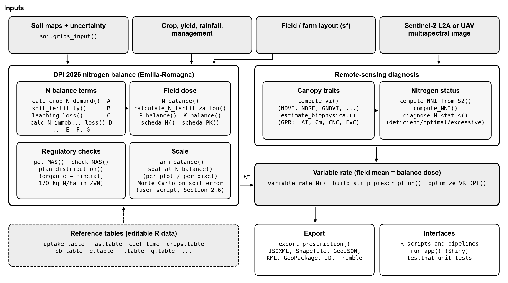
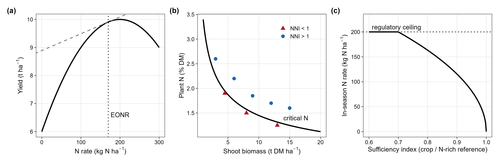
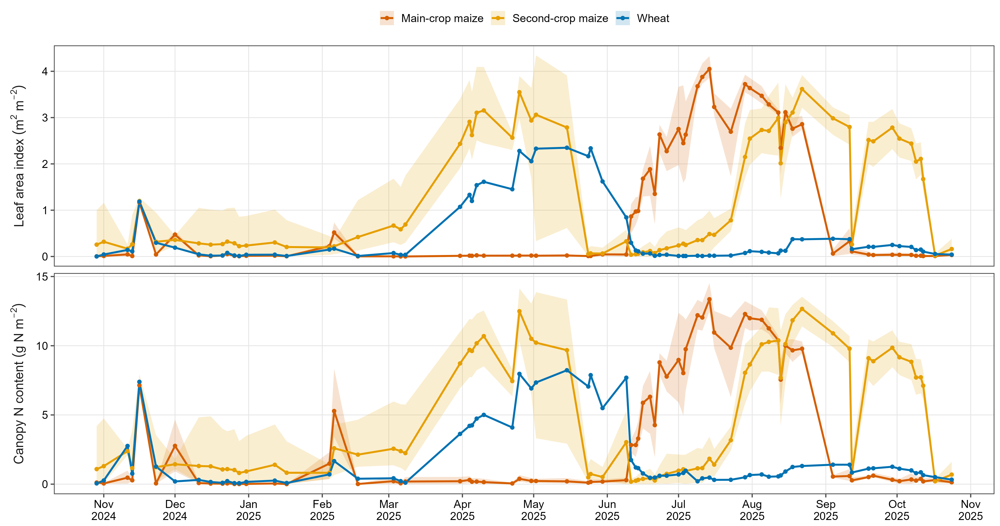
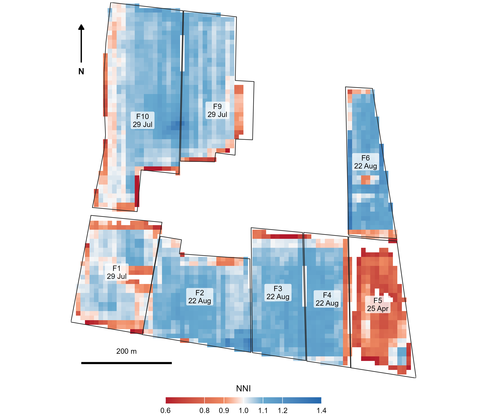
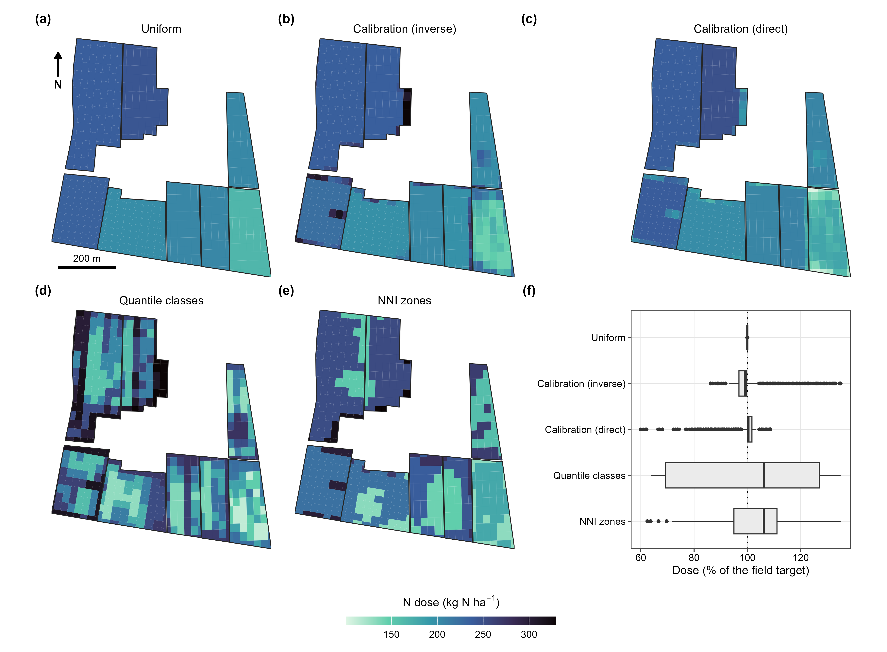
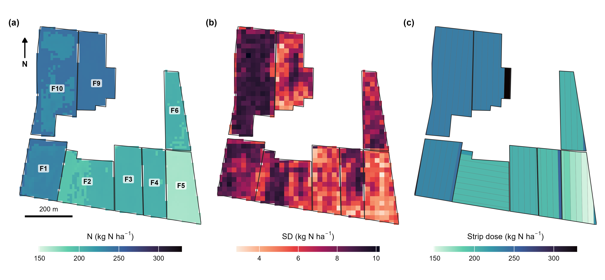
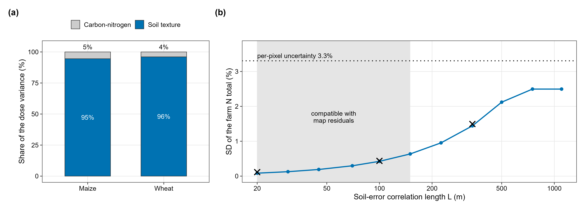
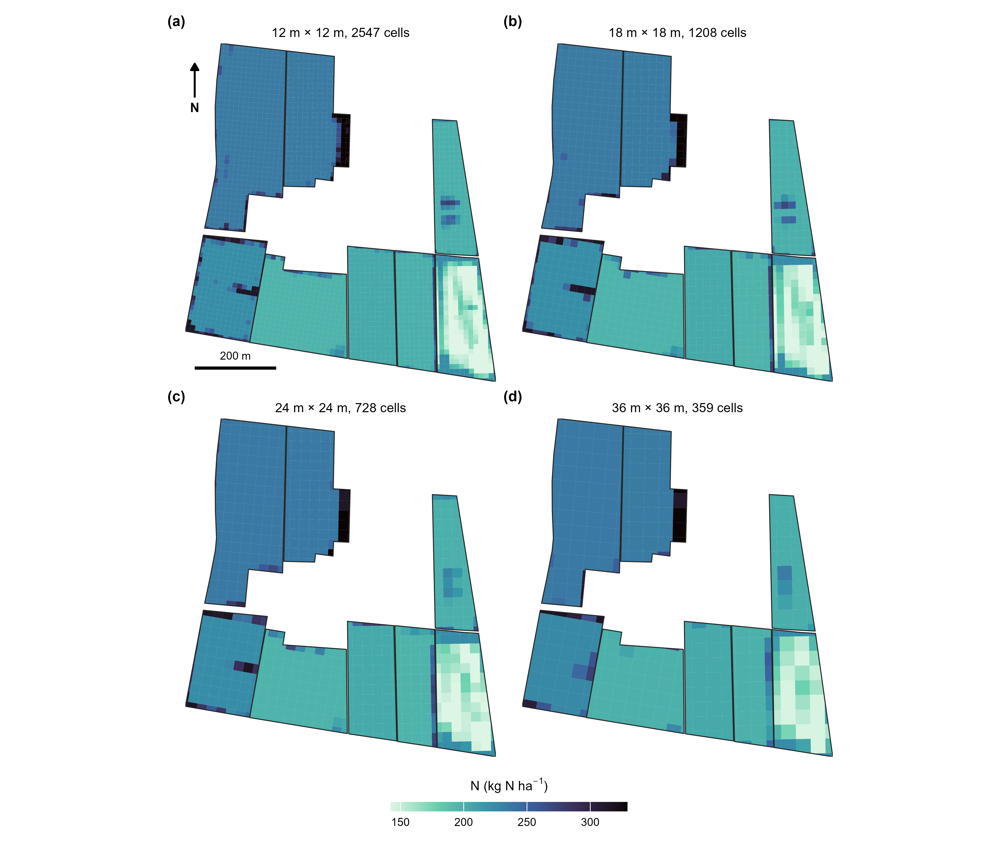
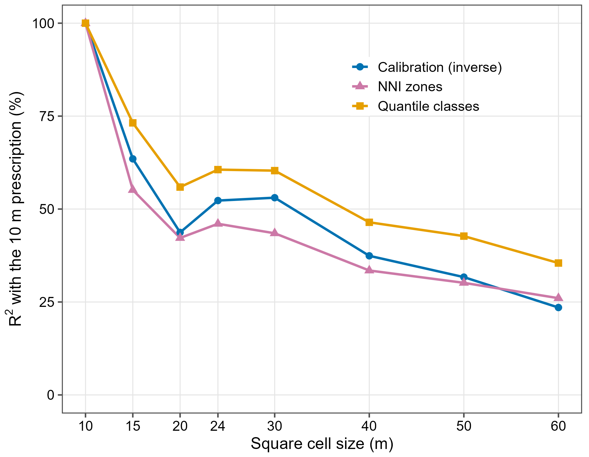

<!--
Single Smart Agricultural Technology manuscript, merging the earlier SAT draft (soil-input
uncertainty, correlation length) with the SoftwareX manuscript (NFert 1.0.0); the verification against Fert_Office is package documentation, not part of this paper. Every CERZOO number comes from the scripts in paper/sat/ (01 to 05) and the CSV
files in paper/sat/data/; the management inputs of the case study are in
paper/sat/cerzoo_field_inputs.csv. Items that only the authors can supply stay marked
`[confirm ...]` or `[CITATION NEEDED: ...]` and must be resolved before submission.
Conventions: no em or en dashes (ranges as "X to Y"); "percent"; SI units.
-->

## Highlights

- Open R tool runs a regulatory nitrogen balance from soil pixel to farm total
- Soil texture, not organic carbon, drives soil-map error in the regulatory N dose
- Soil-map errors show no detectable spatial structure; farm N total SD below 1 %
- Measured rainfall raised the farm N dose 26 %, pushing 4 of 8 fields over the cap
- Sentinel-2 NNI strips keep the field N target and export to farm monitors

## Abstract

Regulatory nitrogen balances set the maximum fertilizer dose from soil texture and organic
matter, which digital soil maps now supply pixel by pixel, yet how reliable such a dose is, and
how that reliability changes from the pixel to the farm total that regulators audit, is rarely
quantified. We built NFert, an open-source R package that implements the Emilia-Romagna
Integrated Production nitrogen balance (DPI 2026), couples it under one mass-balance constraint
to a Sentinel-2 diagnosis of nitrogen status and a machine-ready variable-rate prescription, and
propagates soil-map uncertainty by correlated Monte Carlo from the pixel to the farm. We
evaluated it on the CERZOO experimental farm (Po Valley, Italy; eight maize and wheat fields,
32 ha, 6.9 t of nitrogen). The per-pixel dose uncertainty was 3.3 percent, and 95 to 96 percent
of it came from soil texture, unlike a published process-model recommendation, where soil organic
carbon dominated. Leave-one-out residuals of the soil maps showed no detectable spatial structure at the 45 m
sampling spacing, which places the farm in the short-range regime: the standard deviation of the farm nitrogen
total is at most about 0.6 percent, against 2.5 percent if the map errors were systematic. Under the rainfall measured in 2024 to 2025 the farm dose rose by 26 percent and exceeded the
maximum allowed dose on four of the eight fields. Within a regulatory balance, the soil-map error
of a well-sampled farm is therefore a second-order uncertainty, and the weather input matters
more for compliance.

**Keywords:** variable-rate nitrogen; nutrient balance; uncertainty propagation; multi-scale
nutrient accounting; Sentinel-2; reproducible research

---

## 1. Introduction

Fertilization is among the most consequential decisions in arable cropping, and the rate of
nitrogen applied is the decision that most directly determines its outcome: the yield and
quality achievable, the profitability of the operation, and the size of the nitrogen surplus
lost to water and air [@oenema2003; @sutton2011]. The rate is a constrained optimization in
which agronomic, economic and regulatory objectives must be satisfied at once, and for nitrogen
the regulatory ceiling is explicit: the European Nitrates Directive constrains application in
vulnerable zones [@nitrates1991], and regional integrated-production schemes translate it into
an auditable field budget [@dpi2026].

The methods proposed to set the nitrogen rate form a small number of recurring families:
regulatory or mass-balance budgets; soil-test and standard-dose schemes; crop-growth models;
sensor-based empirical algorithms; biophysical diagnosis through the Nitrogen Nutrition Index (NNI);
and, more recently, machine learning. A scoping review of side-dress recommendation systems
found the empirical, vegetation-index-based family dominant, with mechanistic and
machine-learning systems a minority [@corti2022]. Here we take the families as given and
address three gaps that a practical tool must close.

The first gap is integration. A reflectance index resolves within-field variability but sets no
field-level ceiling, while a mass balance sets a defensible ceiling but no spatial pattern; the
two are rarely coupled in one reproducible workflow, so a sensor-driven map and a compliant
budget are seldom reconciled [@raun2002; @holland2010]. The second gap is openness and reproducibility. The regulatory methods are typically locked in closed regional spreadsheets, and
research code is fragmented and often not versioned or inspectable, which undermines replication
and cross-region transfer [@seibold2021; @wilkinson2016]. The third gap, less often made explicit, is that operational tools give a deterministic rate at a
single scale: they ignore the uncertainty of their soil inputs, and they disconnect the field
decision from the farm accounting that advisers and regulators need.

Propagating the error of digital soil maps through a model is established practice in spatial
modelling, and so is the result that the uncertainty of a spatial total depends on how the map
errors are correlated in space [@heuvelink1989; @heuvelink1999; @wadoux2023]. The closest
application to fertilization propagated soil-map uncertainty through the QUEFTS crop model into
nitrogen, phosphorus and potassium recommendations, found that soil organic carbon drove almost
all of the nitrogen uncertainty, and that the Monte Carlo doses differed from the deterministic
ones [@takoutsing2024]. Regulatory balances differ from such process models in two ways that
matter for uncertainty. Their coefficients change in steps across soil classes, and the decision
they support is legal: a field dose bounded by a crop maximum and a farm total that is audited.
To our knowledge, no study has quantified how soil-map uncertainty propagates through a
regulatory nitrogen balance, which soil property it comes from, how it scales from the pixel to
the audited farm total, or how it compares with the weather input that the same balance needs.
On the tool side, the regulatory calculation is usually a closed spreadsheet or web service
[@fertoffice2026; @donauer2025], and the sensor-based prescription tools that resolve the
within-field pattern do not enforce the regulatory budget [@hamie2026; @vizzari2019;
@santaga2021]. Compatibility with compliance demands is one of the factors that decide whether
farmers and advisers adopt a decision-support tool [@rose2016]. Table 1 compares NFert with the
closest published tools and studies.

**Table 1.** NFert and the closest published nitrogen tools and studies. Properties are as
reported in each publication (abstracts and main text as available); "Not stated" means the
publication does not report it. [confirm each row against the full texts]

| Tool or study | Method family | Regulatory budget | Spatial unit | Soil-input uncertainty | Remote sensing | Machine export | Open code | Evidence |
|---|---|---|---|---|---|---|---|---|
| Fert_Office [@fertoffice2026] | Regional balance, spreadsheet | Yes (DPI) | Field | No | No | No | No | Regional reference |
| webBESyD [@donauer2025] | Nutrient balance, web | Yes (German rules) | Field, farm | No | No | No | Not stated | Software description |
| Takoutsing et al. [@takoutsing2024] | Crop model (QUEFTS) | No | Pixel | Yes, Monte Carlo | No | No | Not stated | Regional case study |
| Basso et al. [@basso2016] | Crop model, VRT | Nitrate-vulnerable zone | Zone | No | No | No | No | Simulation case study |
| Vizzari et al.; Santaga et al. [@vizzari2019; @santaga2021] | Balance + NDVI VRT | Field balance | Zone | No | Sentinel-2 | Prescription map | Not stated | Field trials |
| AgroSat [@hamie2026] | NDVI VRT, web | No | Zone | No | Sentinel-2 | Prescription map | Not stated | Farm case study |
| NFert (this work) | Regional balance + NNI VRT | Yes (DPI, MAS) | Pixel, field, farm | Yes, correlated Monte Carlo | Sentinel-2 | Yes (ISOXML and others) | Yes (MIT) | Farm case study |

We built NFert, an open, versioned R implementation of the Emilia-Romagna regulatory nitrogen
balance coupled to a Sentinel-2 diagnosis and a variable-rate prescription [@nfert2026], and
used it on a 32 ha farm to answer four questions:

- RQ1. Can a within-field redistribution driven by the Sentinel-2 Nitrogen Nutrition Index keep
  the regulatory field target and be delivered as a machine prescription, and how much pattern
  is lost as the machine cell grows?
- RQ2. How large is the uncertainty of a regulatory nitrogen dose computed from digital soil
  maps, and how does it scale from the pixel to the farm total, given the measured spatial
  structure of the map errors?
- RQ3. Which soil property controls that uncertainty, and does propagating it shift the mean
  dose, as reported for process models?
- RQ4. How does the soil-map uncertainty compare with the effect of the weather input of the same
  balance, and what does each imply for the crop maximum allowed dose?

## 2. Materials and methods

### 2.1 Design and implementation

NFert is an R package (version 1.0.0, MIT license) with a single hard runtime dependency
(terra, for raster handling [@terra2024]) and optional packages that enable the Sentinel-2
retrieval, the machine-format exports and the interactive app. It is hosted on GitHub, tested by
a unit-test suite (169 tests, about 87 percent line coverage) run under continuous integration across
Linux, macOS and Windows, and archived with a persistent identifier [confirm DOI]. Its design
principle is that every coefficient table is an editable, inspectable object rather than a
hidden spreadsheet cell, so a recommendation can be verified, corrected and transferred. The
package exposes the balance, the diagnosis and the prescription as scriptable functions, and an
optional interactive interface. Figure 1 shows the architecture: the agronomic core (the balance
and its regulatory checks) feeds, under the mass-balance constraint, the precision module (the
vegetation-index engine, the biophysical retrieval, the NNI, the
variable-rate step and the export formats).



**Figure 1.** Architecture of NFert. The regulatory nitrogen balance sets the compliant field
budget; the precision module resolves the within-field pattern from Sentinel-2; the
mass-balance constraint reconciles the two into a variable-rate prescription, exported to
farm-monitor formats. The same computation is applied at field and farm scale, and the
propagation of the soil-map uncertainty is a short script on the open balance function. All
coefficient tables are editable R datasets.

The nitrogen rate rests on a small number of functional forms that recur across recommendation
methods and that NFert draws on (Figure 2): the yield response to nitrogen and its economic
optimum, the critical-nitrogen dilution curve and the NNI, and the sensor
sufficiency-index ramp. Each is detailed in the sections that follow.



**Figure 2.** Functional forms underlying the main nitrogen rate-setting methods that NFert
integrates. (a) The yield response to nitrogen and its economic optimum (EONR), the rate at
which the marginal yield value equals the nitrogen cost. (b) The species-specific
critical-nitrogen dilution curve and the NNI: canopy observations above
the curve are in luxury consumption (NNI above 1) and below it deficient (NNI below 1). (c) The
sensor sufficiency-index ramp: the in-season rate falls from the regulatory ceiling when the
canopy is deficient to zero when it is sufficient. The panels are schematic and illustrative,
not fitted to CERZOO data; panel (a) shows the economic-optimum module, which the case study
does not exercise.

A minimal end-to-end session is a few lines of R; the full arguments are documented in the
package help and vignettes:

```r
library(NFert)

# 1. Regulatory field dose from crop, yield and soil (DPI 2026 balance)
b <- N_balance(expected_yield_tons_ha = 9, crop = "Grano tenero FF (granella)",
               ccp = "Autumn-winter crop <150 days",
               sand = 30, clay = 38, Ntot = 1.3, SOM = 2.4, CN = 10)
calculate_N_fertilization(b)

# 2. The same balance per pixel on soil rasters, or per field across a farm
n_field <- spatial_N_balance(soil_stack, expected_yield_tons_ha = 9,
                             crop = "Grano tenero FF (granella)", ccp = ccp,
                             winter_rain = 150, start_spring_rain = 0,
                             prev_crop = "Maize stalks buried")
farm    <- farm_balance("fields.gpkg")

# 3. Sentinel-2 diagnosis and a machine-ready variable-rate prescription
bio <- estimate_biophysical("s2_scene.tif", output_dir = "bio")
nni <- compute_NNI_from_S2(bio$LAI, bio$Cm, bio$CNC_Cprot, crop = "maize", fvc = bio$FVC)
rx  <- build_strip_prescription(field, machine_width = 24, variability = "nni",
                                nni_raster = nni$NNI, n_target = 190)
export_prescription(rx, "prescription.shp")

# Optional: an open, global default soil layer from SoilGrids (no local map needed)
soil_stack <- soilgrids_input(field, crs_out = 32632)
```

### 2.2 Soil properties and their uncertainty (input layer)

The balance is a function of soil texture and of soil carbon and nitrogen, so a spatially
explicit and uncertainty-aware estimate of these properties is the first input. For the case
study, clay, sand, organic carbon and total nitrogen and their per-pixel uncertainty were
estimated from 20 georeferenced soil samples and a bare-soil Sentinel-2 Level-2A composite by a
multi-model machine-learning spatialization [CITATION NEEDED: the soil-spatialization method,
companion work]. For each property the best model was chosen among tree-based, linear and
penalized regressors by leave-one-point-out cross-validation, subject to a physical-plausibility
constraint (the map must stay within 15 percent of the range observed in the laboratory), and
the per-pixel uncertainty is the standard deviation of 25 bootstrap resamples. That estimation
is a separate contribution and is not the subject of this paper: the prediction and uncertainty
rasters are taken here as the soil input layer. A bootstrap standard deviation can understate the
total prediction error (the mean bootstrap deviation is 0.96 percent for clay, against a
leave-one-point-out RMSE of 2.90), so the hold-out RMSE of each property, in its own units (clay
2.90 and sand 3.47 percent, organic carbon 0.103 percent, total nitrogen 0.013 percent), was
used as the primary, more conservative soil-input uncertainty. An RMSE estimated from 20 points
is itself uncertain: under normal errors its 95 percent interval spans 0.77 to 1.44 times the
estimate, and the propagation was repeated at both ends (Section 2.6). An area-of-applicability
analysis [@meyer2021], which maps where a model interpolates among its training data, was run for
the preceding model run with the same points and predictors [confirm for the final maps]; 82
percent of the mapped area lies inside the area of applicability of all four properties at once
(84 to 91 percent for each property alone). The doses reported here are computed over the whole
mapped area, and the doses inside and outside the area of applicability are compared in Section
3.3.

Where a bespoke local soil map is not available, the same inputs can be built from the open,
global SoilGrids product (function `soilgrids_input()`), which supplies the balance properties
and their per-pixel uncertainty quantiles under a permissive licence [@poggio2021]. SoilGrids is
a 250 m global product with modest local accuracy, so it resolves the field-mean dose and the
farm total rather than the within-field pattern; it is used here as the open default that makes
the whole pipeline reproducible anywhere, and as a benchmark for the value of local sampling,
not as a substitute for it.

### 2.3 The regulatory nitrogen balance

The field nitrogen requirement is computed by the balance of Annex 2 of the Emilia-Romagna
Integrated Production Guidelines (Disciplinari di Produzione Integrata, DPI 2026; `N_balance()`),
which reconciles crop demand with soil supply and losses:

$$N = A - B + C_1 + C_2 + D - E - F - G$$

where A is the crop nitrogen demand (unit uptake times expected yield), B the soil nitrogen
supply (readily available plus mineralisable), C~1~ and C~2~ the autumn-winter and end-of-winter
leaching losses, D immobilization and dispersion, E the previous-crop residue credit, F the
residual effect of organic fertilization in previous years and G atmospheric deposition plus
biological fixation by legumes. Soil texture, organic matter, total nitrogen (in g per kg) and
the carbon to nitrogen ratio enter the supply and loss terms, which is why their uncertainty
propagates to the dose. Each term has its own exported function, and `N_balance()` returns all
of them, so a dose can be audited term by term. `calculate_N_fertilization()` then multiplies the
balance by the share admitted for the crop phase, bounds it to zero and to the crop ceiling, and
subtracts the nitrogen of the organic fertilisers applied in the current season. In this paper
the dose of the case study is the requirement before that last credit, because the aim is the
prescription of the total requirement and the distribution between organic and mineral sources
is a separate step (`plan_distribution()`, Section 2.5). The dose is checked against the crop
maximum allowed dose (MAS, `check_MAS()`) [@dpi2026; @rr2_2024]; the DPI allows the balance to
exceed the MAS only when the yields of the previous years document it, so NFert reports the
exceedance rather than truncating the balance silently. The balance reproduces the regional
decision tool Fert_Office [@fertoffice2026], and takes the tool, not the printed tables of the
guidelines, as the numerical reference where the two differ.

### 2.4 In-season diagnosis of nitrogen status

In-season status is diagnosed through the NNI, the ratio of the actual to
the critical nitrogen concentration along the species-specific critical-nitrogen dilution curve
(Figure 2b) [@lemaire1997; @justes1994; @plenet1999]. The canopy biomass and nitrogen the index
requires are retrieved from Sentinel-2 Level-2A reflectance by a hybrid Gaussian-process
regression trained on radiative-transfer simulations (`estimate_biophysical()`)
[@estevez2022; @verrelst2015], which `compute_NNI_from_S2()` combines into the index. A
multi-index vegetation engine (`compute_vi()`), including red-edge chlorophyll indices that
remain sensitive once the canopy closes, provides the empirical alternative
[@gitelson2005; @clevers2013]. The diagnosis requires an active canopy, which the tool
approximates by masking pixels below a leaf-area (open-canopy) threshold. The mask restricts the
diagnosis to a closed canopy but not, on its own, to the vegetative window in which the
critical-nitrogen curve is defined, so the acquisition dates are chosen within the crop window
(Section 2.8).

### 2.5 The variable-rate step and the economic optimum

The prescription follows the mass-balance constraint. The balance sets the field target dose N\*
(the balance dose capped at the MAS), and the nitrogen-status pattern sets the relative
distribution within the field. The two are reconciled by rescaling, so that the area-weighted
mean equals the target while every cell stays within the dose bounds. This rescaling keeps the
prescription compliant while redistributing nitrogen within the field (`build_strip_prescription()`
and `variable_rate_N()`, exported to farm-monitor formats by `export_prescription()`).

Five within-field strategies are compared in the case study, all on the same cells and with
dose bounds of 60 and 135 percent of N\*. Uniform applies N\* to every cell. Calibration
(inverse) maps the cell-mean NDVI to the dose along a two-point linear ramp (NDVI 0.35 to 0.80),
the lowest NDVI receiving the highest dose, as in side-dress compensation; Calibration (direct)
uses the same ramp with the opposite sign, the highest NDVI receiving the highest dose.
Quantile classes split the cells into five NDVI quantiles and assign an equally spaced dose
ladder, the lowest class receiving the highest dose. NNI zones assign the upper bound to
deficient cells (NNI below 0.9), N\* to optimal cells (0.9 to 1.1) and the lower bound to cells
in luxury consumption (above 1.1) [@lemaire1997]. Every strategy is then rescaled to N\*. The
package also provides the Holland and Schepers sufficiency-index curve
(`estimate_N_rate_from_holland_schepers()`, Figure 2c) [@holland2010; @raun2002], which the case
study does not use.

The builder tiles each field along its working direction, the A-B guidance line, into passes of
the chosen working width, optionally subdivided along their length into cells; the zonal-mean
dose is assigned to every strip or cell. By default the direction is the longest edge of the
field's minimum-area rotated rectangle, which minimises the number of passes and headland turns.
The operator can instead pass an explicit A-B line (for example a track recorded in the field) or
a fixed azimuth, so the prescription follows the driver's own guidance line, such as a slope
contour, a drainage line or a shared headland. Strips and cells are drawn in the local UTM zone,
so working width and cell length are true ground distances. Two further modules are available
but not used in the case study: an economic optimum from the QUEFTS crop model [@janssen1990],
capped by the regulatory dose (`optimize_VR_DPI()`), and an application plan that splits the dose
between organic and mineral fertilisers and enforces the 170 kg N per ha ceiling on organic
nitrogen in nitrate-vulnerable zones (`plan_distribution()`).

### 2.6 Propagation of the soil uncertainty

The balance is a deterministic function of the soil inputs, so their uncertainty maps onto the
dose. This uncertainty was propagated by Monte Carlo with correlated Gaussian draws, on a 20 m
analysis grid (a two-fold aggregation of the 10 m soil maps; 866 pixels), so that the structure
of the soil data is respected rather than each property drawn independently. In each draw a
property was perturbed by adding a normal deviate with standard deviation equal to its hold-out
RMSE (Section 2.2): clay and sand were drawn jointly with the empirical clay-to-sand correlation
(-0.644) and constrained so that clay, silt and sand sum to 100 percent (silt as the residual,
sand capped at 98 minus clay), while organic carbon and total nitrogen were drawn jointly with
their empirical correlation (0.904) so that the carbon-to-nitrogen ratio stays physically
plausible, with organic carbon and total nitrogen floored at small positive values. The balance
was evaluated per pixel over K = 100 draws from a fixed seed, accumulating the per-pixel mean and
standard deviation of the dose. A separate variance decomposition perturbed one correlated group
at a time (texture, then carbon-nitrogen) over 3000 draws at the mean soil of each field, and
reports each group's first-order contribution to the dose variance as a share of their sum, so
the small texture-by-carbon-nitrogen interaction is absorbed into the two reported shares; the
shares are averaged over the fields of each crop, weighted by area.

The dependence of the aggregate uncertainty on the spatial structure of the soil error was
modelled, not assumed. The soil error was assigned a spatial correlation length L, and the mapped
area A was treated as a mosaic of independent correlation blocks of side L, giving an effective
number of independent samples n~eff~ = min(max(A / L^2^, 1), N) over the N mapped pixels. For a response that is linear in the soil error, the standard deviation of the farm total is then
SD~sys~ / sqrt(n~eff~), where SD~sys~ is its standard deviation under a fully systematic error
(n~eff~ = 1). SD~sys~ was obtained by Monte Carlo at pixel level (400 draws): in each draw a single
correlated soil-error realisation per property (with the clay-sand and carbon-nitrogen correlations
above) was applied to every pixel, the balance was re-evaluated per pixel and summed to the farm
total. The block formula was checked by re-evaluating the pixel-level balance with each property's
RMSE scaled by 1 / sqrt(n~eff~) at two correlation lengths (100 and 340 m, 150 draws each), and its
short-range end against the independent per-pixel Monte Carlo above. Sweeping L from the pixel size
(20 m) to beyond the farm extent (1100 m) traces the standard deviation of the total from the
short-range regime, in which the per-pixel errors average out (n~eff~ approaches N), to the
long-range regime, in which a systematic error persists undiminished on aggregation (n~eff~ = 1). This block model is a
transparent first-order description of how spatial correlation controls the aggregate
uncertainty [@heuvelink1999; @wadoux2023].

The correlation length of the CERZOO map errors was then bounded from the data, following the
idea of estimating the error correlation from standardised residuals [@wadoux2023]. Per-point
leave-one-out predictions are not stored by the soil mapping pipeline, so a random forest was
re-fitted on the same bare-soil Sentinel-2 predictors; it reproduced the leave-one-point-out RMSE
of the maps within 5 percent (clay 2.87, sand 3.56, organic carbon 0.107, total nitrogen 0.013
percent). The residuals were divided by their RMSE, pooled over the four properties, and their
semivariance was computed in five distance classes (0 to 150, 150 to 300, 300 to 450, 450 to 600
and 600 to 1000 m; 31 to 47 point pairs each; minimum spacing 45 m). Spatial structure would
lower the semivariance at short distances, so each class was compared with the 95 percent
envelope of 999 random permutations of the residuals among the sampling points.

Two further checks used the same per-pixel Monte Carlo. The mean shift is the difference between
the Monte Carlo mean dose and the deterministic dose on the same 20 m support, per field and for
the farm, because thresholds in a model can shift the mean as well as add spread
[@takoutsing2024]. The sensitivity to the input error repeated the per-pixel Monte Carlo (50
draws) with every RMSE multiplied by the two ends of its 95 percent interval (0.77 and 1.44).

### 2.7 Field and farm aggregation

The same balance was evaluated at two nested scales. At the field scale the per-pixel
prescription and its uncertainty band were produced on the 10 m grid by applying the balance to
the soil-property rasters (`spatial_N_balance()`). At the farm scale the balance was run per
field with the field crop and yield, and the per-field dose, the field nitrogen total and the farm
total were aggregated with their propagated uncertainty. The per-field totals are a strict
sub-aggregation of the farm total, so the two scales share one computation and are not
double-counted.

### 2.8 Case study and data

The field and farm scales are demonstrated on the CERZOO experimental farm of the Università
Cattolica del Sacro Cuore, in the Po Valley near Piacenza. The farm comprises eight fields with
the crops declared for 2025 (silage maize as a main crop, silage maize as a second crop with or
without a preceding grass, and soft wheat), covering 32.06 ha of mapped soil. The expected
yields that drive the balance demand term (silage maize 70 t/ha fresh forage for the
well-managed main crop and 60 t/ha for the second crop, soft wheat 6 t/ha grain) are benchmarked
against the official provincial statistics for Piacenza (silage maize 43 to 65 t/ha fresh, soft
wheat about 6 t/ha, 2020 to 2025) [@istat_coltivazioni]: the wheat and second-crop values sit at
the provincial mean and range, while the main-crop 70 t/ha is an upper-range value for a fully
irrigated field, above the rain-fed provincial average. The main case study uses the DPI
reference weather (150 mm of rain from October to January and none in February, so that the
leaching terms are zero), the previous crop recorded as maize stalks buried, and the main
maize phase (spring-summer, 100 to 130 days) for all maize fields, including the second crops;
wheat is an autumn-winter crop shorter than 150 days. A sensitivity run uses the rainfall
measured in 2024 to 2025 (301 mm from October to January, 98 mm in February) and the recorded
previous crops. All inputs are listed in `paper/sat/cerzoo_field_inputs.csv` and
`cerzoo_field_inputs_season.csv` [confirm the management inputs]. Soil properties were taken
from the input layer of Section 2.2; in-season nitrogen status used the Sentinel-2 Level-2A
scene of highest mean NDVI of 2025 in the crop window of each field (wheat March to June, maize
June to September). All analyses were run in R version 4.5.1 [@rcore2025] with terra
[@terra2024] and NFert. The package and the analysis scripts are openly
available at https://github.com/mcroci/NFert [confirm: DOI]. The soil input maps of Section 2.2
are produced by a separate, proprietary pipeline [CITATION NEEDED: companion work] and are
available from the provider; where they cannot be released, the package function
`soilgrids_input()` rebuilds the whole pipeline on the open, global SoilGrids layer (250 m,
CC-BY 4.0) [@poggio2021], so the tool and its computation are reproducible from open code and
data even without the proprietary maps, at the cost of the coarser resolution discussed in
Section 2.2.

## 3. Results

### 3.1 In-season diagnosis and variable-rate prescription (RQ1)

The Sentinel-2 time series resolves the cropping calendar of the whole farm: main-crop maize as a
summer peak, the second-crop fields as a spring peak (the preceding winter crop) followed by a
late-summer maize peak, and wheat as a spring peak, with the Gaussian-process retrieval tracking leaf area and
canopy nitrogen through each cycle (Figure 3). At peak canopy the NNI moves
between deficiency, optimal status and luxury consumption, and it varies within every field
(Figure 4). At its peak on 25 April, 76 percent of the wheat pixels are in the deficient class,
whereas the optimal class dominates in five of the seven maize fields (58 to 81 percent of the
pixels); in the second-crop fields F4 and F6 the excess class dominates (49 and 62 percent). This in-season
within-field variation, and not the soil (Section 3.2), is what the variable-rate step
redistributes.



**Figure 3.** Farm-scale seasonal canopy trajectories at CERZOO, retrieved from the Sentinel-2
time series (October 2024 to October 2025, cloud-masked scenes) by Gaussian-process regression: leaf area index (top) and canopy nitrogen content (bottom) as the crop-group mean (line) with the field-to-field range (band). Main-crop
maize peaks in summer, the second-crop fields in spring (the preceding winter crop) and again in
late summer (the maize), and wheat in spring.



**Figure 4.** In-season NNI across the CERZOO farm, each field mapped at
its 2025 crop-specific peak canopy (date labelled: F5, wheat, on 25 April; the maize fields on 29 July or 22 August) from
Sentinel-2 by Gaussian-process biophysical retrieval and the species-specific critical-nitrogen
curve. The index moves between deficiency (red, below 0.9), optimal status (pale, 0.9 to 1.1) and luxury consumption (blue, above 1.1), and it varies within every field; NNI = 1 is the
theoretical critical value and 0.9 to 1.1 the operational band around it. The absolute index is
a first-guess, relative diagnosis: the biophysical retrieval uses uncalibrated leaf-allocation
and nitrogen-to-chlorophyll coefficients that can bias the absolute NNI by
15 to 30 percent, so the classes should be read as relative status, not as calibrated absolute
values.

Under the mass-balance constraint, the five prescription strategies all reproduce the field
target to within 0.04 kg N per ha while differing in within-field contrast (Figure 5). The two
calibrations move 1.1 and 2.1 percent of the farm nitrogen between cells of the same field, the
NNI zones 7.6 percent and the quantile classes 11.3 percent; 13 percent of the area reaches the
dose bounds with the quantile classes, against 4 percent or less with the other strategies.



**Figure 5.** Variable-rate prescription maps across the eight CERZOO fields under five
strategies (uniform, calibration inverse and direct, vegetation-index quantile classes, and
NNI zones), each constrained to its own field target and shown on a common colour scale. The uniform strategy varies only between fields (by crop), while the sensor-driven
strategies add the within-field pattern from the canopy. The last panel gives the area-weighted distribution of the prescribed dose relative to the field target for each strategy (box: quartiles; whiskers: 1.5 times the interquartile range): uniform sits at the target; the two calibrations spread it moderately (inverse 86 to 135 percent, direct 60 to 109 percent, mostly downward); the quantile classes and the NNI zones differentiate most (about 62 to 135 percent).



**Figure 6.** Farm-scale application on the eight CERZOO fields in one computation: (a) the
nitrogen dose, with the crop-driven contrast between the main-crop maize fields (F1, F9,
F10), the second-crop maize fields (F2, F3, F4, F6) and the wheat field (F5); (b) the
soil-propagated standard deviation of the dose; (c) the machine-width strip
prescription (24 m strips) delivered to the farm monitor. Within-field variation is small on
these homogeneous soils, so the between-field crop difference dominates the pattern, while the
propagated uncertainty (b) has a within-field texture of its own.

From the same computation the prescription is delivered as machine-ready strips (Figure 6c) or
as a two-dimensional cell grid (Section 2.5), always preserving the field mean. Changing only the machine geometry
re-tiles the whole farm automatically (Supplementary Figure S1): a 24 m strip delivery gives 58
passes over the eight fields, while a full two-dimensional grid ranges from 359 cells at a 36 m
working width to 2547 at 12 m, the finer machine resolving the within-field pattern more
closely. Each prescription is exported to the interoperable formats read by farm monitors
(shapefile, GeoJSON, KML, GeoPackage, ISOXML, and the John Deere and Trimble formats).

The choice of cell size trades machine simplicity against spatial fidelity, at a rate that
depends on the strategy. Reproducing the finest (10 m) within-field prescription with a coarser
square grid loses pattern progressively (Supplementary Figure S2): at a 24 m cell only about 46 to 61 percent of the finest pattern is reproduced, and by 60 m about 24 to 35 percent, the loss being fastest for the sharp NNI zones (up to 50 m) and most gradual for the vegetation-index quantile classes. On these
homogeneous soils this sets a practical cell size below which a finer machine adds little
differentiation.

### 3.2 Farm nitrogen accounting

Aggregating the per-field dose to the farm gives a total of 6.91 t N over 32.06 ha (215 kg N per
ha, area-weighted), with the per-field totals ranging from 0.55 t on the smallest second-crop
field to 1.64 t on the largest main-crop maize field (Table 2). Every field is below its MAS.

**Table 2.** Per-field and farm nitrogen accounting at CERZOO under the DPI reference weather:
crop, expected yield, area, area-weighted mean dose, crop maximum allowed dose (MAS)
and nitrogen total (source: `paper/sat/data/farm_accounting.csv`). Silage-maize yields are fresh
forage weight; the wheat yield is grain.

| Field | Crop | Yield (t ha^-1^) | Area (ha) | Mean dose (kg N ha^-1^) | MAS (kg N ha^-1^) | N total (t) |
|-------|------|------------------|-----------|-------------------------|-------------------|-------------|
| F1  | Silage maize                     | 70 | 3.90 | 234 | 280 | 0.91 |
| F2  | Grass + second-crop silage maize | 60 | 4.53 | 200 | 280 | 0.90 |
| F3  | Grass + second-crop silage maize | 60 | 3.23 | 205 | 280 | 0.66 |
| F4  | Grass + second-crop silage maize | 60 | 2.78 | 205 | 280 | 0.57 |
| F5  | Soft wheat                       |  6 | 3.67 | 166 | 190 | 0.61 |
| F6  | Second-crop silage maize         | 60 | 2.72 | 204 | 280 | 0.55 |
| F9  | Silage maize                     | 70 | 4.31 | 244 | 280 | 1.05 |
| F10 | Silage maize                     | 70 | 6.93 | 237 | 280 | 1.64 |
| **Farm** | **8 fields**                | **--** | **32.06** | **215** | **--** | **6.91** |

The dose is driven mainly by the crop and its expected yield between fields, from the main-crop maize
(F1, F9, F10; 70 t/ha fresh forage, about 240 kg N per ha) through the second-crop maize (60
t/ha, about 205 kg N per ha) to the wheat field (F5; 6 t/ha grain, 166 kg N per ha), because
within-field soil variation is small on these homogeneous alluvial soils: the within-field
coefficient of variation of the dose is 0.2 to 3.5 percent across the eight fields. On
such soils the balance alone gives a near-uniform field dose, and the within-field
variable-rate contrast comes from the in-season NNI (Figure 5) rather than
from the soil. The soil-propagated uncertainty, by contrast, has a spatial texture within each
field (Figure 6b), and it is this uncertainty, not a strong within-field dose gradient, that the
tool surfaces on homogeneous soils.

### 3.3 Soil-map uncertainty from pixel to farm (RQ2, RQ3)

The per-pixel standard deviation of the dose is 7.1 kg N per ha, or 3.3 percent of the dose
(Figure 6b). Soil texture contributes 95 percent of the dose variance for maize and 96 percent
for wheat, soil carbon and nitrogen the remainder (Figure 7a). Propagation hardly shifts the mean:
the Monte Carlo mean dose differs from the deterministic dose by -1.8 to +1.5 percent per field
(-3.6 to +3.6 kg N per ha) and by -0.4 percent for the farm. With the RMSE at the ends of its 95
percent interval, the per-pixel uncertainty becomes 2.8 and 3.8 percent: a 44 percent larger
input error raises it by only 16 percent, because the class thresholds of the balance, not the
size of the error, set most of the response. Doses inside and outside the area of applicability
differ by 3 percent (217 against 210 kg N per ha; 82 and 18 percent of the mapped area).

How the pixel uncertainty scales to the farm total depends on the spatial correlation of the map
error (Figure 7b). Under the block model, the standard deviation of the farm nitrogen total rises
from 0.1 percent when the error decorrelates within a pixel to 2.5 percent when it is systematic.
The systematic value stays below the 3.3 percent per-pixel uncertainty because the pixels cross
the class thresholds of the balance at different points of the same error, so even a common error
does not move all pixel doses together. Direct re-evaluation at two correlation lengths gives
0.44 and 1.50 percent, within 4 percent of the block model (0.42 and 1.44 percent). The
leave-one-out residuals of the soil maps show no spatial structure: in every distance class,
including the shortest (0 to 150 m), their semivariance lies inside the permutation envelope
(Supplementary Table S1). No spatial structure is detectable at the sampling spacing (45 m or
more); taking 150 m, the width of the first distance class, as a conservative bound, the block
model gives at most 0.6 percent for the farm total, and CERZOO sits in the short-range regime.



**Figure 7.** Sources and scaling of the soil-driven nitrogen-dose uncertainty. (a) Per-crop
decomposition into soil-texture and carbon-nitrogen contributions: texture dominates for both
crops, so denser texture sampling would tighten the dose most. (b) Standard deviation
of the farm nitrogen total as a function of the soil-error correlation length, from the
short-range (averaging) to the long-range (systematic) regime; crosses mark direct re-evaluations of the balance at two correlation lengths and, at the left end, the independent per-pixel Monte Carlo; the dotted line marks the per-pixel uncertainty (3.3 percent); the shaded band marks the correlation lengths compatible with the leave-one-out residuals of the soil maps (below 150 m).

### 3.4 Weather input and the maximum allowed dose (RQ4)

With the rainfall measured
in 2024 to 2025 (301 mm from October to January and 98 mm in February), all of the ready
nitrogen is leached before the crops use it, and the farm total rises to 8.71 t N (272 kg N per
ha), 26 percent more than under the reference weather. The dose then exceeds the MAS on four
of the eight fields: the three main-crop maize fields (302 to 309 kg N per ha against 280) and
the wheat field (231 against 190). Under the DPI such an excess is allowed only if the yields of
the previous years document it, which is why NFert reports the check next to the dose.

## 4. Discussion

### 4.1 What is established and what is new

The soil-map uncertainty of the regulatory dose at CERZOO is small and stays small on aggregation:
3.3 percent per pixel and at most about 0.6 percent for the farm total, because the map errors
show no detectable spatial structure at the sampling spacing. That the uncertainty of a spatial total depends on the
correlation of the errors, and that systematic errors do not average out, is established
[@heuvelink1989; @heuvelink1999]; so is estimating that correlation from map residuals
[@wadoux2023]. What this study adds is the application to a legal instrument: a dose bounded by a
crop maximum and a farm total that is audited, computed by a balance whose coefficients change in
steps across soil classes. The full correlation-length curve (Figure 7b) is kept because it tells
a user of another map where the farm total would sit if the map errors were spatially
structured; the residual analysis places CERZOO at the short-range end. The bound rests on 20
points with a minimum spacing of 45 m and on 31 point pairs in the shortest distance class, so the
test can exclude only strong structure, and structure at shorter distances cannot be excluded; it
would raise the farm uncertainty only within the shaded band of Figure 7b.

### 4.2 The form of the model decides which soil property matters

In the regulatory balance, soil texture produced 95 to 96 percent of the dose variance, whereas a
Monte Carlo propagation through the QUEFTS crop model attributed almost all of the nitrogen
uncertainty to soil organic carbon [@takoutsing2024]. The difference follows from the model
structure, not from the maps. In the DPI balance, texture sets the soil-supply coefficients and,
in wet seasons, the leaching terms, and those coefficients change in steps between texture
classes; organic carbon and total nitrogen enter through smoother terms and a carbon-to-nitrogen
class. A similar dominance may therefore be expected on other farms under the same guideline, and
the practical implication is that sampling for a regulatory dose should target texture. The step
structure also explains two results that a smooth model would not produce: the mean dose shifts
by up to 1.8 percent in either direction depending on where each field sits relative to a class
boundary, and the per-pixel uncertainty grows less than in proportion to the input error.
Takoutsing et al. [@takoutsing2024] found larger mean shifts with QUEFTS, a model whose response
to soil inputs is non-linear.

### 4.3 Soil uncertainty against weather

Under the rainfall measured in 2024 to 2025, the farm dose rose by 26 percent and four fields
exceeded the MAS, whereas the soil-map uncertainty of the farm total was below 1 percent. The two
numbers are not the same statistic: the first is the difference between two weather scenarios,
the second a standard deviation. Placing them on a common scale requires the distribution of the
winter rainfall over many years, which this study did not use. Even as a scenario contrast,
however, the comparison shows where better information pays off for compliance: on a farm sampled
as densely as CERZOO, improving the soil map would barely change the farm total, whereas the
weather input moves the dose across the legal cap. This is a value-of-information argument in the
sense of Lark and Knights [@lark2015]. It also places the soil-map error against the 8 percent
coefficient of variation reported for whole-farm nitrogen surpluses [@oenema2015] and the larger
uncertainty of the loss terms of nutrient budgets [@oenema2003].

### 4.4 The maximum allowed dose as a binding cap

The four fields above the MAS under measured rainfall do not indicate non-compliance. Two rule
layers meet there: the DPI balance, which a farmer follows voluntarily within the integrated
production scheme, and the MAS, the regional legal cap on crop nitrogen [@rr2_2024]. In a wet
season the balance asks for more than the cap allows, and the DPI admits the excess only when
earlier yields document it. NFert reports the check next to the dose for this reason. An
auditable record of that decision, with the inputs and the uncertainty that produced it, is the
kind of output that digital nutrient-management services can build on.

### 4.5 Limitations and validation roadmap

The prescriptions have not been validated agronomically: every number is an output of the model,
and the evidence on whether variable-rate nitrogen outperforms well-managed uniform application
is mixed, with input savings more consistent than yield or profit gains [@diacono2013;
@colaco2018]. We therefore claim no yield or profit gain, and call the CERZOO application a case
study. The natural next step is a strip trial on the same farm, comparing the uniform balance
dose with the NNI-driven prescription and measuring yield, crop nitrogen uptake and the nitrogen
nutrition index at a later date. The demonstration rests on one site and one season on
homogeneous alluvial soils, so the magnitudes reported here are site-specific; heterogeneous soils
would give a larger within-field dose contrast. Only the soil-input uncertainty was propagated,
not the error of the satellite retrieval, the weather or the balance coefficients. The NNI rests
on uncalibrated leaf-allocation and nitrogen-to-chlorophyll coefficients, with a potential bias
of 15 to 30 percent in the absolute index, so it serves here as a relative within-field
diagnosis. The area of applicability was computed for the preceding soil model run; doses inside
and outside it differ by only 3 percent.

## 5. Conclusions

Three results transfer beyond CERZOO. First, on a farm sampled at about one point per 1.6 ha, the
soil-map uncertainty of a regulatory nitrogen dose is small per pixel (3.3 percent) and smaller
still for the farm total (at most about 0.6 percent), because no spatial structure of the map
errors was detectable. Second, in a regulatory balance with class coefficients, soil texture rather than
organic carbon controlled that uncertainty, and may be expected to do so under similar guidelines,
so a sampling plan for compliance should target texture. Third, the weather input moves the dose and the compliance check far more than the soil
map does, and should be the next input to propagate.

NFert makes these analyses scriptable. The same open code computes the dose from the pixel to the
farm, couples it to a Sentinel-2 diagnosis and a machine-ready prescription, and records how each
number was obtained. The package already includes tested phosphorus and potassium balances and an
organic-mineral distribution planner; coupling them to the sensor-based prescription and to the
uncertainty propagation is future work. Because the coefficient tables are data, the same
machinery can be re-parameterised for other regional guidelines that use balance methods.

## Declarations

**CRediT authorship contribution statement.** [confirm per-author roles: Michele Croci:
conceptualization, methodology, software, writing; ... ]

**Declaration of competing interest.** The authors declare no competing interests. [confirm;
note any relationship with the soil-spatialization provider.]

**Funding.** This work was supported by the EOAGRITWIN project [confirm grant number and
programme].

**Data and code availability.** NFert is available at https://github.com/mcroci/NFert with an
archived release [confirm DOI]. The case-study analysis scripts and data (`paper/sat/`) and the scripts that produce the figures are in the same repository. The ISTAT
crop-yield benchmark (Section 2.8) and the open, SoilGrids-based soil pipeline are fully
reproducible from the scripts under `paper/data/` and the `soilgrids_input()` function, under
their respective open licences (Istat CC-BY 3.0; SoilGrids CC-BY 4.0). The soil input maps of
Section 2.2 are produced by a separate, proprietary pipeline and are available from [CITATION
NEEDED: companion work]; their access and credit are stated there.

**Declaration of generative AI and AI-assisted technologies in the writing process.** [confirm:
the authors state here whether and how AI-assisted tools were used, as required by the journal.]

**Acknowledgements.** The authors thank the Servizio Agricoltura Sostenibile of Regione
Emilia-Romagna for publishing the DPI 2026 guidelines and the Fert_Office tool. [confirm]

## Supplementary material



**Supplementary Figure S1.** Auto-generated two-dimensional variable-rate prescriptions for four
machine geometries (working width equal to cell length, 12 to 36 m) across the eight CERZOO
fields. The same builder re-tiles each field into cells and assigns the NDVI-driven dose per
cell while preserving the field mean, so a finer machine gives a finer grid (2547 cells at 12 m
to 359 at 36 m).



**Supplementary Figure S2.** Effect of the two-dimensional cell size on the spatial fidelity of
the prescription: the coefficient of determination between the coarse-grid prescription and the
finest (10 m) prescription, for the three within-field strategies, averaged over the eight CERZOO
fields. Fidelity is lowest for the NNI zones up to 50 m and highest for the vegetation-index quantile classes; the curves are not strictly monotonic because grids of 15 and 24 m are not aligned with the 10 m reference.


**Supplementary Table S1.** Semivariance of the standardised leave-one-out residuals of the soil maps (clay, sand, organic carbon and total nitrogen pooled), by distance class, with the 95 percent envelope of 999 random permutations of the residuals among the 20 sampling points. Values inside the envelope indicate no detectable spatial structure.

| Distance (m) | Point pairs | Semivariance | Envelope, 2.5 % | Envelope, 97.5 % |
|---|---|---|---|---|
| 0 to 150 | 31 | 1.07 | 0.76 | 1.33 |
| 150 to 300 | 31 | 1.15 | 0.75 | 1.39 |
| 300 to 450 | 47 | 1.03 | 0.80 | 1.38 |
| 450 to 600 | 44 | 1.17 | 0.83 | 1.28 |
| 600 to 1000 | 37 | 0.80 | 0.69 | 1.43 |

## References
