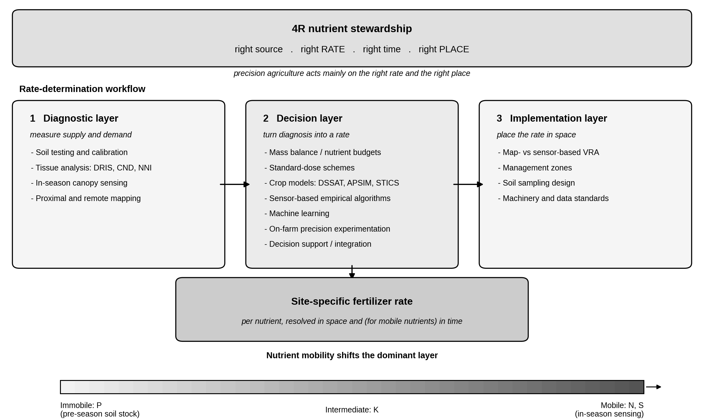
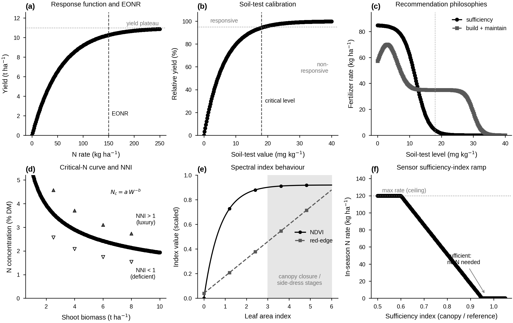
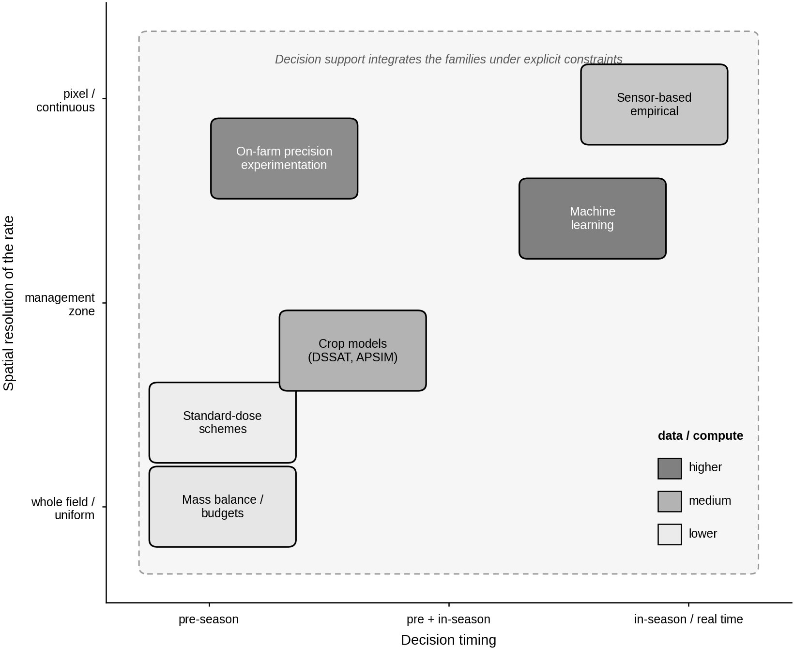
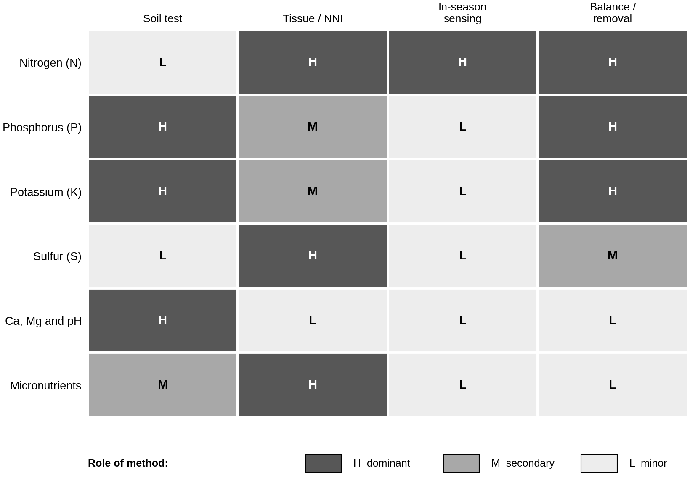
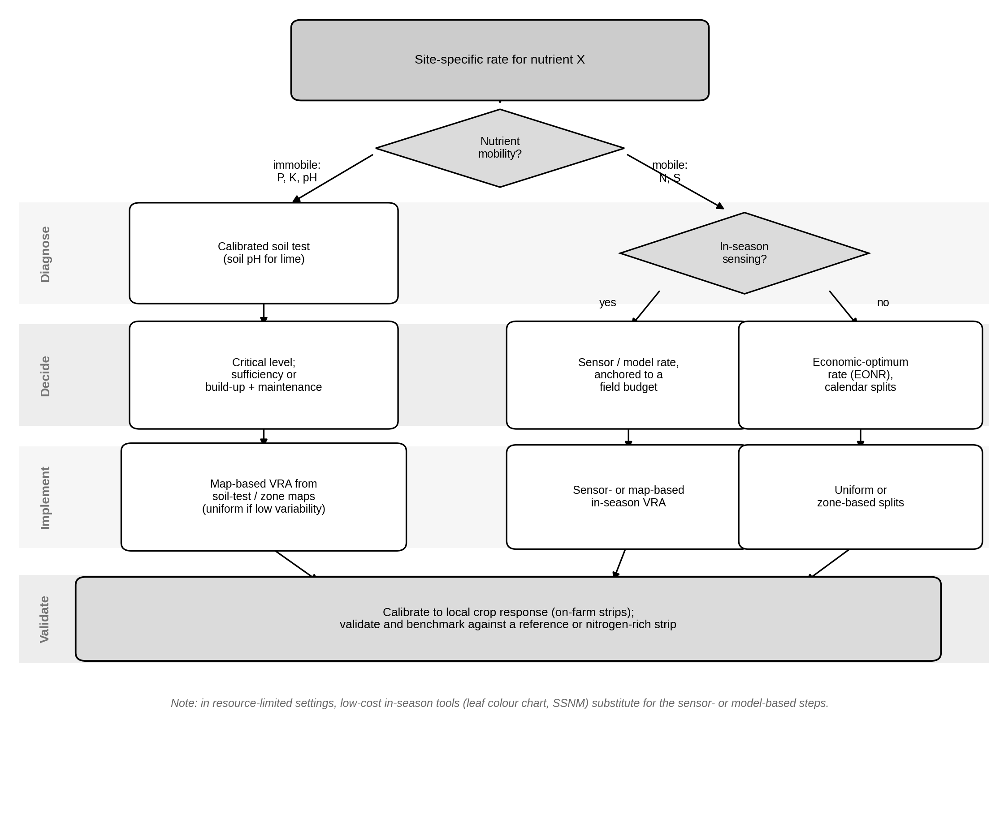

# Setting the rate, nutrient by nutrient: a methodological review of site-specific fertilizer rate determination in precision agriculture

*Working draft (restructured version). Language: English. Author conventions applied: no em or en dashes (ranges written as "X to Y"; hyphens only in reference page ranges), literal accented characters, colon separators in labels, third person. Citations are grounded in peer-reviewed and authoritative sources; entries without a verified identifier are flagged rather than given a fabricated DOI. The five figures are embedded at their relevant sections and were built as reproducible vector graphics through the scientific-figures pipeline.*

---

## Highlights

- Fertilizer rate determination is organized into diagnosis, decision and application layers.
- The dominant rate method differs by nutrient because soil mobility differs.
- Nitrogen relies on in-season sensing and balances; phosphorus and potassium on soil-test stocks.
- Sulfur and micronutrients rely on tissue testing where the soil test is weak.
- Gains of variable-rate over uniform application are real but mixed and context dependent.

## Abstract

The central operational question of precision nutrient management is not whether to fertilize but how much to apply, and where. Setting the rate is a constrained optimization: the supply of each nutrient must be matched to crop demand in space and time, subject to economic and, for some nutrients, regulatory limits. The methods developed to answer this question form a small number of recurring families, but the dominant family differs sharply among nutrients because nutrient behavior in the soil differs. Existing reviews tend to be organized either around a single nutrient, usually nitrogen, or around a single technology, usually soil or canopy sensing, and a cross-nutrient synthesis organized by the architecture of the rate decision is lacking. This review supplies that synthesis. It places the 4R framework as the umbrella, then organizes methods into three layers that mirror the workflow of a site-specific recommendation: a diagnostic layer (soil testing, plant and tissue analysis, in-season canopy sensing, proximal and remote mapping), a decision layer (mass balance, standard-dose schemes, crop models, sensor-based empirical algorithms, machine learning, on-farm precision experimentation, and the decision-support tools that integrate them), and an implementation layer (map-based and sensor-based variable-rate application, management zones, sampling design). It then contrasts the state of practice nutrient by nutrient. Mobile, dynamic nitrogen is managed mainly through mass balances, in-season canopy sensing and the Nitrogen Nutrition Index, with crop simulation models, machine learning and on-farm experimentation at the frontier. Immobile phosphorus and semi mobile potassium are managed through soil-test stocks interpreted by a critical level and by two competing philosophies, sufficiency and build-up plus maintenance, with crop removal driving the maintenance rate and spatial structure making sampling design decisive. Sulfur has re-emerged as a deficiency since atmospheric deposition fell, and its soil test is poorly calibrated, so tissue analysis and strip trials carry more weight. Micronutrients are diagnosed mainly by tissue analysis, occur in patchy patterns, and are corrected reactively, often by foliar application within narrow safe ranges. The evidence on whether variable-rate management outperforms well-managed uniform application is mixed and context dependent, with input savings and nutrient-use-efficiency gains more consistently demonstrated than yield or profit gains. Beyond the core families, the review treats the source dimension of organic amendments and enhanced-efficiency fertilizers, the temporal dimension from in-season to rotation scale, a practical guide for choosing a method, and the environmental, accounting and regulatory context that increasingly conditions the rate. The recurring conclusion is that the families are complementary rather than competing, and that the right method is the one matched to the nutrient, the data available, the required spatial resolution, the decision timing and the economic and regulatory context.

**Keywords:** precision agriculture; variable-rate application; nutrient management; nitrogen recommendation; soil testing; 4R nutrient stewardship; management zones; site-specific management

**Abbreviations:** 4R, right source, rate, time and place; CND, compositional nutrient diagnosis; DRIS, diagnosis and recommendation integrated system; ECa, apparent soil electrical conductivity; EONR, economic optimum nitrogen rate; LAI, leaf area index; NNI, nitrogen nutrition index; NUE, nitrogen use efficiency; PA, precision agriculture; SSNM, site-specific nutrient management; VRA, variable-rate application.

---

## 1. Introduction

### 1.1 Why the rate decision matters

Fertilization is among the most consequential and most frequently repeated decisions in arable cropping, and the rate of each nutrient applied is the decision that most directly determines its outcome. The rate sets, simultaneously, the yield and quality achievable, the profitability of the operation, and the size of the nutrient surplus that can be lost to water and air. The scale of the input makes the decision both economically and environmentally consequential: global nitrogen fertilizer consumption now exceeds 190 million tonnes per year, of which around 60 percent is applied to cereals, yet only about a third is recovered by the crop, the remainder representing at once a financial loss and a pollution load (International Fertilizer Association, 2024; Raun et al., 2002). Getting it wrong in either direction is costly: under-application caps yield and erodes margin, while over-application wastes input expenditure, lowers nutrient use efficiency, and drives losses such as nitrate leaching, phosphorus runoff and nitrous oxide emission. Four pressures therefore converge on the same number. Food security requires that yield not be left on the table. Economics requires that the marginal unit of fertilizer pay for itself, an imperative sharpened by volatile fertilizer prices. Environmental protection requires that surplus be minimized. Regulation, for nitrogen and increasingly for phosphorus, imposes ceilings that the rate must respect (Oenema et al., 2003; Sutton et al., 2011). The rate decision is, in short, a constrained optimization in which several objectives must be satisfied at once.

### 1.2 The premise of precision: within-field variability

Precision agriculture rests on an empirical premise: that within-field variability in soil, terrain and crop status is large enough that a single uniform rate is rarely optimal everywhere, and that geo-referenced data plus variable-rate machinery can place each nutrient where it is needed. The premise is not automatically true on every field. Its strength depends on whether the relevant soil and crop properties vary substantially within the field and, critically, whether that variation actually predicts the crop response to the nutrient. Where fields are uniform, or where variability does not translate into differential response, the case for site-specific rates weakens and a well-chosen uniform rate may be hard to beat. This conditionality is why the magnitude and structure of within-field variability, and its relationship to response, recur as the decisive factors in the economic evidence of Section 8. In practice the link between a measured soil property and the crop response is often loose: a single covariate such as apparent electrical conductivity has explained only on the order of one fifth of within-field yield variance in reported studies, so abundant variability in a sensor layer does not by itself guarantee a manageable response. This is why the methods below are valuable precisely to the extent that meaningful variability exists, can be measured, and actually relates to the nutrient response in question.

### 1.3 Why nutrients differ: mobility as the organizing axis

What is less often made explicit is that the rate question is answered very differently for different nutrients, because the underlying soil chemistry and crop physiology differ. Nitrogen is mobile and dynamic, so its availability changes within a season and is best diagnosed close to the time of demand. Phosphorus is strongly retained and immobile, so it is managed as a slowly changing soil stock with a pronounced and persistent spatial pattern. Potassium is intermediate, held on exchange sites but subject to fixation and to large removal in forage and straw. Sulfur, long supplied incidentally by atmospheric deposition, has re-emerged as a limiting nutrient as that deposition has declined. Micronutrients are needed in small amounts, occur in patchy field patterns, and are often corrected reactively. Nutrient mobility is therefore the single most useful organizing axis for a review of rate-determination methods, because it determines whether the rate can be set from a stable soil stock or must be diagnosed in season, and it explains why no single method dominates across nutrients.

### 1.4 What existing reviews cover, and the gap this review fills

The review literature on precision nutrient management is substantial but partitioned along two axes that leave a synthesis gap. Along the first axis, many of the most useful reviews are nutrient-siloed, treating one nutrient in depth: precision nitrogen management in wheat, for example, has been reviewed thoroughly (Diacono et al., 2013), and operational nitrogen side-dress recommendation systems have been classified by type, empirical, mechanistic or machine-learning, in a dedicated scoping review (Corti et al., 2022). Along the second axis, comprehensive reviews tend to be technology-siloed, organized around the sensing and data technologies rather than the nutrients: a recent comprehensive review of site-specific nutrient management is built around soil sensing technologies and concludes that electrochemical sensing and spectroscopy dominate the research and that no single sensor predicts all soil properties (Vullaganti et al., 2025). A third group consists of systematic, effectiveness-focused reviews that quantify outcomes across studies, for example a PRISMA review reporting that precision techniques improve nutrient use efficiency and yields across the analyzed evidence base (Bayu, 2025), or syntheses focused on whether crop sensors actually improve nitrogen management (Colaço and Bramley, 2018). What is missing is a review that is neither nutrient-siloed nor technology-siloed: a cross-nutrient synthesis that treats nitrogen, phosphorus, potassium, sulfur, the secondary nutrients and the micronutrients together, and organizes the field by the architecture of the rate decision rather than by a single nutrient or a single sensor. This review supplies that synthesis, with mobility as the organizing axis and the rate-determination workflow as the structure.

### 1.5 Scope and approach of this review

This is a structured narrative review rather than a systematic, protocol-driven one: it does not apply a PRISMA search-and-screen procedure or perform a quantitative meta-analysis, and it makes no claim to exhaustive coverage of the primary literature. Its scope is the productive macronutrients and the secondary and micronutrients of arable and forage systems, and specifically the methods used to set the application rate site-specifically. It draws on the foundational literature that established each method together with developments to the mid-2020s, prioritizing peer-reviewed sources and authoritative references and grounding quantitative claims in cited work. The organizing frame has three nested elements. The 4R nutrient stewardship framework is the umbrella, locating the rate decision among source, timing and placement (Section 2.1). Within it, the methods that set the rate are organized into three layers that mirror the workflow of a recommendation: a diagnostic layer that measures supply and demand (Section 3), a decision layer that turns that diagnosis into a number (Section 4), and an implementation layer that turns the number into a spatial prescription (Section 5). The nutrient-specific state of practice is then synthesized as a contrast across nutrients (Section 6), a practical guide for choosing a method is given (Section 7), the validation and the evidence on effectiveness and economics are weighed (Section 8), the environmental, accounting and regulatory context is set out (Section 9), and the open problems and likely directions are treated separately (Sections 10 and 11). Throughout, nitrogen, the most developed case, is kept in proportion with the other nutrients that determine balanced crop nutrition.

## 2. Conceptual framework

### 2.1 The 4R framework and where the rate sits

The 4R nutrient stewardship framework states that sustainable fertilization applies the right source at the right rate, the right time and the right place, and it is the most widely used organizing principle for nutrient management (IPNI, 2012; IFA, 2009). The four rights are interdependent and are optimized together, and precision agriculture contributes most directly to the right rate and the right place. The interactions with the other two rights are real and constrain the rate: a split application changes the relevant rate at each timing; a banded rather than broadcast placement changes the rate needed for the same availability; an enhanced-efficiency source changes the rate that achieves a target supply. A site-specific rate is therefore best understood not as an isolated number but as one component of a coherent nutrient plan, and the three-layer workflow used in this review sits inside the right-rate and right-place dimensions of the 4R umbrella, on the assumption that source and timing are specified.

### 2.2 The yield response function and the economic optimum

Every rate recommendation rests, explicitly or implicitly, on a yield response function: the relationship between the rate of a nutrient and the resulting yield. For a responsive nutrient the function rises steeply at low rates, bends as other factors become limiting, and plateaus or declines at high rates. The agronomically interesting feature is not the rate that maximizes yield but the rate that maximizes profit, the economic optimum, which falls below the yield maximum because the marginal yield gain eventually fails to pay for the marginal unit of fertilizer. For nitrogen this is formalized as the economic optimum nitrogen rate, the rate at which the marginal value of additional yield equals the marginal cost of nitrogen, and it shifts with the price ratio between grain and fertilizer (Puntel et al., 2016). The functional form assumed, linear-response-plateau, quadratic or quadratic-plateau, places the optimum at different rates, and because the response function varies among fields and among seasons, a single regional optimum is at best an average. That variability is the deeper rationale for the site-specific and season-specific approaches that follow.

### 2.3 Two recommendation philosophies: sufficiency versus build-up plus maintenance

For nutrients managed as soil stocks, chiefly phosphorus and potassium, two distinct philosophies have coexisted for decades and lead to materially different rates (Olson et al., 1987). The sufficiency approach, summarized as feeding the crop, supplies only the amount needed to reach near-maximum yield in the current season and recommends little or nothing once the soil test exceeds a critical level. The build-up plus maintenance approach, summarized as feeding the soil, first raises a low soil test toward a target level (build-up), then applies a maintenance rate roughly equal to crop removal to hold it there, and reduces application (drawdown) where the soil test is high. A national survey of land-grant university recommendations in the United States found these philosophies split roughly into sufficiency, build and maintain, hybrid and multiple-philosophy categories, and documented that recommendations for nominally identical soil-test values differ markedly among institutions, by extraction method and by interpretation (Lyons et al., 2023; Zhang et al., 2021). The practical consequence is that the same soil sample can yield very different rates depending on the laboratory and the philosophy, a caution against treating any single recommendation as ground truth.

### 2.4 Nutrient mobility and its consequences

The single most useful organizing fact, introduced in Section 1.3, is nutrient mobility in soil, because it determines whether the rate can be set from a stable soil stock or must be diagnosed close to the time of demand. Nitrogen, as nitrate, is mobile and subject to leaching, mineralization and immobilization, so its plant availability changes through the season and a pre-season soil test loses predictive value quickly, which is why nitrogen management leans on in-season diagnosis and on dynamic balances and models. Phosphorus is strongly sorbed and effectively immobile, so a soil test integrates the available stock well and a pre-season recommendation is stable, and its spatial pattern within a field is strongly structured and persistent. Potassium is held on cation exchange sites and is intermediate, well described by an exchangeable soil test but complicated by fixation and release in clay-rich soils and by large removal in high-biomass harvests. Sulfur as sulfate behaves somewhat like nitrate, mobile and leachable, which is one reason its soil test is unreliable. Micronutrient availability is governed strongly by soil pH and organic matter, and deficiencies are often localized. These contrasts recur throughout the review and structure the nutrient-by-nutrient synthesis of Section 6.

**Figure 1.** Conceptual framework of site-specific fertilizer rate determination. The 4R nutrient stewardship framework is the umbrella, and precision agriculture acts mainly on the right rate and the right place. Within it, the rate is set through a three-layer workflow: a diagnostic layer measures supply and demand, a decision layer turns the diagnosis into a rate, and an implementation layer places it in space, with decision support integrating the families. Nutrient mobility shifts the dominant layer, from pre-season soil-stock management for immobile nutrients such as phosphorus to in-season sensing and redistribution for mobile nutrients such as nitrogen and sulfur.

### 2.5 The source dimension: organic amendments and enhanced-efficiency fertilizers

The 4R right source is the dimension that interacts most directly with the rate, and two source choices change the rate enough to deserve explicit treatment. The first is the use of organic amendments and biological nitrogen. Manures, composts and digestates supply nutrients in variable and only partly available forms, releasing nitrogen over more than one season through mineralization, and they carry nitrogen, phosphorus and potassium in fixed ratios that rarely match crop demand, so that applying enough to meet the nitrogen requirement usually over-applies phosphorus. Legumes in the rotation leave a nitrogen credit that reduces the requirement of the following crop. In all these cases the mineral rate that the methods of Sections 3 and 4 should target is the residual after crediting the nutrients supplied by organic and biological sources, which is the basis of integrated nutrient management and of nutrient-budgeting approaches that account for all inputs and removals (Oenema et al., 2003). Recovered fertilizers derived from manure, promoted in the European Union as a route to greater nutrient autonomy, sit between organic and mineral sources and must be credited in the same way.

The second source choice is the fertilizer technology itself. Enhanced-efficiency fertilizers, which include urease and nitrification inhibitors, controlled-release and slow-release products, and stabilized nitrogen, slow the transformation or release of applied nutrients so that supply is better synchronized with uptake and losses are reduced. Because they change the fraction of applied nutrient that reaches the crop, they shift the response function: a meta-analysis of urease and nitrification inhibitors found gains in nitrogen use efficiency and yield relative to conventional fertilizer (Abalos et al., 2014), and meta-analytic syntheses report substantial reductions in nitrous oxide emissions from controlled-release fertilizers and from nitrification inhibitors. The practical implication for rate setting is twofold: a comparable agronomic outcome may be achievable at a lower rate, and the source can substitute for some of the timing precision that splitting would otherwise provide. The right source therefore conditions the right rate, and a complete site-specific plan specifies them together rather than treating the rate in isolation.

### 2.6 The temporal dimension: in-season, annual and rotation timescales

Just as mobility organizes the rate decision in space, time organizes it across three nested horizons. At the shortest horizon, mobile nutrients are managed within the season: nitrogen and sulfur supply changes between sowing and demand, so their rate is set, or adjusted, close to the time of uptake through splitting and in-season sensing. At the intermediate horizon is the rate for the current crop, the single number that most of this review addresses. At the longest horizon, immobile nutrients are managed as soil stocks over the rotation: the build-up plus maintenance philosophy of Section 2.3 operates over several years, raising or drawing down a soil test that responds slowly, so the phosphorus or potassium rate in any one year is a step in a multi-year trajectory rather than a self-contained decision. Carryover and residual effects link successive crops, and a rate that is optimal for a single season may be suboptimal for the rotation. This temporal structure has two consequences. It means that evaluating a rate method honestly often requires multi-year trials rather than a single season, and it means that frameworks which optimize a sequence of rates over a rotation, across the several nutrients that balanced nutrition requires, remain a genuine gap (Section 10).

## 3. The diagnostic layer: measuring supply and demand

The diagnostic and decision techniques in this and the next section rest on a few characteristic relationships, summarized schematically in Figure 2: the yield response function and its economic optimum, the soil-test calibration and its critical value, the two recommendation philosophies, the critical-nitrogen dilution curve underlying the Nitrogen Nutrition Index, the saturation of broadband versus red-edge spectral indices, and the sensor sufficiency-index ramp.

**Figure 2.** Schematic of the core diagnostic and decision techniques (illustrative curves, not fitted to data). (a) The yield response function rises to a plateau, and the economic optimum nitrogen rate (EONR) falls below the agronomic maximum. (b) Soil-test calibration relates relative yield to the soil-test value, with a critical level above which little response is expected. (c) The sufficiency philosophy supplies little above the critical level, whereas the build-up plus maintenance philosophy keeps applying a maintenance rate and adds build-up at low and drawdown at high soil-test levels. (d) The critical-nitrogen dilution curve Nc = a W^(-b) (winter-wheat coefficients; Justes et al., 1994) separates luxury consumption (NNI above 1) from deficiency (NNI below 1). (e) Broadband NDVI saturates once the canopy closes, while a red-edge index stays responsive, which is why red-edge indices are preferred at the side-dress stages. (f) A sensor sufficiency-index algorithm maps the canopy index to an in-season rate, capped by a ceiling and falling to zero as the crop approaches a well-fertilized reference.

### 3.1 Soil testing and calibration

Soil testing is the foundation of fertilizer recommendation for the soil-stock nutrients and remains widely used for nitrogen in some systems. A useful soil test follows a three-step logic established for extension practice: correlation of a routine extractant index with crop response, calibration of that index against field-trial yields, and translation into a recommendation (Dahnke and Olson, 1990; Fixen and Grove, 1990). Central to interpretation is the critical soil-test value that separates responsive from non-responsive sites, classically delineated by partitioning relative-yield data into two classes (Cate and Nelson, 1971; Mallarino and Blackmer, 1992); above the critical value little fertilizer response is expected, and at it yield is typically near 95 to 97 percent of maximum.

The extractant matters, and different regions use different chemistries: Mehlich-3, Mehlich-1, Bray and Olsen for phosphorus, and ammonium-acetate exchangeable potassium, among others. Because critical values and recommendation philosophies differ by extractant, region and institution, the same soil can produce different rates depending on which calibration is used (Lyons et al., 2023; Zhang et al., 2021). Open soil-test databases have been developed to improve the transparency of the underlying calibrations and to support harmonization (Lyons et al., 2020). For site-specific management the soil test must be georeferenced, which raises the sampling-design questions treated in Section 5.

### 3.2 Plant and tissue analysis and biophysical diagnosis

Plant tissue analysis diagnoses what the crop has actually taken up, which complements the soil test and is especially valuable where the soil test is weak, as for several micronutrients and for sulfur. The traditional interpretation compares a measured tissue concentration against a critical value, the point at which a shortage causes a defined yield loss, or against a sufficiency range. These univariate approaches are simple but sensitive to tissue age and growth stage, because nutrient concentration is diluted as biomass accumulates.

Two multivariate methods address that limitation by interpreting nutrient balance rather than single concentrations. The Diagnosis and Recommendation Integrated System, introduced by Beaufils, uses ratios between pairs of nutrients and ranks them from most deficient to most excessive, reducing the effect of tissue age and revealing the order in which nutrients are likely to become limiting (Beaufils, 1973). Compositional Nutrient Diagnosis extends this idea with compositional data analysis to avoid the additivity problems of the ratio approach (Parent and Dafir, 1992). Both require a calibrated set of norms from a high-yielding reference population, and those norms must be maintained as genotypes and management change.

For nitrogen specifically, biophysical diagnosis has matured into the Nitrogen Nutrition Index, the ratio of actual to critical nitrogen concentration along the species-specific critical-nitrogen dilution curve, with values below about 0.9 indicating deficiency, near 1.0 optimal status and above about 1.1 luxury consumption (Lemaire and Gastal, 1997; Houlès et al., 2007). The critical curve takes the power form Nc = a W^(-b), where Nc is the critical nitrogen concentration as a percentage of dry matter, W is the shoot biomass in tonnes per hectare, and a and b are species-specific (a = 5.35 and b = 0.442 in the original winter-wheat formulation; Justes et al., 1994), with lower values of a in C4 species such as maize, reflecting their lower critical nitrogen (Plénet and Lemaire, 1999). The coefficients are derived from dedicated experiments that isolate the minimum shoot nitrogen sustaining maximum biomass at a given dry matter, and species-specific parameters are established for winter wheat, maize, oilseed rape, rice, sorghum and sunflower, among others (Justes et al., 1994; Plénet and Lemaire, 1999; Colnenne et al., 1998; Sheehy et al., 1998; Oosterom et al., 2001; Debaeke et al., 2012). The Index is physiologically grounded and interpretable, but it requires biomass and plant nitrogen concentration, which are not routinely measured and must be retrieved from sensing (Section 3.4); recent reviews treat its estimation from remote sensing in detail (Silva et al., 2023).

### 3.3 In-season sensing of crop status

Because nitrogen status changes within a season, in-season sensing of the canopy underpins much of variable-rate nitrogen management. The simplest tools are hand-held chlorophyll meters that estimate leaf chlorophyll, a proxy for nitrogen, and are interpreted relative to a well-fertilized reference. Active canopy sensors, which carry their own light source and are insensitive to ambient illumination, scale this to the field: sensors such as the GreenSeeker and the Crop Circle underpin many in-season systems, and the in-season estimate of yield translates mid-season canopy reflectance into a variable nitrogen recommendation for cereals (Raun et al., 2002).

The spectral index used is critical. The normalized difference vegetation index is the historical default but saturates once the canopy closes and the leaf area index exceeds roughly 3 to 4, precisely at the side-dressing stages, so it loses sensitivity to additional biomass and nitrogen (Mutanga and Skidmore, 2004). Indices that exploit the red-edge region remain responsive to chlorophyll at high leaf area: red-edge chlorophyll indices provide a near-linear, broadly transferable estimate of canopy chlorophyll and nitrogen across maize, soybean and grass canopies, and red-edge indices from active sensors outperform broadband indices for diagnosing nitrogen status across growth stages (Gitelson et al., 2005; Clevers and Gitelson, 2013; Cao et al., 2013). Two algorithmic forms recur: a calibration ramp that maps the index to a rate from reference strips, and a sufficiency-index form that lowers the rate as the canopy index approaches a nitrogen-rich reference strip (Holland and Schepers, 2010). These methods resolve within-field variability and respond to the season, but a reflectance index is a proxy and, on its own, sets no field-level ceiling.

### 3.4 Proximal and remote mapping of soil and canopy

Mapping the field is the data foundation for both management zones and pixel-wise prescriptions. On the soil side, on-the-go proximal sensors generate high-resolution layers cheaply and non-destructively. Apparent electrical conductivity, measured by electromagnetic induction or by coulter-based contact sensors, responds chiefly to clay content and moisture and is the most widely used layer for zoning; gamma-ray spectrometry responds to clay mineralogy and parent material and complements conductivity; and visible and near-infrared spectroscopy estimates organic carbon, pH, texture and, with more difficulty, some nutrients (as documented in proximal soil-sensing reviews). Multi-sensor platforms now integrate conductivity, gamma, pH and spectroscopy on a single vehicle to map several soil properties in one pass, and have been used to derive site-specific lime requirement directly (site-specific lime-requirement studies on multi-sensor platforms, 2021). These data feed digital soil mapping, in which machine-learning models predict soil properties continuously from sensor and covariate layers, and recent work specifically targets fusion of proximal and remote sensing to improve phosphorus prediction.

On the canopy side, satellite constellations such as Sentinel-2 and Landsat, and uncrewed aerial vehicles carrying multispectral or hyperspectral cameras, provide repeated imagery across the season. The standard route from reflectance to a nitrogen-relevant variable is biophysical retrieval, in which the coupled leaf-canopy radiative transfer model is inverted to estimate leaf area index, canopy chlorophyll and canopy nitrogen. Hybrid retrieval, training a non-parametric regressor such as a Gaussian process on radiative-transfer simulations, has become the standard because it combines the physical generality of radiative transfer with the speed and uncertainty estimates of statistical regression (Jacquemoud et al., 2009; Verrelst et al., 2015, 2019; Berger et al., 2020; Weiss et al., 2020). These retrievals provide the biomass and nitrogen layers the Nitrogen Nutrition Index requires, although they inherit calibration sensitivities that propagate into the diagnosis.

## 4. The decision layer: turning diagnosis into a rate

### 4.1 Mass-balance and nutrient-budget methods

Balance methods compute the rate as a budget that reconciles crop demand with soil supply and losses. For nitrogen the budget combines crop demand with soil supply from mineralization and residual mineral nitrogen, then subtracts or adds terms for leaching, immobilization, the previous-crop contribution, organic amendments and atmospheric deposition, returning the mineral nitrogen to apply. Their strengths are transparency and defensibility: every term is auditable and the result can be made compliant with regulatory ceilings by construction (Oenema et al., 2003). For phosphorus and potassium the dominant balance logic is removal-based maintenance, applying roughly what the harvested crop removes to hold the soil test steady, combined with build-up or drawdown depending on the soil-test level (Olson et al., 1987). The limitations of balance methods are that they are static, typically field-uniform, and bound to locally calibrated coefficients, so on their own they neither resolve within-field variability nor respond to the actual season.

### 4.2 Standard-dose and response-class schemes

Many operational systems simplify the soil-test calibration into a lookup table: a small number of soil-test classes, each mapped to a recommended rate, often modified by yield goal and previous crop. This is the everyday form of recommendation in much of extension practice for phosphorus and potassium, and exists for nitrogen as regionally fixed standard doses with documented increments and decrements. Such schemes are cheap, fast and easy to deploy at scale, but their reliance on a few categories and regionally fixed coefficients limits site-specificity, and as Section 2.3 noted, the resulting rates vary widely among institutions for identical soil-test values (Lyons et al., 2023).

### 4.3 Mechanistic crop and soil-crop models

Process-based crop models such as DSSAT, APSIM and STICS simulate nitrogen uptake and loss dynamically by coupling soil water and nitrogen balances to phenology- and radiation-driven growth on a daily step (Jones et al., 2003; Keating et al., 2003; Brisson et al., 2003), and successive releases have broadened their process coverage and modularity (Holzworth et al., 2014). In principle they produce site- and season-specific rates, and because they resolve the interacting dynamics of mineralization, demand and weather they can be run across long climate records to derive an economic optimum: a model constrained by a multi-year experiment has been used to estimate the economic optimum nitrogen rate for maize (Puntel et al., 2016). Their cost is parameterization, weather data and computational weight, which has limited routine field use, and their coverage of phosphorus and potassium dynamics is generally less mature than for nitrogen.

### 4.4 Sensor-based empirical algorithms

The most common operational family for nitrogen maps a canopy-reflectance signal to a rate, applied pixel by pixel. The calibration-ramp form fits a relationship between an index and the rate from on-farm reference strips, while the sufficiency-index form lowers the rate as the canopy approaches a nitrogen-rich strip (Holland and Schepers, 2010; Raun et al., 2002). These algorithms resolve within-field variability and respond to the season, and are the basis of most commercial in-season nitrogen tools. Their weakness is that a reflectance index is a proxy that, by itself, sets no field-level ceiling, so the family is most defensible when its output is constrained to a balance-derived total, a point developed in Section 4.7.

### 4.5 Machine learning and data-driven models

Purely data-driven models predict nitrogen status or the recommended rate from large labelled datasets, using algorithms from random forests and support vector machines to deep neural networks (Chlingaryan et al., 2018; Liakos et al., 2018). Applied implementations have diagnosed in-season nitrogen status and prescribed side-dress rates for maize from canopy-sensor data (Wang et al., 2021), and convolutional networks trained on on-farm experiments have modelled the spatial yield response to nitrogen (Barbosa et al., 2020). They can capture complex, non-linear interactions but are data-hungry, prone to out-of-domain overfitting, comparatively opaque, and do not by themselves enforce a regulatory ceiling; in current operational systems they remain a small minority (Corti et al., 2022).

### 4.6 On-farm precision experimentation

A distinct and increasingly important strand derives the response function from the field itself. On-farm precision experimentation applies deliberately randomized rates across a field with variable-rate machinery, records the as-applied rates and the resulting yield at high resolution, and estimates a site-specific yield response and economic optimum from the data (Bullock et al., 2019). Spatially explicit analytics, including geographically weighted regression and causal-forest methods, are used to resolve how the optimum varies within the field and to quantify the value of the information (Kakimoto et al., 2022). Machine learning applied to such trials has been used to predict the site-specific economic optimum nitrogen rate from soil, terrain and remote-sensed covariates (site-specific economic optimum nitrogen rate from on-farm experimentation, 2023). The approach turns the recommendation problem into a measurement problem at field scale, at the cost of multi-year data collection and the need for practical tools to turn trial data into routine decisions.

### 4.7 Decision support and the integration of methods

The families above are most often presented as alternatives, but in practice the strongest recommendations combine them, and the layer that does the combining is the decision-support system. The central integration is between a method that sets a defensible field total and a method that resolves where within the field that total should go. A mass balance, or a regulatory or economically optimal field budget, supplies the ceiling and the auditability that a reflectance index lacks; an in-season sensor, a biophysical retrieval or a model supplies the spatial and temporal pattern that a static balance lacks; and a sound recommendation constrains the second to respect the first, so that within-field redistribution changes where nutrients go without violating the field total (building on Sections 4.1 and 4.4). For the soil-stock nutrients the analogous integration combines a soil-test map with crop-removal logic and, where justified, management zones, so that the maintenance rate varies with both the stock and the expected removal. Decision-support systems also carry the practical apparatus of a recommendation: the data ingestion, the calibration coefficients, the economic and regulatory constraints, and the generation of a prescription. Two properties determine their trustworthiness. The first is transparency: a recommendation whose coefficients and logic are inspectable can be verified and corrected, whereas a proprietary black box cannot. The second is the quality of the underlying calibrations, which the system inherits. Integration is therefore not a separate method so much as the discipline of using each family for the part of the problem it solves, under explicit constraints.

**Figure 3.** The decision-layer method families positioned by decision timing (pre-season to in-season) and by the spatial resolution of the rate they produce (whole field to pixel). Shade indicates the relative data and computational intensity of each family. Decision support integrates the families under explicit constraints, for example by combining a balance-derived field ceiling with a sensor- or model-driven spatial pattern.

## 5. The implementation layer: from rate to spatial prescription

### 5.1 Map-based versus sensor-based variable-rate application

Variable-rate application reaches the field in two architectures. In the map-based approach, a prescription is computed in advance from georeferenced data (soil maps, yield history, imagery) and uploaded to the controller, which varies the rate by position. In the sensor-based approach, an on-board sensor measures the crop or soil in real time and the controller adjusts the rate on the go, with no prior map. Map-based application suits stable, soil-stock nutrients and pre-season decisions; sensor-based application suits dynamic in-season nitrogen, where the relevant state changes too fast and too unpredictably to map in advance. The two can be combined, for example using a soil or yield map to set a field budget and a sensor to redistribute the in-season share, which is the implementation-layer expression of the integration described in Section 4.7.

### 5.2 Management zones

Where pixel-wise prescription is not warranted, the field is divided into management zones, sub-areas expected to behave uniformly enough to receive a single rate. Zones are delineated by clustering one or more stable layers, commonly apparent electrical conductivity, multi-year yield, elevation and other terrain attributes, and bare-soil or vegetation imagery. Unsupervised clustering, chiefly k-means and fuzzy c-means, is the standard tool, often preceded by principal component analysis to reduce correlated layers and by geostatistical interpolation to a common grid, and supported by indices that select the number of zones (as shown in recent management-zone delineation studies). Apparent electrical conductivity is the single most used layer because it is cheap to map at high resolution and correlates with texture and water-holding capacity, which drive yield variability in many fields. The practical caution is that zones are only useful where the chosen layers actually relate to the nutrient and the response in question, and a small number of well-separated zones is usually preferred over many fragmented ones.

### 5.3 Soil sampling design for variable-rate application

For the soil-stock nutrients the prescription is only as good as the soil map behind it, which makes sampling design a first-order decision. Two strategies dominate. Grid sampling places samples on a regular pattern and interpolates, capturing spatial structure but at a cost that rises steeply as the grid tightens. Zone sampling collects a composite per management zone, which is cheaper but assumes the zones capture the relevant variability. Comparisons across fields find that neither is universally superior: grid sampling tends to refine recommendations in highly variable fields, particularly for phosphorus, whose nested and field-specific spatial structure is poorly captured by coarse grids, whereas in more homogeneous fields larger grids or zone sampling suffice with little loss (Mallarino and Wittry, 2004; and recent grid versus zone sampling comparisons). Because phosphorus and potassium are more spatially structured than mobile nutrients, sampling design matters more for them than for nitrogen, and directed or zone-based sampling is increasingly recommended to control cost where fertility is uniform. Mapping georeferenced soil-test phosphorus and potassium for variable-rate application is a long-standing practice that depends directly on this sampling foundation (Wollenhaupt et al., 1994).

### 5.4 Machinery, controllers and data standards

The prescription must finally be executed by a rate controller on a spreader, drill or sprayer, and exchanged between the planning software and the machine. Interoperable data standards for prescription maps and as-applied logging are part of what makes a recommendation reproducible and auditable, and the lack of open, inspectable parameters in some proprietary platforms is a recurring obstacle to independent verification of how a rate was derived.

## 6. Cross-nutrient synthesis

The diagnostic, decision and implementation layers above apply, in principle, to every nutrient, but their relative weight differs sharply by nutrient because the underlying mobility differs (Section 2.4). This section does not repeat how each method works; it contrasts, for each nutrient, which methods dominate and why, and what is distinctive about its rate decision. Table 2 is the integrating device, mapping each nutrient to its mobility, dominant diagnostic, dominant rate logic and suitability for variable-rate application.

**Figure 4.** Dominant role of each diagnostic and decision method for each nutrient, as a qualitative synthesis of the review: H, dominant; M, secondary; L, minor or not used. The contrast reflects nutrient mobility: immobile phosphorus and potassium lean on the soil test and removal-based balance, mobile nitrogen on tissue or canopy diagnosis and in-season balance, and sulfur and micronutrients on tissue analysis where the soil test is weak.

### 6.1 Nitrogen

Nitrogen is the most developed case and the only nutrient for which all of the decision-layer families of Sections 4.1 to 4.6 are in active use, reflecting its dynamic availability, its dominant role in yield, and its environmental and regulatory salience. In practice nitrogen management combines the pre-season balance of Section 4.1, which sets the field total, with the in-season canopy sensing of Section 3.3 or the Nitrogen Nutrition Index of Section 3.2, which resolve where within the field, and increasingly with models or machine learning at the research frontier. Most operational side-dress systems remain empirical and index-based, with mechanistic and machine-learning systems a minority (Corti et al., 2022). The defining tension, noted in Sections 3.3 and 4.4, is between the proxy nature of reflectance and the need for a defensible total, which is precisely the integration that Section 4.7 resolves by constraining a sensor-driven pattern to a balance-derived ceiling.

### 6.2 Phosphorus

Phosphorus is the archetypal soil-stock nutrient, managed through the calibrated soil test and critical level of Section 3.1 and the sufficiency or build-up plus maintenance logic of Sections 2.3 and 4.1, with the maintenance rate driven by crop removal. Two features make it a strong candidate for variable-rate application: its within-field spatial structure is pronounced and persistent, and its environmental cost is concentrated where soil-test phosphorus is high and runoff connects to water, so reducing the rate on high-testing areas serves both economy and water quality, with environmental risk often assessed by a phosphorus index that combines soil-test level with transport factors. The binding constraint is not the rate logic but the sampling cost of Section 5.3, because mapping a spatially structured nutrient densely is expensive, compounded by the wide variation in critical values and philosophy among institutions.

### 6.3 Potassium

Potassium follows the same soil-test and philosophy logic as phosphorus (Sections 2.3, 3.1, 4.1), but two features distinguish it. Its mobility is intermediate, complicated by fixation and release in clay-rich soils, which weakens the simple stock interpretation. And crop removal is a larger term, because potassium removal per unit yield is high and the export of high-biomass material such as silage, forage and straw can deplete the soil test quickly. Variable-rate application is justified where exchangeable potassium is spatially variable and depends, as for phosphorus, on adequate sampling.

### 6.4 Sulfur

Sulfur is mobile like nitrate but would be managed like a soil stock if its soil test worked; the distinctive problem is diagnostic rather than one of rate logic. Plant-available soil sulfur is estimated to have fallen by between 34 and 86 percent over the past two decades in many regions as atmospheric deposition has declined, while removal under high-yielding crops and lower organic-matter inputs have risen, so the deficiency has re-emerged (declining-sulfur review, Agriculture, 2026). Because the sulfate soil test is poorly calibrated and highly variable among laboratories and methods, a caveat to the soil testing of Section 3.1, the tissue analysis of Section 3.2 and the in-field strip trials related to the on-farm experimentation of Section 4.6 carry more weight than for the other macronutrients; paired soil-and-tissue surveys have found a large share of fields judged sulfur-deficient by the soil test yet adequate by tissue analysis, which underlines the unreliability of the soil test for this nutrient. Within a field, sulfur deficiency tends to track sandier, lower-organic-matter and higher-elevation areas, which gives it a latent site-specific dimension even though calibrated variable-rate prescriptions remain uncommon.

### 6.5 Secondary nutrients and pH management

Calcium and magnesium are usually supplied incidentally by liming materials and managed through soil pH and base saturation rather than as separate rate decisions in most arable systems. Soil pH itself is a strong candidate for variable-rate management: where pH is spatially variable, variable-rate liming from a pH map corrects acidity efficiently, and because pH governs the availability of phosphorus and several micronutrients, it carries indirect leverage over the efficiency of other nutrients. The on-the-go pH sensing and direct lime-requirement prediction of Section 3.4 make this among the more mature soil-property mapping applications.

### 6.6 Micronutrients

Micronutrients, chiefly zinc, boron, manganese, copper, iron and molybdenum, are required in small amounts, but a deficiency in any one can cap yield and waste the more expensive macronutrient and water inputs. Diagnosis is harder than for macronutrients: the soil tests of Section 3.1 are reasonably reliable for zinc, boron, copper and manganese but less precise than for phosphorus, potassium and pH, and for many micronutrients the tissue analysis of Section 3.2 correlates poorly with soil tests and is the more reliable indicator. Deficiencies are characteristically patchy, following soil and management variation, which gives them a clear site-specific character; iron chlorosis, for example, often appears as field patches that can guide future targeted management. Correction is frequently by foliar application, which allows low rates of sometimes expensive materials and rapid uptake, although foliar response is not always supported by yield evidence outside a few well-established cases such as zinc in maize and rice. Boron requires particular care because the range between deficiency and toxicity is narrow, so uniform and accurate placement matters more than for most nutrients. Because micronutrient response is often uncertain and localized, the dominant logic is diagnostic and reactive rather than a calculated rate, and the value of precision lies more in targeting where to intervene than in fine-tuning a rate everywhere.

## 7. Choosing a method: a practical guide

The preceding sections describe a broad menu of diagnostic and decision methods, but in practice the choice among them is governed by a small number of factors, and making that choice explicit is more useful to a practitioner than any single method description. Five factors dominate. Nutrient mobility decides whether the rate can be set from a stable soil stock before the season or must be diagnosed close to demand. The spatial structure of variability decides whether a map-based prescription is worth its sampling cost. The availability of in-season sensing, proximal or satellite, decides whether a sensor- or model-driven pattern is achievable. Farm scale and resources decide whether high-throughput technology or a low-cost tool is appropriate. Finally, the management objective, whether the priority is yield, profit or the reduction of environmental loss, decides which rate logic and which constraints apply.

Figure 5 sets out this logic as a decision flow. For immobile nutrients the path runs through a calibrated soil test and a critical-level or build-up-maintenance decision to a map-based variable rate built from soil-test or zone maps. For mobile nutrients the path forks on whether in-season sensing is available: where it is, a sensor- or model-driven in-season prescription is preferred, anchored to a field budget; where it is not, a mass-balance or economic-optimum rate with calendar-based splits remains the pragmatic default. Whichever path is taken, the rate should be calibrated to the local crop response, ideally through on-farm strips, and validated against a reference or nitrogen-rich strip, a step developed in Section 8.1. Table 4 expands the same logic into a situation-to-method guide spanning common combinations of nutrient, data availability, farm scale and objective. Neither device is a substitute for judgement, but together they make explicit the reasoning that an experienced adviser applies implicitly, and they guard against the two common errors of applying a high-technology method where its information does not pay and of defaulting to a uniform rate where structured variability would reward a map.

**Figure 5.** A decision flow for choosing a rate-determination method, organized by the three layers of the workflow (diagnose, decide, implement) and closed by a cross-cutting validation step. The first split is nutrient mobility. Immobile nutrients (phosphorus, potassium, pH) are managed from a calibrated soil test through a critical-level or build-up-maintenance decision to a map-based variable rate, reverting to a uniform rate where within-field variability is weak. Mobile nutrients (nitrogen, sulfur) fork on the availability of in-season sensing, leading either to a sensor- or model-driven in-season prescription anchored to a field budget or to an economic-optimum rate with calendar-based splits; in resource-limited settings, low-cost tools such as the leaf colour chart and site-specific nutrient management substitute for the sensor- or model-based steps. All paths converge on local calibration through on-farm strips and validation against a reference or nitrogen-rich strip. The flow is a simplification; real decisions also weigh spatial structure, farm scale and the management objective, which Table 4 makes explicit.

## 8. Validation, effectiveness, economics and adoption

### 8.1 Validating and benchmarking recommendation methods

A recommendation method is only as good as the evidence that it sets the right rate, yet validating one is harder than it appears, because the true optimum rate for a given field and season is never observed directly. The most practical field instruments are reference strips. A nitrogen-rich strip, fertilized at a non-limiting rate, provides a within-field benchmark of what the crop could achieve and lets a sensor read a sufficiency index against it, while a zero or farmer-practice strip bounds the response from below, so that the difference between strips estimates the in-season response that a rate decision should capture (Raun et al., 2002). On-farm precision experimentation generalizes this idea into randomized, replicated rate trials that estimate the local response function and the economic optimum directly, and increasingly serve as the reference against which simpler methods are judged (Bullock et al., 2019). The harder task is independent, comparable benchmarking across methods and sites: head-to-head comparisons under common protocols are scarce, which is one reason the effectiveness evidence reviewed below remains mixed and context dependent.

Two ideas sharpen this assessment. The first is the value of information: a more elaborate diagnosis is worth adopting only when the improvement in the rate it enables is worth more than its cost, which reframes method choice as an economic comparison rather than a contest of technical sophistication. The second is the propagation of uncertainty. A site-specific rate is the end of a chain that runs from sensing through diagnosis and a decision rule to the applied rate, and error enters at every link: radiometric and atmospheric error in imagery, retrieval error in a biophysical variable, calibration error in a critical value or a model parameter, and application error in the machinery. These combine, so a map that is spatially detailed is not necessarily accurate, and a more precise-looking prescription can carry more uncertainty than a coarser one. Treating the rate as a distribution rather than a point, and propagating uncertainty explicitly, is still rare in practice and is one reason that demonstrably better rates are harder to deliver than better maps.

### 8.2 Effectiveness and economics

Whether variable-rate, sensor-driven management actually outperforms well-managed uniform application is the central, unresolved question of the field, and the evidence is mixed. Individual field trials are frequently encouraging: site-specific nitrogen guided by canopy sensing or low-altitude remote sensing has reduced inputs while maintaining or modestly improving yield, nitrogen use efficiency and margin in winter wheat, and a combined field and modelling study in a nitrate-vulnerable zone reported concurrent economic gains and reduced nitrate leaching relative to uniform rates (Stamatiadis et al., 2018; Argento et al., 2021; Basso et al., 2016). Reviews are more guarded. A review of precision nitrogen in wheat concluded that variable-rate nitrogen can raise the agronomic efficiency of applied nitrogen but that yield responses are inconsistent and strongly site- and season-dependent (Diacono et al., 2013). A synthesis of grain-crop trials found that most studies achieved nitrogen savings of roughly 5 to 45 percent with little effect on grain yield, yet profit impacts typically ranged from modest losses to modest gains, with a substantial minority reporting outright economic losses, and attributed the slow uptake of crop sensors to this lack of consistent, demonstrable benefit (Colaço and Bramley, 2018).

The broader economic picture is similarly nuanced but, on balance, positive when technologies are used appropriately. An influential overview of more than one hundred profitability studies found 63 percent reporting positive net returns, 26 percent mixed, and 11 percent negative (Lambert and Lowenberg-DeBoer, 2000). More recent syntheses are quantitatively positive when technologies are adopted as integrated systems: a 2025 meta-analysis in Sustainability reported average gains of about 22 percent in return on investment and 19 percent in net profit, with a roughly 15 percent improvement in nitrogen use efficiency, and a 2026 systematic review in Agriculture reported nitrogen input savings of about 7 to 12 percent with yield gains of about 1 to 3.5 percent. Two qualifications recur. First, the realized benefit depends on the magnitude of within-field variability, the fidelity of the diagnosis-to-rate algorithm, farm size and local price conditions, with thresholds of field size or variability below which adoption does not pay, which returns to the premise of Section 1.2. Second, profitability depends on the information source guiding the prescription, not only on the act of varying the rate, so the choice between yield-history zones, soil sampling and in-season imagery is itself an economic decision. The literature thus supports cautious optimism that precision nutrient management can improve efficiency and reduce environmental surplus, but it does not justify a blanket claim of yield or profit gains over well-managed uniform application, and slow grower adoption is widely read as a rational response to inconsistent, hard-to-demonstrate returns (Lowenberg-DeBoer and Erickson, 2019; Schimmelpfennig, 2016; Robertson et al., 2012).

### 8.3 Farm scale, accessibility and the global context

The methods reviewed here were developed largely for large, mechanized farms with the capital to acquire sensors, variable-rate controllers and data services, and their economics, as Section 8.2 notes, depend on field size and within-field variability. Much of the world's cropland is farmed at a different scale, by smallholders for whom that technology is out of reach and for whom the binding constraint is not spatial resolution but access to any reliable, low-cost diagnosis. Here a different lineage of site-specific nutrient management has been influential. The leaf colour chart, a simple calibrated card read against the crop canopy, lets a farmer time and size nitrogen top-dressings to the crop's status and has been shown to maintain yield while reducing nitrogen use in lowland rice (Alam et al., 2005; Witt et al., 2005), and it underpins the site-specific nutrient management approach promoted across Asian rice systems. Smartphone applications that read leaf colour or canopy images, and message-based advisory services, are extending the same principle at low cost. The broader point is one of equity and applicability: the goal of matching the rate to the need is universal, but the appropriate instrument is not, and a balanced account of rate determination must include the low-cost, decision-support end of the spectrum alongside the sensor- and data-intensive end, lest the benefits of better nutrient management accrue only to those already best equipped.

## 9. Environmental dimension, accounting and regulation

### 9.1 Nutrient losses and environmental risk

The rate that maximizes profit is not in general the rate that minimizes environmental harm, and the gap between them is the reason nutrient management has become an environmental as well as an agronomic question. Nitrogen applied above crop demand is lost as nitrate to water, as nitrous oxide, a potent greenhouse gas, to the atmosphere, and as ammonia by volatilization, and these losses rise disproportionately once the rate exceeds the economic optimum, so trimming the rate toward that optimum, and varying it to avoid local over-application, is among the most effective loss-reduction levers available. Phosphorus behaves differently: because it is immobile, its environmental risk is tied less to the rate in a given year than to accumulated soil-test phosphorus and to the transport pathways, erosion and runoff, that carry it to surface water, where it drives eutrophication.

This distinction is captured by the phosphorus index, a risk-assessment tool that combines source factors, chiefly soil-test phosphorus and the rate, form and method of phosphorus application, with transport factors such as soil erosion, runoff class and proximity to water, to rank a field's risk of phosphorus loss and to identify critical source areas where a small fraction of the land contributes most of the loss (Lemunyon and Gilbert, 1993). Its central lesson is directly relevant to rate setting: an agronomic soil-test interpretation, designed to predict crop response, is an inadequate guide to environmental risk, so a phosphorus rate that is agronomically sound can still be environmentally hazardous on a high-risk site. Site-specific management is well suited to this problem, because the same spatial logic that varies the agronomic rate can withhold or reduce phosphorus in critical source areas, aligning the agronomic and environmental optima where they would otherwise conflict.

### 9.2 Nutrient accounting and the regulatory framework

Because losses are hard to measure directly, nutrient management is increasingly judged by accounting indicators. The nutrient budget and the resulting surplus, the difference between inputs and removals, serve as proxies for loss at the field, farm and regional scale, and the same balances that set a mass-balance rate (Section 4.1) double as the metric by which environmental performance is assessed. Greenhouse-gas accounting adds the emissions associated with manufacture and with field losses, particularly nitrous oxide, to this picture, linking the rate decision to a carbon footprint.

These indicators are embedded in policy. In the European Union the Nitrates Directive has for three decades constrained nitrogen application in vulnerable zones (Council of the European Union, 1991), and the Farm to Fork strategy set targets to halve nutrient losses and reduce fertilizer use by at least a fifth by 2030 (European Commission, 2020), although analysis suggests that an input cut of that size alone would reduce the nitrogen surplus only modestly and that region-specific measures are needed to meet the goal. More recently, the carbon farming agenda has begun to reward outcomes rather than restrict inputs: the European Union's Carbon Removal Certification Framework establishes a certification scheme for carbon farming and soil-emission reductions (European Parliament and Council, 2024), and such schemes depend on robust monitoring, reporting and verification of practices that include nutrient management. The regulatory direction of travel, from limiting inputs toward certifying auditable outcomes, reinforces the case for the transparent, well-calibrated and spatially explicit rate-determination methods that this review has emphasized, since these are precisely the methods that can document what was applied, where and why.

## 10. Research gaps and open problems

Several gaps cut across nutrients and methods and define where the field is least settled.

1. Calibration transfer and local validation. Critical soil-test values, critical-nitrogen curve coefficients, tissue norms and biophysical-retrieval parameters are all locally sensitive, and adopting them without local verification introduces bias. A transferable, uncertainty-aware basis for moving calibrations across regions and seasons is largely missing.
2. Diagnosis where the soil test is weak. For sulfur and for several micronutrients the diagnosis itself, not the rate logic, is the limiting step, because the soil test is poorly calibrated, which caps the precision achievable downstream regardless of the application technology.
3. Sampling cost versus spatial structure. For phosphorus and potassium, mapping a spatially structured nutrient densely enough to drive variable rates is expensive, and the economics of sampling design, how much to spend mapping versus the value of the resulting prescription, are not well resolved.
4. The proxy-versus-ceiling problem for nitrogen. Reflectance indices set no field-level total, so a sensor-driven pattern needs an external budget; the operational coupling of a defensible ceiling to a sensed pattern is still under-formalized outside research systems.
5. Multi-nutrient and multi-year planning. Most methods are single-nutrient and single-season, yet balanced nutrition and soil-stock management are inherently multi-nutrient and multi-year, and frameworks that optimize across nutrients and over rotations are scarce.
6. From data and analytics to usable tools. Machine learning and on-farm precision experimentation generate the response information needed for site-specific rates, but practical, trustworthy decision tools that turn that information into routine recommendations are still rare, which limits their impact on growers.
7. Data interoperability, openness and reproducibility. A site-specific recommendation draws on soil, terrain, imagery and yield layers from different sources and formats, and the absence of open, inspectable, versioned workflows, in line with widely adopted data- and software-stewardship principles, undermines reproducibility (Wilkinson et al., 2016; Barker et al., 2022).
8. Standardized evidence on effectiveness. Whether variable rates beat good uniform management remains mixed and context dependent, and the field lacks standardized, comparable, multi-site on-farm evidence that would let the conditions for benefit be predicted rather than discovered field by field.

## 11. Outlook

Three directions are likely to shape the next decade. The first is fuller integration of the method families rather than their use in isolation, formalizing the decision-support discipline of Section 4.7: coupling a regulation-compliant or economically optimal field budget with a sensor- or model-driven spatial pattern, and extending such constrained redistribution from nitrogen to phosphorus and potassium and across multiple seasons. The second is the maturation of the sensing and data base: forthcoming spaceborne imaging-spectroscopy missions will improve canopy-nitrogen retrieval, multi-sensor proximal platforms and digital soil mapping will improve soil-property layers, and on-farm precision experimentation will supply the field-specific response functions that data-driven methods need. The third is the consolidation of machine learning and on-farm experimentation into operational tools that growers can use, which is currently the widest gap between research and practice. Across all three, the binding constraint is less conceptual than infrastructural and economic, namely the cost of data, the transfer of calibrations, and the demonstration of consistent benefit. The wider drivers of sustainability, nutrient-loss regulation, carbon and nutrient accounting, and the broader turn to digital agriculture will continue to push the field toward auditable, efficiency-oriented nutrient management, which favors exactly the transparent, integrated, well-calibrated approaches that the open problems above identify as currently lacking.

## 12. Conclusions

Setting the fertilizer rate site-specifically is a constrained optimization answered by a small number of recurring method families, but the dominant family differs by nutrient because nutrient behavior differs. Nitrogen is managed through balances, in-season sensing and the Nitrogen Nutrition Index, with models, machine learning and on-farm experimentation advancing at the frontier. Phosphorus and potassium are managed as soil stocks through a critical level and the competing sufficiency and build-up plus maintenance philosophies, with crop removal driving maintenance and spatial structure making sampling design decisive. Sulfur has re-emerged as a deficiency with a weak soil test, leaning on tissue analysis and strip trials. Micronutrients are diagnosed mainly by tissue analysis, occur in patches and are corrected reactively, often by foliar application within narrow safe ranges. Across nutrients the methods are complementary rather than competing: a diagnostic layer measures supply and demand, a decision layer sets the number, an implementation layer places it in space, and decision support integrates them under explicit constraints. The evidence on whether varying the rate outperforms a well-managed uniform rate is mixed and context dependent, which argues against method dogmatism and for matching the method to the nutrient, the available data, the required spatial resolution, the decision timing and the economic and regulatory setting. The most promising path forward is integration under explicit constraints, a stronger and more open sensing and data foundation, and the translation of advanced analytics into tools that growers can actually use.

---

## Tables

**Table 1. Method families for setting fertilizer rates, across operational dimensions (qualitative).**

| Family | Data required | Spatial resolution | Timing | Nutrients best suited | Openness / reproducibility |
| --- | --- | --- | --- | --- | --- |
| Mass balance / nutrient budget | soil analysis, crop, climate, history, removal | field (or zone) | pre-season | N, P, K | transparent in principle, often closed spreadsheets |
| Standard-dose / response class | soil test, crop, yield goal | field | pre-season | P, K, N | simple tables, regionally fixed |
| Crop and soil-crop models | weather, soil, management | field / zone | pre and in-season | N (P, K less mature) | open models exist, heavy to parameterize |
| Soil testing and calibration | georeferenced soil test | point to zone | pre-season | P, K, pH, S, micronutrients | calibration-dependent, varies by region |
| Tissue analysis (critical value, sufficiency, DRIS, CND) | plant tissue | plot to zone | in-season | S, micronutrients, N | norm-dependent, needs maintenance |
| In-season canopy sensing (chlorophyll, active sensors, indices) | canopy reflectance, reference strip | pixel / zone | in-season | N | mixed, often proprietary algorithms |
| Biophysical retrieval (radiative transfer plus regression) | multispectral / hyperspectral imagery | pixel | in-season | N (canopy chlorophyll, N) | research code, often Python |
| Machine learning / data-driven | large labelled datasets | pixel / zone | in-season | N | varies, often opaque |
| On-farm precision experimentation | randomized rate trials, yield, covariates | within-field | multi-year | N (extendable) | data-intensive, increasingly open |
| Decision support / integration | outputs of the above, constraints | field to pixel | pre and in-season | all | transparent or black box, determines trust |

**Table 2. Nutrient-specific summary of mobility, diagnosis, dominant rate logic and variable-rate suitability.**

| Nutrient | Mobility in soil | Dominant diagnostic | Dominant rate logic | Variable-rate suitability |
| --- | --- | --- | --- | --- |
| Nitrogen (N) | mobile, dynamic | in-season canopy sensing, NNI, balance | balance total plus in-season redistribution | high, but needs a field ceiling |
| Phosphorus (P) | immobile | calibrated soil test, critical level | sufficiency or build-up plus maintenance, removal | high where spatially variable, sampling-limited |
| Potassium (K) | intermediate (exchange, fixation) | exchangeable soil test | sufficiency or build-up plus maintenance, high removal | moderate to high, sampling-limited |
| Sulfur (S) | mobile (sulfate) | tissue analysis, strip trials (soil test weak) | response-based, soil and tissue combined | emerging, often by soil type within field |
| Calcium / magnesium and pH | managed via liming | soil pH, base saturation | variable-rate lime from pH map | high for lime where pH is variable |
| Micronutrients (Zn, B, Mn, Cu, Fe, Mo) | pH and organic-matter dependent | tissue analysis, targeted soil test | diagnostic and reactive, often foliar | targeting hotspots more than rate tuning |

**Table 3. How this review is positioned relative to existing review types.**

| Review type | Organizing axis | Typical scope | What this review adds |
| --- | --- | --- | --- |
| Nutrient-siloed (for example precision N in wheat) | one nutrient | deep, single-nutrient | extends the method architecture across all nutrients |
| Technology-siloed (for example soil-sensing reviews of SSNM) | one sensor or technology family | broad on sensing, narrow on decision | adds the decision and implementation layers and the rate logic |
| Systematic effectiveness reviews (PRISMA) | quantified outcomes | does PA improve NUE, yield, profit | adds the methodological how, organized by the rate decision |
| This review | the architecture of the rate decision, with mobility as the axis | cross-nutrient, methods to set the rate | a single frame that links diagnosis, decision, implementation across nutrients |

**Table 4. Choosing a method: a situation-to-method guide (qualitative).**

| Situation | Recommended approach | Key tools | Notes |
| --- | --- | --- | --- |
| Immobile nutrient (P, K), known spatial variability | map-based variable rate from soil-test or zone maps; sufficiency or build-up plus maintenance | georeferenced soil test, interpolation, zone delineation, variable-rate spreader | sampling design is decisive; manage over the rotation, not a single year |
| pH and liming | variable-rate lime from a dense pH map | dense soil pH sampling, variable-rate lime spreader | high-value, stable target; pre-season decision |
| Mobile N, in-season sensing available | sensor- or model-driven in-season rate anchored to a field budget | canopy sensors, Sentinel-2 or aerial imagery, reference or N-rich strip | couple a defensible ceiling to the sensed pattern |
| Mobile N, no sensing but data-rich history | crop-model or machine-learning map set pre-season, adjusted in-season | DSSAT, APSIM or STICS, yield maps, weather, on-farm trials | needs local calibration of parameters |
| Mobile N, limited data or resources (smallholder) | low-cost in-season diagnosis and simple split rules | leaf colour chart, SSNM guidelines, smartphone or message-based advisory | matches the rate to need without high-throughput technology |
| Sulfur | tissue-led diagnosis and balance accounting for deposition decline | plant tissue analysis, strip trials | soil test weak; often by soil type within field |
| Micronutrients | tissue-led, targeted or spot application where deficiency is mapped | plant tissue analysis, deficiency maps, foliar application | target hotspots rather than tune a rate everywhere; respect narrow safe ranges |
| New field or no local calibration | establish local response before committing | replicated on-farm strips, reference or N-rich strip, as-applied plus yield maps | value of information before investing in technology |
| Environmental-risk priority (water quality) | add loss-risk screening to the agronomic rate; reduce or withhold in critical source areas | phosphorus index, erosion and runoff layers, nutrient budget or surplus | environmental optimum can differ from the agronomic optimum |

---

## Figures

The five figures are embedded at the relevant sections above: Figure 1 in Section 2.4, Figure 2 in Section 3, Figure 3 in Section 4.7, Figure 4 in Section 6, and Figure 5 in Section 7. They are grayscale and built at Elsevier double-column (Figures 1, 2 and 5) and 1.5-column (Figures 3 and 4) widths as reproducible Python and matplotlib code (vector PDF; the generating script figures_precision_review.py and the pubfig engine are provided alongside this document). Figure 2 is schematic, drawn from illustrative curves rather than measured data, with the single exception of the published winter-wheat critical-nitrogen coefficients used in panel (d); the other figures are conceptual or qualitative. No AI-generated imagery is used, and each level and series is encoded redundantly by shade, linestyle, marker and text so the figures remain legible in black and white.

---

## References

*Citations marked without a DOI are real published works for which a verified identifier was not confirmed at the time of drafting; verify and complete before any submission. Author diacritics are rendered literally.*

Abalos, D., Jeffery, S., Sanz-Cobena, A., Guardia, G., and Vallejo, A. 2014. Meta-analysis of the effect of urease and nitrification inhibitors on crop productivity and nitrogen use efficiency. Agriculture, Ecosystems and Environment 189: 136-144. https://doi.org/10.1016/j.agee.2014.03.036

Alam, M. M., Ladha, J. K., Khan, S. R., Foyjunnessa, Harun-ur-Rashid, Khan, A. H., and Buresh, R. J. 2005. Leaf color chart for managing nitrogen fertilizer in lowland rice in Bangladesh. Agronomy Journal 97(3): 949-959. [verify DOI]

Argento, F., Anken, T., Abt, F., Vogelsanger, E., Walter, A., and Liebisch, F. 2021. Site-specific nitrogen management in winter wheat supported by low-altitude remote sensing and soil data. Precision Agriculture 22(2): 364-386. https://doi.org/10.1007/s11119-020-09733-3

Barbosa, A., Trevisan, R., Hovakimyan, N., and Martin, N. F. 2020. Modeling yield response to crop management using convolutional neural networks. Computers and Electronics in Agriculture 170: 105197. https://doi.org/10.1016/j.compag.2019.105197

Barker, M., Chue Hong, N. P., Katz, D. S., et al. 2022. Introducing the FAIR principles for research software. Scientific Data 9(1): 622. https://doi.org/10.1038/s41597-022-01710-x

Basso, B., Dumont, B., Cammarano, D., Pezzuolo, A., Marinello, F., and Sartori, L. 2016. Environmental and economic benefits of variable rate nitrogen fertilization in a nitrate vulnerable zone. Science of the Total Environment 545-546: 227-235. https://doi.org/10.1016/j.scitotenv.2015.12.104

Bayu, T. 2025. Precision agriculture techniques for optimizing chemical fertilizer use and environmental sustainability: a systematic review. Frontiers in Agronomy 7: 1665444. https://doi.org/10.3389/fagro.2025.1665444

Beaufils, E. R. 1973. Diagnosis and Recommendation Integrated System (DRIS). Soil Science Bulletin 1, University of Natal, Pietermaritzburg. [origin of DRIS; no DOI]

Berger, K., Verrelst, J., Féret, J.-B., et al. 2020. Crop nitrogen monitoring: recent progress and principal developments in the context of imaging spectroscopy missions. Remote Sensing of Environment 242: 111758. https://doi.org/10.1016/j.rse.2020.111758

Brisson, N., Gary, C., Justes, E., et al. 2003. An overview of the crop model STICS. European Journal of Agronomy 18(3-4): 309-332. https://doi.org/10.1016/S1161-0301(02)00110-7

Bullock, D. S., Boerngen, M., Tao, H., Maxwell, B., Luck, J. D., Shiratsuchi, L., Puntel, L., and Martin, N. F. 2019. The data-intensive farm management project: changing agronomic research through on-farm precision experimentation. Agronomy Journal 111(6): 2736-2746. https://doi.org/10.2134/agronj2019.03.0165

Cao, Q., Miao, Y., Wang, H., et al. 2013. Non-destructive estimation of rice plant nitrogen status with Crop Circle multispectral active canopy sensor. Field Crops Research 154: 133-144. https://doi.org/10.1016/j.fcr.2013.08.005

Cate, R. B., and Nelson, L. A. 1971. A simple statistical procedure for partitioning soil test correlation data into two classes. Soil Science Society of America Journal 35: 658-660. https://doi.org/10.2136/sssaj1971.03615995003500040048x

Chlingaryan, A., Sukkarieh, S., and Whelan, B. 2018. Machine learning approaches for crop yield prediction and nitrogen status estimation in precision agriculture: a review. Computers and Electronics in Agriculture 151: 61-69. https://doi.org/10.1016/j.compag.2018.05.012

Clevers, J. G. P. W., and Gitelson, A. A. 2013. Remote estimation of crop and grass chlorophyll and nitrogen content using red-edge bands on Sentinel-2 and -3. International Journal of Applied Earth Observation and Geoinformation 23: 344-351. https://doi.org/10.1016/j.jag.2012.10.008

Colaço, A. F., and Bramley, R. G. V. 2018. Do crop sensors promote improved nitrogen management in grain crops? Field Crops Research 218: 126-140. https://doi.org/10.1016/j.fcr.2018.01.007

Colnenne, C., Meynard, J. M., Reau, R., Justes, E., and Merrien, A. 1998. Determination of a critical nitrogen dilution curve for winter oilseed rape. Annals of Botany 81(2): 311-317. https://doi.org/10.1006/anbo.1997.0557

Corti, M., Fassa, V., and Bechini, L. 2022. A scoping review of side-dress nitrogen recommendation systems and their perspectives in precision agriculture. Italian Journal of Agronomy 17(1): 1951. https://doi.org/10.4081/ija.2021.1951

Council of the European Union. 1991. Council Directive 91/676/EEC of 12 December 1991 concerning the protection of waters against pollution caused by nitrates from agricultural sources. Official Journal of the European Communities L 375: 1-8.

Dahnke, W. C., and Olson, R. A. 1990. Soil test correlation, calibration, and recommendation. In Soil Testing and Plant Analysis, 3rd ed., SSSA Book Series 3, ch. 4. Soil Science Society of America. https://doi.org/10.2136/sssabookser3.3ed.c4

Debaeke, P., van Oosterom, E. J., Justes, E., et al. 2012. A species-specific critical nitrogen dilution curve for sunflower (Helianthus annuus L.). Field Crops Research 136: 76-84. https://doi.org/10.1016/j.fcr.2012.07.024

Diacono, M., Rubino, P., and Montemurro, F. 2013. Precision nitrogen management of wheat. A review. Agronomy for Sustainable Development 33: 219-241. https://doi.org/10.1007/s13593-012-0111-z

European Commission. 2020. Farm to Fork Strategy: for a fair, healthy and environmentally-friendly food system. COM(2020) 381 final. European Commission, Brussels.

European Parliament and Council. 2024. Regulation (EU) 2024/3012 of 27 November 2024 establishing a Union certification framework for permanent carbon removals, carbon farming and carbon storage in products. Official Journal of the European Union, 2024/3012.

Fixen, P. E., and Grove, J. H. 1990. Testing soils for phosphorus. In Soil Testing and Plant Analysis, 3rd ed., SSSA Book Series 3, ch. 7. Soil Science Society of America. https://doi.org/10.2136/sssabookser3.3ed.c7

Getahun, S., et al. 2024. Application of precision agriculture technologies for sustainable crop production and environmental sustainability: a systematic review. The Scientific World Journal 2024: 2126734. https://doi.org/10.1155/2024/2126734

Gitelson, A. A., Viña, A., Ciganda, V., Rundquist, D. C., and Arkebauer, T. J. 2005. Remote estimation of canopy chlorophyll content in crops. Geophysical Research Letters 32(8): L08403. https://doi.org/10.1029/2005GL022688

Holland, K. H., and Schepers, J. S. 2010. Derivation of a variable rate nitrogen application model for in-season fertilization of corn. Agronomy Journal 102(5): 1415-1424. https://doi.org/10.2134/agronj2010.0015

Holzworth, D. P., Huth, N. I., deVoil, P. G., et al. 2014. APSIM: evolution towards a new generation of agricultural systems simulation. Environmental Modelling and Software 62: 327-350. https://doi.org/10.1016/j.envsoft.2014.07.009

Houlès, V., Guérif, M., and Mary, B. 2007. Elaboration of a nitrogen nutrition indicator for winter wheat based on leaf area index and chlorophyll content for making nitrogen recommendations. European Journal of Agronomy 27: 1-11. https://doi.org/10.1016/j.eja.2006.10.001

IFA. 2009. The Global "4R" Nutrient Stewardship Framework: developing fertilizer best management practices for delivering economic, social and environmental benefits. International Fertilizer Industry Association, Paris. [no DOI]

International Fertilizer Association. 2024. Fertilizer consumption and use-by-crop statistics. IFA, Paris. [secondary source for global nitrogen consumption figures; verify exact citation]

IPNI. 2012. 4R Plant Nutrition Manual: a manual for improving the management of plant nutrition (Bruulsema, T. W., Fixen, P. E., and Sulewski, G. D., eds.). International Plant Nutrition Institute, Norcross, GA. [no DOI]

Jacquemoud, S., Verhoef, W., Baret, F., et al. 2009. PROSPECT+SAIL models: a review of use for vegetation characterization. Remote Sensing of Environment 113: S56-S66. https://doi.org/10.1016/j.rse.2008.01.026

Jones, J. W., Hoogenboom, G., Porter, C. H., et al. 2003. The DSSAT cropping system model. European Journal of Agronomy 18(3-4): 235-265. https://doi.org/10.1016/S1161-0301(02)00107-7

Justes, E., Mary, B., Meynard, J.-M., Machet, J. M., and Huche-Thelier, L. 1994. Determination of a critical nitrogen dilution curve for winter wheat crops. Annals of Botany 74(4): 397-407. https://doi.org/10.1006/anbo.1994.1133

Kakimoto, S., Mieno, T., Tanaka, T. S. T., and Bullock, D. S. 2022. Causal forest approach for site-specific input management via on-farm precision experimentation. Computers and Electronics in Agriculture 199: 107164. https://doi.org/10.1016/j.compag.2022.107164

Keating, B. A., Carberry, P. S., Hammer, G. L., et al. 2003. An overview of APSIM, a model designed for farming systems simulation. European Journal of Agronomy 18(3-4): 267-288. https://doi.org/10.1016/S1161-0301(02)00108-9

Lambert, D., and Lowenberg-DeBoer, J. 2000. Precision Agriculture Profitability Review. School of Agriculture, Purdue University, West Lafayette, IN. [overview of profitability studies; no DOI]

Lemaire, G., and Gastal, F. 1997. N uptake and distribution in plant canopies. In Diagnosis of the Nitrogen Status in Crops (Lemaire, G., ed.). Springer-Verlag. https://doi.org/10.1007/978-3-642-60684-7_1

Lemunyon, J. L., and Gilbert, R. G. 1993. The concept and need for a phosphorus assessment tool. Journal of Production Agriculture 6(4): 483-486. [verify DOI]

Liakos, K. G., Busato, P., Moshou, D., Pearson, S., and Bochtis, D. 2018. Machine learning in agriculture: a review. Sensors 18(8): 2674. https://doi.org/10.3390/s18082674

Lowenberg-DeBoer, J., and Erickson, B. 2019. Setting the record straight on precision agriculture adoption. Agronomy Journal 111(4): 1552-1569. https://doi.org/10.2134/agronj2018.12.0779

Lyons, S. E., Osmond, D. L., Slaton, N. A., et al. 2020. FRST: a national soil testing database to improve fertility recommendations. Agricultural and Environmental Letters 5: e20008. https://doi.org/10.1002/ael2.20008

Lyons, S. E., Clark, J. D., Osmond, D. L., et al. 2023. Current status of US soil test phosphorus and potassium recommendations and analytical methods. Soil Science Society of America Journal 87(4): 985-998. https://doi.org/10.1002/saj2.20536

Mallarino, A. P., and Blackmer, A. M. 1992. Comparison of methods for determining critical concentrations of soil test phosphorus for corn. Agronomy Journal 84(5): 850-856. https://doi.org/10.2134/agronj1992.00021962008400050017x

Mallarino, A. P., and Wittry, D. J. 2004. Efficacy of grid and zone soil sampling approaches for site-specific assessment of phosphorus, potassium, pH, and organic matter. Precision Agriculture 5: 131-144. https://doi.org/10.1023/B:PRAG.0000022358.24102.1b

Mutanga, O., and Skidmore, A. K. 2004. Narrow band vegetation indices overcome the saturation problem in biomass estimation. International Journal of Remote Sensing 25(19): 3999-4014. https://doi.org/10.1080/01431160310001654923

Oenema, O., Kros, H., and de Vries, W. 2003. Approaches and uncertainties in nutrient budgets: implications for nutrient management and environmental policies. European Journal of Agronomy 20: 3-16. https://doi.org/10.1016/S1161-0301(03)00067-4

Olson, R. A., Anderson, F. N., Frank, K. D., Grabouski, P. H., Rehm, G. W., and Shapiro, C. A. 1987. Soil testing interpretations: sufficiency vs. build-up and maintenance. In Soil Testing: Sampling, Correlation, Calibration, and Interpretation, SSSA Special Publication 21, ch. 5. Soil Science Society of America. https://doi.org/10.2136/sssaspecpub21.c5

Oosterom, E. J. van, Carberry, P. S., and Muchow, R. C. 2001. Critical and minimum N contents for development and growth of grain sorghum. Field Crops Research 70(1): 55-73. https://doi.org/10.1016/S0378-4290(00)00152-0

Parent, L. E., and Dafir, M. 1992. A theoretical concept of compositional nutrient diagnosis. Journal of the American Society for Horticultural Science 117(2): 239-242. [foundational CND reference; verify DOI]

Pawase, P. P., Nalawade, S. M., Bhanage, G. B., et al. 2023. Variable rate fertilizer application technology for nutrient management: a review. International Journal of Agricultural and Biological Engineering 16: 11-19. [verify DOI]

Plénet, D., and Lemaire, G. 1999. Relationships between dynamics of nitrogen uptake and dry matter accumulation in maize crops. Determination of critical N concentration. Plant and Soil 216(1-2): 65-82. https://doi.org/10.1023/A:1004783431055

Puntel, L. A., Sawyer, J. E., Barker, D. W., et al. 2016. Modeling long-term corn yield response to nitrogen rate and crop rotation. Frontiers in Plant Science 7: 1630. https://doi.org/10.3389/fpls.2016.01630

Raun, W. R., Solie, J. B., Johnson, G. V., et al. 2002. Improving nitrogen use efficiency in cereal grain production with optical sensing and variable rate application. Agronomy Journal 94(4): 815-820. https://doi.org/10.2134/agronj2002.8150

Robertson, M. J., Llewellyn, R. S., Mandel, R., et al. 2012. Adoption of variable rate fertiliser application in the Australian grains industry: status, issues and prospects. Precision Agriculture 13(2): 181-199. https://doi.org/10.1007/s11119-011-9236-3

Schimmelpfennig, D. 2016. Farm profits and adoption of precision agriculture. Economic Research Report ERR-217. U.S. Department of Agriculture, Economic Research Service. https://doi.org/10.22004/ag.econ.249773

Sheehy, J. E., Dionora, M. J. A., Mitchell, P. L., et al. 1998. Critical nitrogen concentrations: implications for high-yielding rice (Oryza sativa L.) cultivars in the tropics. Field Crops Research 59(1): 31-41. https://doi.org/10.1016/S0378-4290(98)00105-1

Silva, L., Conceição, L. A., Lidon, F. C., and Maçãs, B. 2023. Remote monitoring of crop nitrogen nutrition to adjust crop models: a review. Agriculture 13(4): 835. https://doi.org/10.3390/agriculture13040835

Stamatiadis, S., Schepers, J. S., Evangelou, E., et al. 2018. Variable-rate nitrogen fertilization of winter wheat under high spatial resolution. Precision Agriculture 19(3): 570-587. https://doi.org/10.1007/s11119-017-9540-7

Sutton, M. A., Howard, C. M., Erisman, J. W., et al., eds. 2011. The European Nitrogen Assessment: Sources, Effects and Policy Perspectives. Cambridge University Press. https://doi.org/10.1017/CBO9780511976988

Verrelst, J., Camps-Valls, G., Muñoz-Marí, J., et al. 2015. Optical remote sensing and the retrieval of terrestrial vegetation bio-geophysical properties: a review. ISPRS Journal of Photogrammetry and Remote Sensing 108: 273-290. https://doi.org/10.1016/j.isprsjprs.2015.05.005

Verrelst, J., Malenovský, Z., Van der Tol, C., et al. 2019. Quantifying vegetation biophysical variables from imaging spectroscopy data: a review on retrieval methods. Surveys in Geophysics 40(3): 589-629. https://doi.org/10.1007/s10712-018-9478-y

Vullaganti, N., Ram, B. G., and Sun, X. 2025. Precision agriculture technologies for soil site-specific nutrient management: a comprehensive review. Artificial Intelligence in Agriculture 15: 147-161. [verify DOI]

Wang, X., Miao, Y., Dong, R., et al. 2021. Machine learning-based in-season nitrogen status diagnosis and side-dress nitrogen recommendation for corn. European Journal of Agronomy 123: 126193. https://doi.org/10.1016/j.eja.2020.126193

Weiss, M., Jacob, F., and Duveiller, G. 2020. Remote sensing for agricultural applications: a meta-review. Remote Sensing of Environment 236: 111402. https://doi.org/10.1016/j.rse.2019.111402

Wilkinson, M. D., Dumontier, M., Aalbersberg, IJ. J., et al. 2016. The FAIR Guiding Principles for scientific data management and stewardship. Scientific Data 3: 160018. https://doi.org/10.1038/sdata.2016.18

Witt, C., Pasuquin, J. M. C. A., Mutters, R., and Buresh, R. J. 2005. New leaf color chart for effective nitrogen management in rice. Better Crops 89(1): 36-39.

Wollenhaupt, N. C., Wolkowski, R. P., and Clayton, M. K. 1994. Mapping soil test phosphorus and potassium for variable-rate fertilizer application. Journal of Production Agriculture 7: 441-448. [verify DOI]

Zhang, H., et al. 2021. Variation in soil-test-based phosphorus and potassium rate recommendations across the southern USA. Soil Science Society of America Journal. https://doi.org/10.1002/saj2.20280

---

### Additional sources consulted (verified DOIs; author lists to be completed before submission)

- Precision-agriculture economics, farm-level meta-analysis, Sustainability 17(24): 11223, 2025. https://doi.org/10.3390/su172411223 [reports average gains in return on investment, net profit and nitrogen use efficiency from precision technologies adopted as integrated systems]
- Economic aspects of precision crop production, systematic literature review, Agriculture 16(7): 820, 2026. https://doi.org/10.3390/agriculture16070820 [reports nitrogen input savings on the order of several to about ten percent with small yield gains]
- Declining soil sulphur and its consequences for cereal yield and quality, Agriculture 16(7): 756, 2026. https://doi.org/10.3390/agriculture16070756 [documents the decline in plant-available soil sulfur and the weakness of the sulfate soil test]
- Management-zone delineation studies using fuzzy c-means and k-means clustering with principal component analysis on apparent electrical conductivity, yield and imagery layers (Agronomy, Sustainability, Journal of Soil Science and Plant Nutrition, 2018 to 2025).
- Grid versus zone soil-sampling comparisons for phosphorus, potassium, pH and lime (Agronomy Journal, 2025; Precision Agriculture).
- Proximal soil-sensing and multi-sensor platform reviews and on-the-go lime-requirement mapping (Computers and Electronics in Agriculture, Eurasian Soil Science, Precision Agriculture, 2021 to 2024).
- On-farm precision experimentation analytics, including prediction of the site-specific economic optimum nitrogen rate from trial data with machine learning (Precision Agriculture, 2023).
- Enhanced-efficiency fertilizers evidence map, Environmental Research Letters, 2023. https://doi.org/10.1088/1748-9326/acb833 [synthesizes meta-analyses on nitrification inhibitors, urease inhibitors, double inhibitors and controlled-release fertilizers for nitrogen use efficiency, nitrogen losses, soil fertility and crop production]
- Nitrogen-surplus scenario analysis for the European Union, Nature Food, 2025. https://doi.org/10.1038/s43016-025-01210-2 [finds that a 20 percent fertilizer reduction alone cuts the nitrogen surplus only modestly, so region-specific measures are needed to meet Farm to Fork targets]
